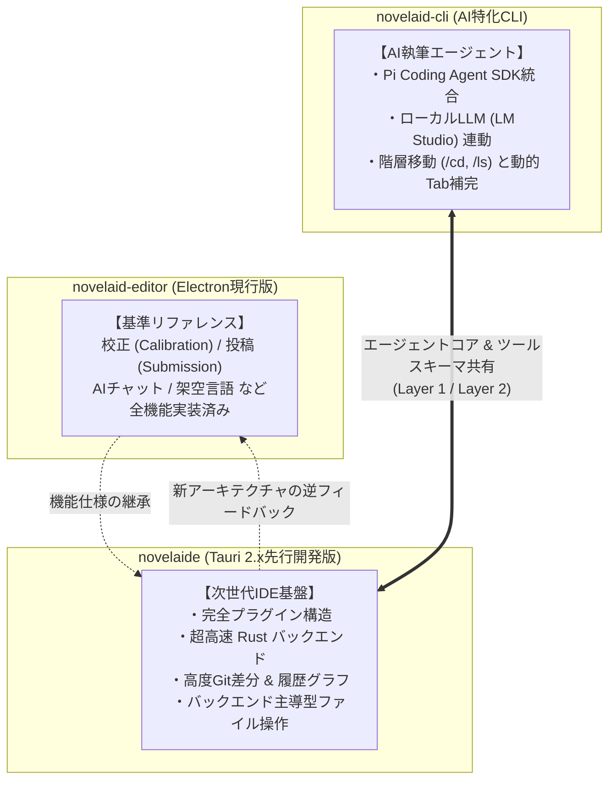
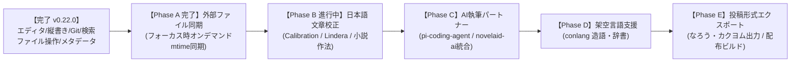

# 3アプリ機能実装状況の比較および novelaide 開発計画

## 1. はじめに

本ドキュメントは、小説執筆支援システム群として並行開発される以下の3つのアプリケーションについて、その機能と実装状況を横断的に比較・整理し、先行開発・調整フェーズにある **`novelaide`（Tauri版・コードネーム `novelaid-e`）** の今後の開発計画を再編したものです。

### 対象プロジェクトと基本方針
1. **`novelaid-editor`（Electron現行版）**:
   - 小説執筆に必要な基本機能を網羅した現行の本番稼働エディター。全機能要件の**「基準（リファレンス）」**となります。
2. **`novelaide`（Tauri完全新設計版・コードネーム `novelaid-e`）**:
   - `novelaid-editor` をベースに、Tauri 2.x + Rust で完全再設計した次世代IDE。
   - 現在は先行開発およびアーキテクチャ調整フェーズであり、高速性・プラグイン疎結合・バックエンド主導型設計などを先行導入しています。
3. **`novelaid-cli`（AIエージェント特化CLI/TUI）**:
   - ターミナル上で作家とAIが対話しながらプロット・設定・本文を執筆・推敲するためのCLIツール。
   - `pi-coding-agent` SDK上に構築され、ローカルLLM（LM Studio）自動連携や境界保護付き階層移動（`/cd`, `/ls`）を備えています。将来的にはエージェントコアおよびツール群を `novelaide` と共有します。

---

## 2. 3アプリの機能と実装状況の比較一覧

`novelaid-editor` の機能を基準とし、3つのアプリの実装状況を機能カテゴリ別に整理しました。

| カテゴリ | 機能項目 | novelaid-editor (基準・現行Electron) | novelaide (先行開発・Tauri v0.22.0) | novelaid-cli (AI特化CLI/TUI) | novelaideの実装ステータスと特徴 |
| :--- | :--- | :---: | :---: | :---: | :--- |
| **アーキテクチャ** | フレームワーク | Electron | Tauri 2.x + Rust | Node.js (TUI) | **移行完了**（軽量・メモリ半減・高速起動） |
| | プラグイン拡張性 | ✕ (固定設計) | **◎ 完全プラグイン化** | ◯ (Command/Tool) | **大幅先行**（View / Panel / Settings / Explorer Registry） |
| | パッケージ/クレート分離 | ✕ (モノリス) | **◎ 独立クレート化** | △ (単一パッケージ) | **大幅先行**（`novelaid-fs`, `restar-git`, `restar-settings`, `novelaid-ai`） |
| **ファイル・プロジェクト** | プロジェクト管理/選択 | ◯ (Launcher) | **◯ (restar-app 統合)** | ◯ (引数/カレントDir) | **同等達成**（最近開いた作品、新規作成） |
| | エクスプローラー・ツリー | ◯ (標準ツリー) | **◎ 進化版ツリー** | ◯ (`/ls`, `/cd`, Tab補完) | **大幅先行**（自動連番推測、インライン作成/リネーム、D&D移動コピー、手動Reveal） |
| | ファイル操作・安全設計 | △ (フロント先行確認) | **◎ バックエンド主導型** | ◯ (ルート上限保護) | **大幅先行**（Rust主導確認、`fs:changed` イベント駆動自律更新） |
| | 外部ファイル監視 (Watcher) | ◯ (chokidar) | **△ 未着手 (次回予定)** | ✕ | *次ステップで `notify` クレート連動実装予定* |
| **エディターコア** | Monaco Editor 統合 | ◯ | **◎ 小説特化 Monaco** | ✕ (TUIのみ) | **同等達成** |
| | ルビ・小説記法補完 | ◯ (novelaid-ruby) | **◎ (novelaid-ruby統合)** | △ (ツール化予定) | **同等達成**（ルビ `｜親文字《ルビ》`、傍点、リーダー自動補完） |
| | 全角スペース・装飾可視化 | ◯ | **◎ デコレーション連動** | ✕ | **同等達成**（空行字下げ・全角スペース可視化） |
| | マルチタブ・未保存管理 | ◯ | **◯ (DocumentContext)** | ✕ (単一コンテキスト) | **同等達成**（タブ分割、未保存ダーティバッジ） |
| **表示・プレビュー** | 縦書き文庫プレビュー | ◯ | **◎ ビュープラグイン化** | ✕ | **同等達成**（フォント・行間・字詰め・ページ送り） |
| | スプリットビュー (2画面) | ◯ (左右分割) | **◎ ドラッグリサイズ連動** | ✕ | **同等達成**（エディタ＋プレビュー、エディタ＋エディタ） |
| | 拡張 Markdown 描画 | ◯ (novelaid-markdown) | **◎ 高度リッチ描画** | ◯ (TUI Markdown) | **同等達成**（MapLibre地図、Mermaid作図、ルビ描画） |
| **検索・アウトライン** | 全文・横断検索 | ◯ (Search) | **◎ 汎用検索パネル** | △ (将来Tool化) | **大幅先行**（本文・メタデータ・セリフ切替検索） |
| | 見出しアウトライン | ◯ | **◎ アウトラインパネル** | ✕ | **同等達成**（H1〜H6階層ジャンプ） |
| **設定・メタデータ** | YAML Frontmatter 編集UI | ◯ (MetadataPanel) | **◯ (MetadataPanel)** | △ (`/metadata` 予定) | **同等達成**（フォーム編集、属性連動） |
| | 設定管理・OS永続化 | ◯ (JSON永続化) | **◎ (restar-settings)** | ◯ (config) | **大幅先行**（独立プラグイン、型安全OS設定永続化） |
| **バージョン管理** | Git ソース管理 (コミット/差分) | ◯ (GitPanel) | **◎ 高度 Git プラグイン** | ✕ | **大幅先行**（SVGコミット履歴グラフ、Monaco Diff Editor文字差分比較） |
| **執筆支援・校正** | 日本語文章校正 (textlint等) | **◯ (Calibration)** | **✕ 未着手** | △ (`/proofread` 予定) | *次期フェーズで移植・実装*（助詞連続、表記揺れ） |
| **AI・創作特化** | AIチャット (壁打ち・相談) | **◯ (Chat)** | **✕ 未着手** | **◎ (Pi SDK フルTUI)** | *次期フェーズで `novelaid-cli` / `pi-coding-agent` と統合* |
| | ペルソナ切替 (編集者/キャラ) | **◯ (AI)** | **✕ 未着手** | △ (プロンプト切替) | *次期フェーズで統合* |
| | 架空言語支援 (conlang) | **◯ (ch/conlang)** | **✕ 未着手** | ✕ | *次期フェーズで移植・実装* |
| **投稿・出力** | 小説投稿サイト形式出力 | **◯ (Submission)** | **✕ 未着手** | ✕ | *最終フェーズで実装*（なろう、カクヨム形式エクスポート） |

---

## 3. 各アプリの強みと役割分担

1. **`novelaid-editor`（基準）**:
   - ユーザーが執筆に必要とする機能要件の定義元。新機能の仕様策定時に動作やUI/UXのモデルケースとして参照。
2. **`novelaide`（先行開発・フラグシップ）**:
   - アーキテクチャの刷新と最適化を担う。Rustネイティブ処理による高速化、プラグイン構造化、堅牢なイベント駆動同期を確立し、将来的に現行版を完全に置き換える。
3. **`novelaid-cli`（AIエージェント先行検証）**:
   - ターミナルでの高速な壁打ち・自律エージェント機能を先行検証。ここで開発・検証されたプロンプトや校正ツール・エージェントロジックを `novelaide`（GUI）へシームレスに組み込む。

---

## 4. `novelaide` の開発計画の整頓・再編（ロードマップ）

現在の `novelaide`（v0.22.0）は、**「エディター基盤」「表示・プレビュー」「検索・アウトライン」「Git管理」「設定」「エクスプローラーファイル操作基盤」「メタデータ編集パネル」** まで完了しています。  
`novelaid-editor` にあって `novelaide` に未実装の領域は、主に **「外部ファイル監視」「文章校正」「AI執筆支援」「架空言語支援」「投稿出力」** の5つです。

これらを踏まえ、今後の開発計画を以下の5つの新フェーズに再編します。

---

### Phase A: 外部ファイル同期と安全制御【実装完了】
* **目的**: 外部プロセス（Git、外部エディタ、CLIツール等）による原稿変更を安全に検知し、作家の執筆を邪魔せず同期する。
* **採用方針**: 
  - 常時監視（chokidar/notify）の自己保存競合・不要ダイアログ頻発を排し、[`docs/dev/ウィンドウフォーカス復帰時ファイル同期および競合制御仕様.md`](./ウィンドウフォーカス復帰時ファイル同期および競合制御仕様.md) に基づく**「ウィンドウフォーカス復帰時（`window.onfocus`）の3段階オンデマンド `mtime` 検証」**を採用・実装完了。
  - 編集中（`isDirty: true`）のバッファは上書きせずL3インラインバナーで穏やかに提示し、未編集なら自動更新。

---

### Phase B: 日本語文章校正・推敲支援パネル（Calibration）の実装【先行基盤完了・ルール拡充中】
* **目的**: `novelaid-editor` の `Calibration` 機能を移植・高度化し、原稿のクオリティを向上させる。
* **進捗・主要タスク**:
  1. 校正パネルプラグイン（`CalibrationPanelPlugin`）およびバックエンド（`tauri-plugin-novelaid-calibration`）の新設【完了】
  2. `Lindera` (v6.x `embed-ipadic`) 内蔵による超高速形態素解析・ルビ推測・作法チェック【完了】
  3. Monaco Editor 上での波線ハイライト・ホバー・ジャンプ・適用機能【完了】
  4. 全34ルール体系に基づく体裁（括弧開閉、字下げ）、辞書（`prh.yml`）、文法（ら抜き、助詞重複）ルールの段階的実装【進行中】

---

### Phase C: AI執筆パートナー & ペルソナチャット（`novelaid-ai` 統合）
* **目的**: `novelaid-cli` で検証されたエージェント機能を取り込み、エディター内でAIと共同執筆・ブレストできる環境を構築する。
* **主要タスク**:
  1. AIチャットパネルプラグイン（`novelaid.panel.ai-chat`）の新設
  2. `@earendil-works/pi-coding-agent` および `tauri-plugin-novelaid-ai` の統合
  3. ローカルLLM（LM Studio）およびクラウドLLM（Gemini等）の接続設定
  4. ペルソナ切り替え（担当編集者、校正係、作中キャラクター）
  5. 執筆中原稿・メタデータのコンテキスト自動注入とツール実行（校正・ルビ・設定検索）

---

### Phase D: 架空言語・ネーミング支援（`novelaid-conlang`）の実装
* **目的**: `novelaid-editor` の `ch/conlang` 機能を移植し、ファンタジー小説等の造語・命名を支援する。
* **主要タスク**:
  1. 架空言語パネルプラグイン（`novelaid.panel.conlang`）の新設
  2. 音韻規則に基づく単語生成エンジン
  3. プロジェクト固有の辞書管理・登録機能
  4. 本文中の架空言語単語の逆引きツールチップ

---

### Phase E: 小説投稿サイト形式出力（Submission）＆ 配布パッケージング
* **目的**: 執筆した作品を主要小説投稿サイト形式へワンクリックで書き出し、最終インストーラーを生成する。
* **主要タスク**:
  1. 「小説家になろう」「カクヨム」等に対応したルビ・改行・記号変換エクスポート
  2. 話数一括出力・ZIPアーカイブ化
  3. Windows（NSIS/MSI）および macOS（DMG）向け配布インストーラーのビルド・検証
