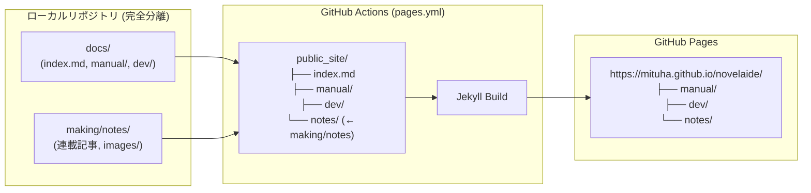

# システム設計 - GitHub Pages ドキュメント公開仕様書

## 1. 概要

本ドキュメントは、小説執筆デスクトップIDE `novelaide`（コードネーム: `novelaid-e`）における、**GitHub Pages を利用した公式ドキュメント・Webサイト公開アーキテクチャ** の設計仕様を定義するものです。

先行プロジェクト（`novelaid-editor`）での運用実績を踏襲しつつ、プロジェクトの「コンテキスト分離の原則（`GEMINI.md`）」を維持しながらメイキング記事（`making/notes/`）をWeb上で一体公開する動的マージアーキテクチャを採用しています。

---

## 2. 公開サイトの構成とURL体系

- **公開URL**: `https://mituha.github.io/novelaide/`
- **Jekyll テーマ**: `jekyll-theme-cayman`

| URL パス | リポジトリ元ソース | 内容 |
| :--- | :--- | :--- |
| `/` | `docs/index.md` | ドキュメントポータルトップ（概要、目次、最新版ダウンロード） |
| `/manual/` | `docs/manual/` | ユーザーマニュアル（基本操作、小説執筆、プレビュー、AI機能等） |
| `/dev/` | `docs/dev/` | 開発者向け仕様書（アーキテクチャ、プラグイン設計、ビルド手順等） |
| `/notes/` | `making/notes/` | メイキング連載記事（note.com 掲載記事のWebアーカイブ） |

---

## 3. コンテキスト分離と動的マージアーキテクチャ

### 3.1 課題と原則
リポジトリ内では以下の原則に従い、フォルダーが物理的に分離されています：
- `docs/` : 将来的にユーザー向けにも公開するドキュメント（マニュアル、仕様書）
- `making/` : システム構築・運用の記録（執筆コンテキストから完全に隔離）

`making/notes/` をリポジトリ内で `docs/` 配下に移動させると、`making-note-writer` スキルや日々の作業ログ記録の運用ルールが崩れてしまいます。

### 3.2 GitHub Actions による動的マージデプロイ
この課題を解決するため、GitHub Actions ワークフロー（`.github/workflows/pages.yml`）内で、ビルド時に一時ディレクトリ `public_site/` を作成し、そこに `docs/` と `making/notes/` を動的にマージしてデプロイします。

### 3.3 ワークフロー仕様 (`.github/workflows/pages.yml`)
- **トリガー**:
  - `main` ブランチへのプッシュ時（対象パス: `docs/**`, `making/notes/**`, `.github/workflows/pages.yml`）
  - 手動実行（`workflow_dispatch`）
- **権限**: `pages: write`, `id-token: write`, `contents: read`
- **アクション**:
  - `actions/checkout@v4`
  - `actions/configure-pages@v4`
  - `actions/jekyll-build-pages@v1`（ソース: `./public_site`）
  - `actions/upload-pages-artifact@v3`
  - `actions/deploy-pages@v4`

### 3.4 Liquid構文衝突（`{{ ... }}`）の自動エスケープ機構
Jekyll はコードブロック内であっても `{{ ... }}` や `` を Liquid テンプレート変数/タグとして解釈しようとするため、React のインラインスタイル（`style={{ color: "..." }}`）や GitHub Actions 構文（`${{ secrets... }}`）を含む技術文書で Liquid パースエラーが発生します。

これを防止するため、ワークフローのデプロイ直前ステップで、公開用一時ディレクトリ `public_site/` 内の全 `.md` ファイルに対して自動的に Frontmatter を保護しつつ本文を `...` でラップする前処理スクリプト（Node.js）を実行します。これにより、ローカルの原稿を汚すことなく、Jekyll ビルド時の Liquid 構文エラーを完全に根絶しています。

---

## 4. 初期設定手順（GitHub リポジトリ設定）

GitHub リポジトリ側で GitHub Pages のデプロイ元を Actions に変更する必要があります：

1. リポジトリの **Settings** タブを開く。
2. 左メニューの **Pages** を選択。
3. **Build and deployment** の **Source** を「`Deploy from a branch`」から「**`GitHub Actions`**」に変更。
4. これにより、ワークフローが成功すると自動的に `https://mituha.github.io/novelaide/` に反映されます。
