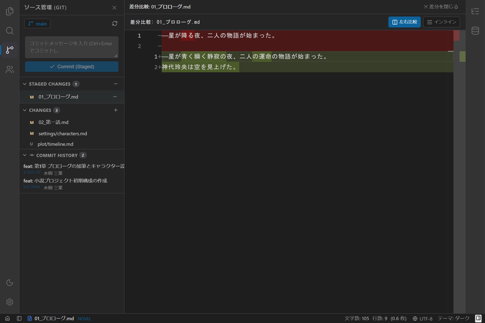

# Gitソース管理実装仕様書（tauri-plugin-restar-git）

## 1. 概要とアーキテクチャ方針

本ドキュメントは、**`novelaide`** における Git ソース管理機能を、独立した Tauri プラグイン **`tauri-plugin-restar-git`（npm: `restar-app-git`）** として構築・連携するための実装仕様を定義するものです。

用語は開発者向けのGit用語（`Commit`, `Stage / Unstage`, `Branch`, `Diff`, `Log` 等）を使用し、システムの `git` コマンドを Rust バックエンドから直接実行することで、ユーザー自身の Git 設定（名前、メール、SSH/GPG鍵、認証ヘルパー）と完全互換を保ちます。

---

## 2. ディレクトリ構成

```text
tauri-plugin-restar-git/
├── Cargo.toml                       # Rustクレート定義
├── build.rs                         # Tauriコマンドパーミッション生成
├── permissions/
│   └── default.toml                 # デフォルト許可パーミッション
├── src/
│   ├── lib.rs                       # プラグイン初期化
│   ├── commands.rs                  # Git IPCコマンド群
│   └── error.rs                     # エラーハンドリング
├── guest-js/
│   ├── index.ts                     # APIエクスポート
│   ├── types.ts                     # GitFileStatus, GitCommitLog, GitRepoStatus, GitDiffResult
│   └── client.ts                    # invoke ラッパー関数
├── package.json                     # "name": "restar-app-git"
├── tsconfig.json
└── rollup.config.js                 # dist-js へのバンドル

novelaide/
├── src/
│   ├── contexts/
│   │   └── GitContext.tsx           # Git状態管理コンテキスト
│   ├── components/
│   │   ├── Git/
│   │   │   ├── GitPanel.tsx         # 左サイドペイン用 Git パネル
│   │   │   ├── GitPanel.css
│   │   │   ├── GitGraph.tsx         # コミット履歴グラフ
│   │   │   └── GitGraph.css
│   │   └── Diff/
│   │       ├── DiffEditorView.tsx   # Monaco Diff Editor ビュー
│   │       └── DiffEditorView.css
│   └── plugins/
│       ├── panels/
│       │   └── GitPanelPlugin.tsx   # PanelRegistry 登録 (novelaid.panel.git)
│       └── views/
│           └── DiffViewPlugin.ts    # ViewRegistry 登録 (novelaid.view.diff)
```

---

## 3. Rust実装仕様 (`src/commands.rs`)

### 3.1 実行ヘルパー関数

Windows 環境における Git コマンド実行時、OS が子プロセスごとに新規のコンソールウィンドウ（コマンドプロンプト画面）を一瞬生成・ポップアップ表示してしまう現象を防止するため、Windows 向けにプロセス生成フラグ **`CREATE_NO_WINDOW`（`0x08000000`）** を設定し、完全バックグラウンド（サイレント）実行を行います。

```rust
#[cfg(windows)]
use std::os::windows::process::CommandExt;

#[cfg(windows)]
const CREATE_NO_WINDOW: u32 = 0x08000000;

fn run_git(repo_path: &str, args: &[&str]) -> Result<String> {
    let mut cmd = std::process::Command::new("git");
    cmd.current_dir(Path::new(repo_path))
        .args(["-c", "core.quotepath=false"]) // 日本語ファイル名エスケープ防止
        .args(args);

    #[cfg(windows)]
    cmd.creation_flags(CREATE_NO_WINDOW);

    let output = cmd.output()?;

    if !output.status.success() {
        let stderr = String::from_utf8_lossy(&output.stderr).trim().to_string();
        return Err(Error::Git(stderr));
    }

    Ok(String::from_utf8_lossy(&output.stdout).to_string())
}
```

### 3.2 コマンド一覧
- `git_is_repo(path: String) -> bool`
- `git_init(path: String) -> Result<(), String>`
- `git_status(path: String) -> Result<GitRepoStatus, String>`:
  - `git status --porcelain=v1 -u` をパースし、`staged`, `unstaged`, `untracked` に分類
  - `git branch --show-current` で現在のブランチを取得
- `git_stage(path: String, files: Vec<String>) -> Result<(), String>`:
  - `git add <files>` （空配列時は `git add -A`）
- `git_unstage(path: String, files: Vec<String>) -> Result<(), String>`:
  - `git reset HEAD <files>` （空配列時は `git reset HEAD`）
- `git_commit(path: String, message: String, stage_all: bool) -> Result<String, String>`:
  - `stage_all` が true の場合は事前に `git add -A` を実行後、`git commit -m <message>`
- `git_log(path: String, max_count: Option<u32>) -> Result<Vec<GitCommitLog>, String>`:
  - `git log --all -n <count> --format="%H%x00%h%x00%an%x00%ae%x00%aI%x00%s%x00%P"` を取得してパース
- `git_diff_file(path: String, file_path: String, staged: bool) -> Result<GitDiffResult, String>`:
  - HEADの内容、作業ツリーの内容、および `git diff` テキストを取得
- `git_discard(path: String, file_path: String) -> Result<(), String>`:
  - `git checkout -- <file_path>` または `git clean -f <file_path>`
- `git_get_remotes(path: String) -> Result<Vec<String>, String>`:
  - `git remote` を実行し、設定されているリモート名一覧（例: `["origin"]`）を取得
- `git_push(path: String, remote: Option<String>, branch: Option<String>, set_upstream: Option<bool>) -> Result<String, String>`:
  - `git push <remote> <branch>` を実行（`-u` オプション対応）。コンソールウィンドウ非表示でサイレント実行し、プッシュ結果またはエラーを返却

---

## 4. UI仕様

1. **左アクティビティバー**:
   - `GitBranch` / `GitCommit` アイコンを配置（3番目）。
   - クリックで `GitPanel` が左サイドペインに展開。
2. **`GitPanel`（左ペイン）**:
   - **ブランチ & アクション**: `🌿 main`、Push ボタン（`UploadCloud`）、リフレッシュボタン。リモートが存在する場合に Push ボタンが有効化。
   - **コミットメッセージ入力欄**: 複数行テキストエリア、ショートカット `Ctrl + Enter` でコミット。
   - **Commit ボタン**: 「Commit」または「Commit All」。
   - **Push セクション**: コミットフォーム直下に、リモート選択ドロップダウン（複数リモート時）およびワンクリック Push ボタンを配置。プッシュ実行中はスピナーアニメーションを表示し、多重実行を防止。
   - **Staged Changes アコーディオン**: ステージ済みファイル、一括/個別アンステージボタン。
   - **Changes アコーディオン**: 未ステージ/新規ファイル、一括/個別ステージボタン、変更破棄ボタン。
   - **Commit History アコーディオン**: コミットハッシュ、メッセージ、作者、経過時間、SVGコミットグラフ。
3. **Monaco `<DiffEditor />`（中央ビュー）**:
   - リスト内のファイルをクリックすると、中央エディターで差分比較タブが開き、行・文字単位のハイライトを表示。

---

## 5. UIスクリーンショット



