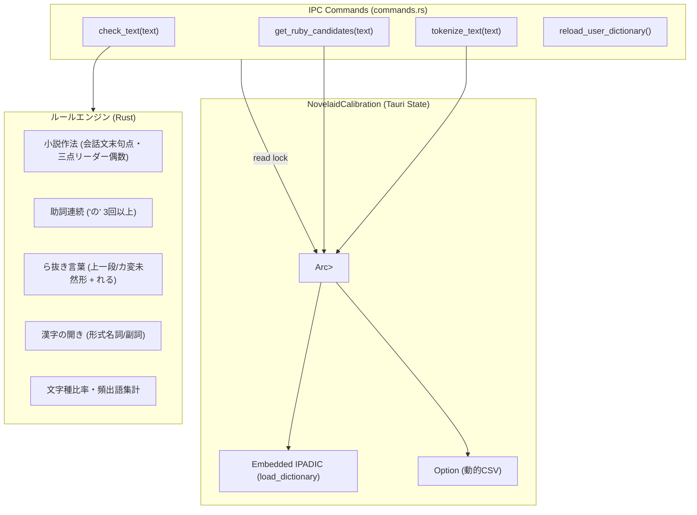

# Lindera 形態素解析エンジン組み込み計画

## 1. 概要

本ドキュメントは、`tauri-plugin-novelaid-calibration` に対する純 Rust 製形態素解析エンジン **`Lindera`**（v6.x）の組み込みアーキテクチャ、トラブル防止策、および段階的導入手順を定義するものである。

現行の `novelaid-editor`（Electron版）で使用していた `kuromoji`（Node.js）からの完全な移行を達成し、外部ランタイム依存ゼロ・ミリ秒単位の超高速ローカル形態素解析基盤を確立する。

---

## 2. ライブラリ選定とクレート仕様

### 2.1. 採用クレートとバージョン
* **クレート**: `lindera = { version = "6", features = ["embed-ipadic"] }`
* **辞書**: IPADIC 内蔵（`embed-ipadic`）
* **対応 Rust バージョン**: 1.88 以上（本環境は `rustc 1.94.1` であり完全適合）

### 2.2. 選定理由とメリット
1. **完全オフライン・外部辞書配布トラブルゼロ**:
   - `embed-ipadic` により辞書バイナリが実行ファイルに静的リンクされるため、OSごとのファイルパス差異やインストーラーでの辞書配置漏れリスクが原理的に排除される。
2. **高速性とメモリ効率**:
   - 形態素解析処理は数万文字の原稿でも数ミリ秒〜十数ミリ秒で完了し、Monaco Editor のタイピングやタブ切り替えを妨げない。
3. **小説執筆に不可欠な形態素情報の取得**:
   - 表層形（`surface`）、品詞体系（`pos`）、原形（`base_form`）、読み（カタカナ `reading`）、発音（`pronunciation`）が網羅的に得られる。
4. **CSV 形式によるユーザー辞書実行時追加の公式サポート**:
   - 設定資料（登場人物・造語）から `表層形,カスタム名詞,読み` の3列 CSV を動的生成し、Segmenter に渡すことが可能。

---

## 3. 組み込みにおける課題と安全設計（トラブル防止策）

大型形態素解析クレートを Tauri デスクトップ環境に組み込む際のリスクを洗い出し、以下の対策を徹底する。

| 課題・リスク | 発生原因 | 対策・安全設計 |
| :--- | :--- | :--- |
| **辞書ロードのオーバーヘッド** | IPC リクエストのたびに辞書を展開すると数十〜数百 ms の遅延が発生する | アプリ起動時（`setup`）に1度だけ辞書をロードし、`NovelaidCalibration` 内に `Arc<Segmenter>` として永続キャッシュ（シングルトン化）。 |
| **マルチスレッド並行アクセス** | フロントエンドから複数の校正・トークン化要求が並行して届く | `Segmenter` を `Arc<RwLock<Segmenter>>` で保持し、スレッドセーフに並行読み取り（`read()`）を許可。 |
| **ユーザー辞書の動的更新競合** | 設定資料の編集によりユーザー辞書を再生成する際のリソース競合 | `write()` ロックにより安全に新しい `Segmenter` インスタンスへアトミック置換。 |
| **バイナリサイズとコンパイル時間** | 辞書データの静的リンクによるビルド時間の長期化 | `tauri-plugin-novelaid-calibration` 側で独立して `cargo test` を行い、本体（`src-tauri`）のコンパイルに影響を与えずに単体検証を実施。 |

---

## 4. 内部アーキテクチャ設計

### 4.1. トークン情報のマッピング仕様
Lindera の `token.details()`（IPADIC）から novelaide 共通の `TokenInfo` への変換：
* `surface`: `token.surface`
* `pos`: `details[0..4]` をカンマ結合（例: `名詞,固有名詞,組織`）
* `base_form`: `details[6]`
* `reading`: `details[7]`（カタカナ）
  - ルビ用途には、カタカナをひらがなに変換する高速ユーティリティ（`katakana_to_hiragana`）を適用。

---

## 5. 段階的導入計画と進捗実績

| フェーズ | 内容 | 状態 | 備考 |
| :--- | :--- | :--- | :--- |
| **フェーズ 1** | 単体クレートでのコンパイル＆動作検証 | **完了** | `Cargo.toml` に Lindera v6 (`embed-ipadic`) を導入し、単体テスト（8件、0.30秒）で辞書ロードと形態素抽出を検証成功。 |
| **フェーズ 2** | プラグイン本体（`desktop.rs`）へのエンジン組み込み | **完了** | `Arc<RwLock<Segmenter>>` 常駐化、`tokenize_text`、`get_ruby_candidates`、および漢字開き・頻出語抽出の本実装完了。 |
| **フェーズ 3** | 形態素解析ベースの小説特化ルール拡充 | 予定 | ら抜き言葉、二重否定、助詞重複の詳細活用形判定。 |
| **フェーズ 4** | ユーザー辞書（設定資料CSV）の動的追加 | 予定 | 登場人物名・固有名詞の動的読み込みとリロード機能。 |
