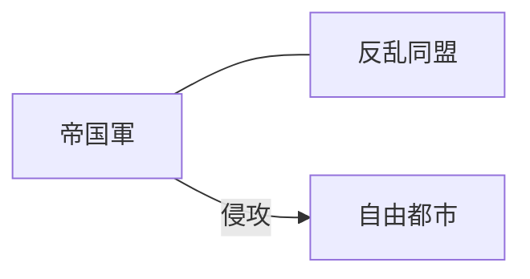

# Markdown拡張描画仕様書（novelaid-markdown組み込み）

## 1. 概要と目的

本ドキュメントは、**`novelaide`** における **設定資料・プロット・世界観設定（`.md`）の表現力を高めるため、独自ライブラリ `novelaid-markdown` を組み込み、多彩なダイアグラム・マップ・小説作法レンダリングを実現する実装仕様** を定義するものです。

### 背景と狙い
小説の創作では、単なる文章メモだけでなく、登場人物のステータス（レーダーチャート）、関係性やストーリー遷移（Mermaid / D2）、作中世界の舞台地図（MapLibre / OpenStreetMap）、そしてルビや傍点を活用した詳細設定が不可欠です。
汎用のMarkdownプレビューから `novelaid-markdown` へ移行することで、作家が構想する豊かな世界観をアプリ内でシームレスに視覚化します。

---

## 2. 対応する拡張描画種類と構文仕様

### 2.1 日本語ルビおよび傍点記法
小説本文（`novel`）と同じ記法がMarkdown文中で直接解釈されます。
- **ルビ**: `|漢字《かんじ》` ⇒ `<ruby>漢字<rt>かんじ</rt></ruby>`
- **傍点**: `《《傍点強調》》` ⇒ `<span class="bouten">傍点強調</span>`

### 2.2 Mermaid ダイアグラム (`mermaid`)
人物相関図、勢力図、ストーリー展開フローチャート、時系列チャートをレンダリング。
````markdown

````

### 2.3 ステータスレーダーチャート簡易記法 (`radar`)
キャラクターのステータスを直感的なキー＆バリューで記述。内部的に Mermaid `radar-beta` へ自動変換。
````markdown
```radar{width=400}
---
title: "ステータス"
color: "#4A90E2"
max: 100
---
攻撃力: 85
防御力: 60
素早さ: 92
魔力: 45
知力: 70
運: 95
```
````

### 2.4 D2 宣言型ダイアグラム (`d2`)
`@terrastruct/d2` による美しい組織図・構造図の自動生成。
````markdown
```d2{width=450}
ギルド: {
  受付 -> クエスト掲示板: 発行
  冒険者 -> 受付: 受注
}
```
````

### 2.5 インタラクティブ・マップ表示 (`map`)
作中世界の舞台となる地図・都市をOpenStreetMap（OSM）ベースで表示し、ピンマーカーと説明ポップアップを配置。
````markdown
```map
id: story-world-map
width: 100%
height: 400px
lat: 35.681236
long: 139.767125
defaultZoom: 13
marker:
  - default, 35.681236, 139.767125, 中央広場, "物語の発端となる場所"
  - school, 35.689506, 139.691701, 魔導学院, "主人公たちの通う学園"
  - book, 35.696123, 139.758231, 大図書館, "古代の記録が眠る"
```
````

---

## 3. 実装・組み込み設計

### 3.1 パッケージ依存関係
`package.json` に公式npmパッケージ `novelaid-markdown` を追加します。

```bash
npm i novelaid-markdown
```

### 3.2 コンポーネント実装 (`MarkdownPreview.tsx`)
既存の `react-markdown` 単体実装から、`NovelaidMarkdown` を使ったリッチプレビューアへ置き換えます。

```tsx
import React from 'react';
import { NovelaidMarkdown } from 'novelaid-markdown';
import { DocumentViewProps } from '../../types/viewPlugin';
import { useDocument } from '../../contexts/DocumentContext';
import 'novelaid-markdown/index.css';
import './MarkdownPreview.css';

export const MarkdownPreview: React.FC<DocumentViewProps> = ({ content, path }) => {
  const { openDocument } = useDocument();

  const handleLinkClick = (url: string) => {
    // 内部相対リンクなら openDocument で開く
    if (!url.startsWith('http://') && !url.startsWith('https://')) {
      // パス解決して開く
      openDocument(url);
    } else {
      window.open(url, '_blank');
    }
  };

  return (
    <div className="markdown-preview-wrapper">
      <div className="markdown-preview-scroll-container">
        <NovelaidMarkdown
          content={content}
          filePath={path}
          className="markdown-body"
          onLinkClick={handleLinkClick}
        />
      </div>
    </div>
  );
};
```

### 3.3 OpenStreetMap User-Agent 設定（Tauri Webview）
OSMタイルサーバーの利用規約（User-Agent の独自指定義務）に適合するため、Tauriのウィンドウ設定またはHTTPリクエストヘッダーに識別子を付与します。
- `Novelaide/<version> (+https://github.com/mituha/novelaide)`

---

## 4. 導入ステップ

1. **仕様書の確定とGitコミット（本仕様書）**
2. **`package.json` への `novelaid-markdown` の追加導入**
3. **`MarkdownPreview.tsx` の改修とスタイル（`novelaid-markdown/index.css`）の統合**
4. **Playwright 自動撮影スクリプトに Mermaid・Radar・Map を含むMarkdownの表示テストを追加・検証**
5. **マニュアル・メイキング記事の更新とGitコミット**
