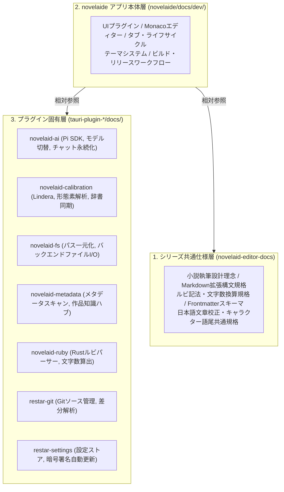

# novelaide 開発者向け仕様書一覧

本ドキュメントは、小説執筆用エディター **`novelaide`**（コードネーム: `novelaid-e`）の開発仕様書、アーキテクチャ設計、および各プラグイン・シリーズ共通仕様への総合参照インデックスです。

---

## 🏛️ 3層ドキュメントアーキテクチャ

本プロジェクトでは、将来的なプラグイン分離・単体公開および複数アプリ間（`novelaide`, `novelaid-editor`, `novelaid-cli`）での仕様共有のため、ドキュメントを以下の3層に構造化しています。

---

## 🔌 1. プラグイン固有ドキュメントへの参照

各機能プラグインの内部実装、IPCコマンド、データ構造に関する仕様書は、将来的な分離・単体公開を見据えてそれぞれのプラグインフォルダー直下に自己完結して配置されています。

| プラグイン名 | 役割・技術基盤 | ドキュメント一覧 |
| :--- | :--- | :--- |
| **`tauri-plugin-novelaid-ai`** | AI執筆パートナー / `@earendil-works/pi-coding-agent` | [ドキュメント一覧](../../tauri-plugin-novelaid-ai/docs/README.md) |
| **`tauri-plugin-novelaid-calibration`** | 文章校正・形態素解析 / 純Rust製 `Lindera 6.x` | [ドキュメント一覧](../../tauri-plugin-novelaid-calibration/docs/README.md) |
| **`tauri-plugin-novelaid-fs`** | ファイル操作基盤・パス一元管理 / `notify` イベント通知 | [ドキュメント一覧](../../tauri-plugin-novelaid-fs/docs/README.md) |
| **`tauri-plugin-novelaid-metadata`** | メタデータスキャン・作品知識ハブ / Frontmatter抽出 | [ドキュメント一覧](../../tauri-plugin-novelaid-metadata/docs/README.md) |
| **`tauri-plugin-novelaid-ruby`** | 小説ルビ・傍点・文字数カウント / 高速Rustパーサー | [ドキュメント一覧](../../tauri-plugin-novelaid-ruby/docs/README.md) |
| **`tauri-plugin-restar-git`** | Gitソース管理・履歴追跡 / `git2-rs` | [ドキュメント一覧](../../tauri-plugin-restar-git/docs/README.md) |
| **`tauri-plugin-restar-settings`** | 環境設定ストア・Tauri v2暗号署名自動更新 | [ドキュメント一覧](../../tauri-plugin-restar-settings/docs/README.md) |

---

## 🌐 2. シリーズ共通ドキュメントへの参照（`novelaid-editor-docs`）

プログラムやフレームワーク（Tauri/Electron/Node CLI）に依存しない小説作法、構文規則、辞書規格などは、シリーズ共通リポジトリ `novelaid-editor-docs` に集約されています。

* **[シリーズ共通開発仕様書一覧](../../../novelaid-editor-docs/docs/dev/index.md)**
  - **[小説執筆エディターシリーズ 共通設計理念](../../../novelaid-editor-docs/docs/dev/00_小説執筆エディターシリーズ設計理念.md)**: なぜ小説専用エディターなのか、5大コアバリュー。
  - **[機能一覧および各アプリ対応状況](../../../novelaid-editor-docs/docs/dev/機能一覧および各アプリ対応状況.md)**: `novelaid-editor`, `novelaide`, `novelaid-cli` の機能マトリクス。
  - **[Markdown拡張描画仕様](../../../novelaid-editor-docs/docs/dev/Markdown拡張描画仕様.md)**: `novelaid-markdown` によるルビ・Mermaid・レーダーチャート・地図描画規格。
  - **[日本語文章校正および形態素解析共通仕様](../../../novelaid-editor-docs/docs/dev/日本語文章校正および形態素解析共通仕様.md)**: 小説作法ルール体系、キャラクター語尾終助詞規格、作品メタデータ辞書規格。
  - **[Frontmatterメタデータ共通仕様](../../../novelaid-editor-docs/docs/dev/Frontmatterメタデータ仕様.md)**: 作品設定資料の標準YAMLスキーマ。
  - **[ルビ関連仕様](../../../novelaid-editor-docs/docs/dev/ルビ関連仕様.md)** / **[文字数カウント仕様](../../../novelaid-editor-docs/docs/dev/文字数カウント仕様.md)**: カクヨム/なろう記法、400字詰原稿用紙換算。
  - **[外部ファイル変更検知および競合制御方針仕様](../../../novelaid-editor-docs/docs/dev/外部ファイル変更検知および競合制御方針仕様.md)**: 作家原稿保護とオンデマンド検証方針。
  - **[novelaid-cli共通化とpi-coding-agent連携計画](../../../novelaid-editor-docs/docs/dev/novelaid-cli共通化とpi-coding-agent連携計画.md)**: CLIとEditorのAIエージェント共通化。

---

## 💻 3. `novelaide` アプリ本体仕様書

`novelaide`（Tauri 2.x + React 19 + Monaco Editor）のデスクトップアプリケーション本体に関するUIアーキテクチャ、ライフサイクル、および実装仕様書です。

### 3.1 UI・プラグインアーキテクチャ基盤
* **[UIプラグインアーキテクチャ仕様](./UIプラグインアーキテクチャ仕様.md)**: 左右対称サイドペイン、パネルプラグイン、ステータスバーアイテムの統合構造。
* **[ビュープラグインアーキテクチャ仕様](./ビュープラグインアーキテクチャ仕様.md)**: 中央ドキュメント表示部のビュー（Editor / Preview / Canvas等）のプラグイン分離設計。
* **[プラグインアーキテクチャおよびRust型定義自動生成仕様](./プラグインアーキテクチャおよびRust型定義自動生成仕様.md)**: `ts-rs` による Rust 構造体から TypeScript 型定義の自動生成と型安全性保証。
* **[統合通知システム設計および呼び出し経路仕様](./統合通知システム設計および呼び出し経路仕様.md)**: トースト通知およびモーダルの階層別通知アーキテクチャ。

### 3.2 小説エディター・表示機能
* **[エディター基盤および小説執筆設定仕様](./エディター基盤および小説執筆設定仕様.md)**: Monaco Editor の小説執筆最適化（フォント、行間、全角スペース可視化、会話文ハイライト）。
* **[MonacoEditorサジェスチョンおよび小説補完仕様](./MonacoEditorサジェスチョンおよび小説補完仕様.md)**: 思考を妨げない補完抑制、三点リーダー・ダッシュ入力、登場人物・ルビサジェスト。
* **[エディターファイルタイトルおよびリネーム仕様](./エディターファイルタイトルおよびリネーム仕様.md)**: エディター上部での思考を止めないファイルタイトル表示とインラインリネーム。
* **[エディタータブヘッダーおよびコンテキストメニュー仕様](./エディタータブヘッダーおよびコンテキストメニュー仕様.md)**: タブコンテキストメニュー、未保存タブ視覚化、上端アクセント表示。
* **[エディタータブのスクロールおよびオーバーフロー制御仕様](./エディタータブのスクロールおよびオーバーフロー制御仕様.md)**: 水平スクロール、アクティブタブ自動スクロールイン、タブ一覧クイックピッカー。
* **[エピソードナビゲーター仕様](./エピソードナビゲーター仕様.md)**: エディターフッターでの小説エピソード前後遷移ナビゲーション。
* **[左右分割ドキュメントエリアと参照カウント式ライフサイクル仕様](./左右分割ドキュメントエリアと参照カウント式ライフサイクル仕様.md)**: 2ペイン独立表示と参照カウントによるドキュメントメモリ管理。
* **[中央ドキュメント表示部および分割タブUX改善仕様](./中央ドキュメント表示部および分割タブUX改善仕様.md)**: 2ペイン分割解除時のタブ統合UX改善。
* **[ドキュメントビューモード仕様](./ドキュメントビューモード仕様.md)**: エディター／プレビュー／リーダー等のモード切り替え。
* **[プレビュー機能およびスプリットビュー仕様](./プレビュー機能およびスプリットビュー仕様.md)**: 縦書き文庫プレビュー、左右スプリット表示。
* **[ステータスバーおよびリアルタイム文字数カウント仕様](./ステータスバーおよびリアルタイム文字数カウント仕様.md)**: 文字数、原稿用紙枚数、カーソル位置、Gitブランチのリアルタイム表示。

### 3.3 ドキュメント種別および汎用パネルUI
* **[DocumentTypeと各種ビューおよび画像プレビュー仕様](./DocumentTypeと各種ビューおよび画像プレビュー仕様.md)**: 小説、プロット、設定資料、画像、非対応ファイルの安全なハンドリング。
* **[DocumentType_Codeおよび設定ファイル編集仕様](./DocumentType_Codeおよび設定ファイル編集仕様.md)**: `.gitignore` 等の設定ファイルテキスト編集。
* **[DocumentTypeに応じた動的パネル・アクティビティバー構成仕様](./DocumentTypeに応じた動的パネル・アクティビティバー構成仕様.md)**: 開いているファイル種別に応じたパネル表示制御。
* **[汎用エクスプローラーパネル仕様](./汎用エクスプローラーパネル仕様.md)**: 小説ファイルツリー、目次、開いている原稿の統合閲覧。
* **[汎用検索パネル仕様](./汎用検索パネル仕様.md)**: プロジェクト全文検索、メタデータ検索。
* **[エクスプローラーパネルのアコーディオン領域構造と個別スクロール仕様](./エクスプローラーパネルのアコーディオン領域構造と個別スクロール仕様.md)**: アコーディオン領域自動按分と個別スクロール。

### 3.4 プロジェクト管理・環境基盤
* **[プロジェクト選択および管理仕様](./プロジェクト選択および管理仕様.md)**: 最近開いた作品一覧、新規作成、フォルダ選択。
* **[テーマシステムおよびUIレイアウト仕様](./テーマシステムおよびUIレイアウト仕様.md)**: ダーク／ライト／セピア等のCSS変数テーマシステム。
* **[永続化情報およびセッション管理仕様](./永続化情報およびセッション管理仕様.md)**: ウィンドウ位置、開いていたタブ、ペイン状態の復元。
* **[システム環境および初期構成.md](./システム環境および初期構成.md)**: 開発環境、推奨ツール、ディレクトリ構成。
* **[機能実装状況および開発ロードマップ](./機能実装状況および開発ロードマップ.md)**: 過去の移行ステップと将来の実装ロードマップ。
* **[novelaid-editor移植・再実装計画](./novelaid-editor移植・再実装計画.md)**: 旧 Electron 版からの移植・再実装方針。

### 3.5 パッケージング・リリースワークフロー
* **[アプリアイコン作成およびアセット仕様](./アプリアイコン作成およびアセット仕様.md)**: 各プラットフォーム向けアイコン生成パイプライン。
* **[アプリウィンドウタイトル表示仕様](./アプリウィンドウタイトル表示仕様.md)**: アプリ名、バージョン、プロジェクト名のタイトル表示。
* **[GitHubビルドおよびリリースワークフロー仕様](./GitHubビルドおよびリリースワークフロー仕様.md)**: GitHub Actions によるクロスプラットフォーム自動ビルド。
* **[Tauriインストーラー生成および日本語化仕様](./Tauriインストーラー生成および日本語化仕様.md)**: NSIS / WiX インストーラーの完全日本語化とレジストリ安全運用。
