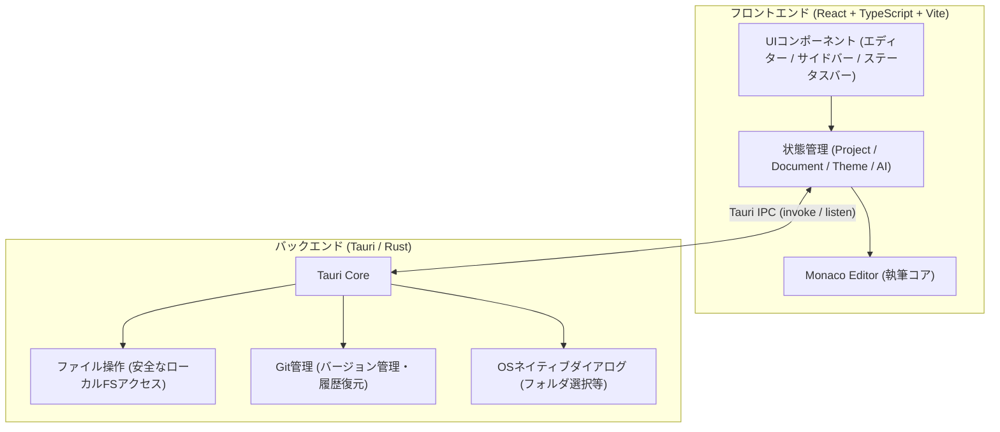

# novelaid-editor 移植・再実装計画書

## 1. 概要と基本方針

本計画は、Electronベースで開発されていた小説執筆エディター **`novelaid-editor`** を、軽量・堅牢なデスクトップフレームワーク **`Tauri`** を基盤とした新アプリ **`novelaide`**（コードネーム: `novelaid-e`）として一から再検討・再実装するためのロードマップです。

### 1.1 プロジェクトの目的
1. **堅牢かつ軽量な小説執筆環境の再構築**
   - ElectronからTauri（Rust + Webフロントエンド）への移行による起動高速化・省メモリ化
   - 既存の `novelaid-editor` や `novelaid-editor-next`（プロトタイプ）で培った知見の統合
2. **開発過程の記録・記事化（メイキング連載）**
   - 開発の全ステップ、試行錯誤、設計意図を `making/notes/` に記事として蓄積
   - **プログラム初心者が記事を読み進めながら、全く同じように自分の執筆環境を自作・再実装できること** を最重要視する

### 1.2 初心者向け連載を意識した設計方針
* **スモールステップ原則**: 1つのステップで扱う技術要素やコード変更を細かく分割し、「何のためにこれを作るのか」「なぜこの技術を選ぶのか」を明確化します。
* **動く喜びの早期体験**: 最初から複雑な機能を詰め込まず、「ウィンドウが出た」「ファイルが開けた」「文字数がカウントされた」といった小さな成功体験を積み重ねられる順序で設計します。
* **図解と比喩の活用**: バックエンド（Rust）とフロントエンド（React）の連携やイベントの流れをMermaid図などで視覚的に解説します。

---

## 2. 全体アーキテクチャ概要

---

## 3. 段階的再実装ロードマップ（全8フェーズ）

### Phase 1: アプリの土台作り（プロジェクト初期化とモダンUI基盤）
> **初心者が学べること**: Tauri環境の仕組み、Vite + Reactの基本、CSS変数によるダークモード設計

* **Step 1.1: Tauri 2.x + Vite + React + TypeScript の環境構築**
  - アプリの雛形作成、起動確認
  - プロジェクト構成（フロントエンド `src/` とバックエンド `src-tauri/` の役割分担）の理解
* **Step 1.2: テーマシステムとCSS変数設計**
  - ライトモード / ダークモードの切り替え機構（`ThemeContext`）
  - 小説執筆に適した目に優しい配色（セピア調、ダークグレー等）の定義
* **Step 1.3: 基本3ペインレイアウトの構築**
  - VS Code風の構成：アクティビティバー（左端アイコン列）、サイドペイン、メインエリア、ステータスバー
  - レスポンシブ＆ペインリサイズ（ドラッグでの幅調整）の基礎

---

### Phase 2: プロジェクト管理とファイル操作（小説を開く・管理する）
> **初心者が学べること**: デスクトップアプリならではのローカルファイル操作、TauriのIPC通信（フロントとRustの連携）

* **Step 2.1: プロジェクト選択・ランチャー画面の実装**
  - 起動時に「最近開いた作品」一覧を表示
  - OSネイティブのフォルダ選択ダイアログ呼び出しとプロジェクト設定の読み込み
* **Step 2.2: Tauriバックエンドによる安全なファイルアクセス基盤**
  - Rust側のファイル読み込み・書き込み・一覧取得コマンドの実装
  - フロントエンド側ラッパー関数の整備
* **Step 2.3: 小説ファイルツリー（novelaid-fs）の実装**
  - フォルダ・ファイルの階層表示（開閉トグル）
  - 右クリックメニュー（新規ファイル作成、フォルダ作成、リネーム、削除）
* **Step 2.4: 小説特有のファイル種別判定とカスタムアイコン**
  - 拡張子やFrontmatterに応じた分類（本文、プロット、キャラクター設定、世界観、メモ、画像）
  - ファイル種別ごとの分かりやすいアイコン表示（Lucide Icons活用）

---

### Phase 3: 小説執筆エディターの実装（書く体験のコア）
> **初心者が学べること**: 高機能エディター（Monaco Editor）の組み込み、複数ドキュメントの状態管理、日本語入力最適化

* **Step 3.1: Monaco Editorの組み込みと小説執筆向けチューニング**
  - `@monaco-editor/react` の導入
  - 小説執筆に特化した設定（日本語フォント指定、行間、行折り返し、ミニマップ非表示など）
* **Step 3.2: マルチタブ管理（DocumentContext）の実装**
  - 複数ファイルを同時に開き、タブで切り替える仕組み
  - 未保存状態のインジケーター（●マーク）表示
* **Step 3.3: 保存処理と自動保存機能**
  - `Ctrl + S` による明示的保存
  - 一定時間変更がない場合の自動保存（オートセーブ）機構
* **Step 3.4: 小説ルビ記法のシンタックスハイライト**
  - 小説標準のルビ記法（例: `｜漢字《かんじ》`、`二重山括弧《》`）をMonacoのMonarchトークナイザーで色分け表示

---

### Phase 4: 執筆進捗とステータス・プレビュー（書いた分を実感する）
> **初心者が学べること**: リアルタイムテキスト解析、Markdownプレビューの構築、2画面連動スクロール

* **Step 4.1: ステータスバーとリアルタイム文字数・原稿用紙換算カウント**
  - 文字数（空白除外 / 空白含む）、行数、カーソル位置のリアルタイム表示
  - 日本の出版・投稿サイト基準の「400字詰原稿用紙換算枚数」計算ロジック
* **Step 4.2: 小説対応Markdownプレビューペイン**
  - `react-markdown` をベースにルビ（`<ruby>`タグ）を正しく表示するレンダラーの実装
  - 縦書き／横書きプレビューの切り替え検討
* **Step 4.3: スプリットビュー（エディターとプレビューの分割・連動）**
  - エディターとプレビューの左右分割表示
  - スクロール位置の同期

---

### Phase 5: 設定とメタデータ管理（物語の構造化）
> **初心者が学べること**: Frontmatter（YAML）のパースと双方向バインディング、モーダルUIの設計

* **Step 5.1: Frontmatter（YAMLメタデータ）の抽出と表示**
  - 小説本文ファイルの先頭にあるFrontmatter（タイトル、登場人物、ステータス、タグ等）の解析
  - 本文とメタデータの分離表示
* **Step 5.2: キャラクター・設定資料パネル（メタデータ一覧）**
  - プロジェクト内の全登場人物や用語設定を一覧表示・クイック参照できるサイドパネルの実装
* **Step 5.3: アプリケーション設定モーダル**
  - 文字サイズ、フォントファミリー、行間、自動保存間隔などをGUIから変更できる設定画面

---

### Phase 6: バージョン管理（大切な原稿を安全に残すGit連携）
> **初心者が学べること**: アプリ内からのGitコマンド実行、ノンプログラマー向けGit UIの設計

* **Step 6.1: TauriバックエンドでのGit統合**
  - プロジェクトフォルダがGitリポジトリか判定し、必要に応じて `git init`
  - 変更ファイルの検出（ステータス取得）
* **Step 6.2: 小説家向けシンプル執筆履歴UI**
  - 難しい「コミット」「ステージング」などのGit用語を「履歴の記録」「版の保存」といった小説家向け用語に変換
  - 執筆履歴の一覧表示と過去バージョンとの差分（Diff）表示

---

### Phase 7: 校正支援とAI執筆パートナー（創作をブーストする）
> **初心者が学べること**: 自然言語処理（形態素解析・文章校正ルール）、LLM APIの呼び出しとストリーミング表示

* **Step 7.1: 日本語校正エンジンの組み込み**
  - 助詞の連続使用、ら抜き言葉、二重否定等の検出（textlint / Kuromoji連携）
  - エディター内への波線ハイライトと警告ツールチップ
* **Step 7.2: AIサービス連携基盤の実装**
  - Gemini APIをはじめとするLLM APIへの接続設定
  - ストリーミングレスポンスの受信
* **Step 7.3: ペルソナ別チャットUI（AI壁打ちパートナー）**
  - 「編集者」「校正係」「登場人物」などのペルソナ切り替え
  - 執筆中テキストを文脈として含めた相談・アイデア出しチャット
* **Step 7.4: （拡張）架空言語・ネーミング支援機能**
  - ファンタジー小説等で役立つ固有名詞・架空言語の自動生成機能の移植
* **Step 7.5: （拡張）スクリーンキャプチャ & スナップショット生成機能**
  - 小説家向け: 執筆進捗（文字数や原稿の一節）の画像カード生成・SNSシェア機能
  - 記事・マニュアル作成支援: アプリ内からワンクリックでUIキャプチャを撮影し、所定ディレクトリ（`making/notes/images/` 等）へ保存する機能

---

### Phase 8: パッケージングと完成（自分だけのアプリを配布する）
> **初心者が学べること**: デスクトップアプリのビルド、インストーラー作成、クロスプラットフォーム配布

* **Step 8.1: アプリ外観・ウィンドウ設定の最適化**
  - アプリアイコンの設定、タイトルバーのカスタマイズ、ウィンドウ最小・最大サイズの調整
* **Step 8.2: デスクトップインストーラーの生成**
  - `tauri build` による Windows（MSI / EXE）や macOS（DMG）向けインストーラーの生成
  - 配布とアップデートの基本解説

---

## 4. 今後の進め方

本計画に基づき、各ステップを以下のサイクルで1つずつ丁寧に進めます。

1. **ステップ着手**: 目的と設計の確認
2. **実装 & 検証**: ソースコードの記述と動作確認
3. **ドキュメント更新**: `docs/dev/`（仕様）および `docs/manual/`（マニュアル）の反映
4. **ログ追記**: `making/logs/` への詳細記録
5. **連載記事執筆**: 初心者向け解説記事（`making/notes/XX_〇〇.md`）の作成と目次更新
6. **Gitコミット**: ステップ単位での確実な履歴保存
