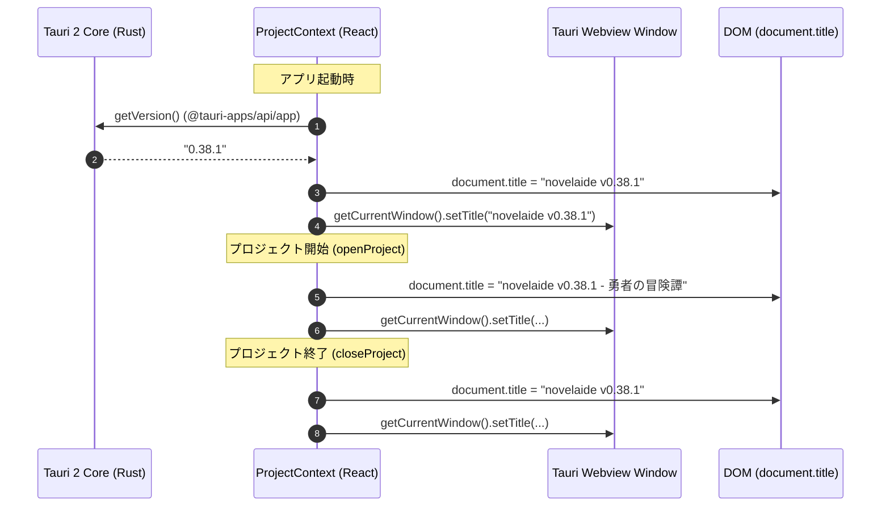

# アプリウィンドウタイトル表示仕様

## 1. 概要

本ドキュメントでは、小説執筆エディター **`novelaide`** におけるウィンドウタイトル（OSタイトルバーおよびブラウザタイトル）の表示規則と動的更新アーキテクチャについて定義します。

旧 Electron 版（`novelaid-editor`）の仕様を継承し、アプリ起動時、プロジェクト読み込み時、プロジェクト終了時の各ライフサイクルにおいて、アプリのバージョン番号および作業中のプロジェクト名をタイトルバーへリアルタイムに反映します。

---

## 2. タイトル表示フォーマット

ウィンドウタイトルは、現在開いているプロジェクトの有無によって以下の形式で表示されます。

| 状態 | タイトル表示形式 | 例 |
| :--- | :--- | :--- |
| **プロジェクト選択中（通常執筆時）** | `novelaide v<バージョン> - <プロジェクト名>` | `novelaide v0.38.1 - 勇者の冒険譚` |
| **ランチャー画面（プロジェクト未選択時）** | `novelaide v<バージョン>` | `novelaide v0.38.1` |

### 規則
1. アプリ名はコードネーム共通基盤（`novelaid`）と区別し、エディター正式名称である **`novelaide`** とします。
2. バージョン番号の前には半角空白と `v` を付与します（例: ` v0.38.1`）。
3. プロジェクト名が存在する場合は、半角ハイフンと前後の空白 ` - ` で区切ってプロジェクト名を付与します。

---

## 3. アーキテクチャと処理フロー

### 3.1. 全体構成



### 3.2. Tauri 2 パーミッション設定

Tauri 2 のセキュリティ設計に基づき、フロントエンドからネイティブウィンドウタイトルを更新するためには `core:window:allow-set-title` 権限が必要です。

`src-tauri/capabilities/default.json`:
```json
{
  "permissions": [
    "core:default",
    "core:window:allow-set-title",
    ...
  ]
}
```

### 3.3. フロントエンド実装 (`src/contexts/ProjectContext.tsx`)

`ProjectContext` がアプリのバージョン状態（`appVersion`）と現在のプロジェクト名（`projectName`）を一元管理し、状態変更に応じて動的にウィンドウタイトルを更新します。

```typescript
const updateTitle = useCallback(async (pName: string | null, version: string) => {
  const base = "novelaide";
  const versionStr = version ? ` v${version}` : "";
  const projectStr = pName ? ` - ${pName}` : "";
  const title = `${base}${versionStr}${projectStr}`;

  document.title = title;
  try {
    await getCurrentWindow().setTitle(title);
    bootLog("Window title updated:", title);
  } catch (error) {
    console.warn("Failed to set window title via Tauri API:", error);
  }
}, []);
```

- **フォールバック設計**: Tauri デスクトップ環境以外（WebプレビューやStorybook等のテスト環境）でもエラーで停止しないよう、`getCurrentWindow().setTitle()` のエラーは警告ログとして捕捉しつつ、`document.title` は常に同期します。
