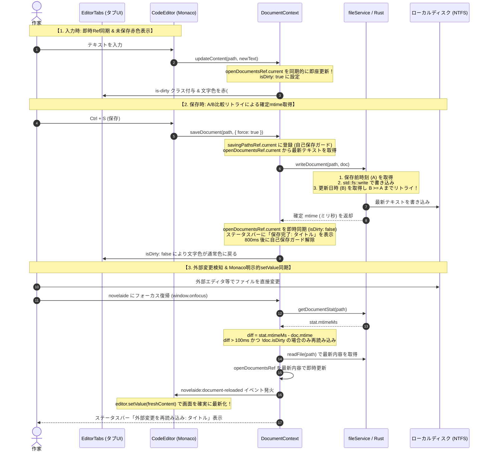

# ウィンドウフォーカス復帰時ファイル同期および競合制御仕様

## 1. 概要と背景

本仕様は、`novelaide` において外部プロセス（Git、外部エディタ、ツール等）による原稿ファイル変更を検知し、ユーザーの執筆内容を損なうことなく安全に同期・競合制御を行うための設計仕様である。

### 1.1. 解決すべき主要課題

1. **自己保存直後の外部変更誤認（クリア現象）の防止**:
   - アプリ自身が保存した直後に他ソフトへ切り替えて戻った際、タイムスタンプの未反映や遅延により「外部で変更された」と誤認され、ディスクから古い状態で再読み込みされてしまう問題を解消。
2. **非同期更新遅延による古いテキスト（ゴミ）混入の防止**:
   - タイピングや Backspace による文字消去の直後に保存（`Ctrl + S`）または自動保存が実行された際、React の非同期 state 更新遅延により古いクロージャ（消す前のテキスト）がディスクに書き込まれてしまう問題を解消。
3. **外部変更が画面に反映されない問題の解消**:
   - ディスクから最新ファイル内容を取得しても、Monaco Editor 側の内部モデルが古いバッファのまま更新されない問題を解消。
4. **未保存状態の直感的な視覚認識**:
   - タブの文字を赤色にするなど、未保存の変更があるドキュメントを一目で判別可能にする。

---

## 2. アーキテクチャと制御フロー

---

## 3. 主要コンポーネント詳細仕様

### 3.1. 【Rust バックエンド】確実な mtime 反映保証アルゴリズム

`tauri-plugin-novelaid-fs/src/desktop.rs` の `write_document`:

* **処理フロー**:
  1. 書き込み直前の現在時刻 `time_before_write (A)` を取得。
  2. `std::fs::write` によりファイルへ永続化。
  3. `std::fs::metadata(path)?.modified() (B)` を取得。
  4. `B < A` の間（ファイルシステムでタイムスタンプ更新が未反映の間）は 10ms 待機し、最大10回リトライ。
  5. 確実に反映された `system_time_to_ms(B)` を返却。
* **効果**:
  - Windows NTFS 等のタイムスタンプ遅延反映による「保存直後の外部変更誤認」が原理的に完全に根絶される。

### 3.2. 【フロントエンド】`DocumentContext.tsx`

1. **`openDocumentsRef.current` の同期的即時更新**:
   - `updateContent` 呼び出し時、React の非同期 state レンダリングを待たずに `openDocumentsRef.current` を即座に更新。
   - `saveDocument` や自動保存タイマーは常に `openDocumentsRef.current` から最新ドキュメントを取得するため、消したはずの文字（ゴミ）が保存されるバグが完全に防がれる。
2. **自己保存ガード (`savingPathsRef`)**:
   - `saveDocument` 実行時にパスを登録し、保存完了後 800ms の間は `checkExternalChanges` によるチェックをスキップ。
3. **外部変更検知とマージン**:
   - `stat.mtimeMs - doc.mtime > 100`（100ms 以上の差分）かつ `!doc.isDirty` の場合のみ自動再読み込み。
   - 再読み込み時、`novelaide:document-reloaded` イベントを発行。
4. **ステータスバー・ログ出力の統合**:
   - `showStatusMessage`（L1通知）により、保存完了、読み込み完了、外部変更再読み込みをステータスバーにフラッシュ表示。
   - コンソールに `Save Start / Success`, `Read Success`, `Focus Check`, `External Reload` の詳細ログを出力。

### 3.3. 【エディター連携】`CodeEditor.tsx`

* `novelaide:document-reloaded` イベントを受信した際、Monaco Editor インスタンスの `editor.setValue(freshContent)` を明示的に実行。
* `Ctrl + S` 押下時に現在の `path` を引数として明示的に `saveDocument(path, { force: true })` を呼び出し。

### 3.4. 【UI・タブ】`EditorTabs.tsx`, `EditorTabs.css`

* タブに `is-dirty` クラスを付与。
* `.editor-tab-item.is-dirty .tab-title`:
  - `color: #f87171 !important;`（未保存時は鮮やかな赤色）
  - `font-weight: 600;`
* `.editor-tab-item.is-dirty .dirty-indicator`:
  - `font-size: 11px;`
  - `color: #ef4444;`
* 保存完了（`isDirty: false`）と同時に即座に通常文字色に戻り、未保存マークが消去される。
