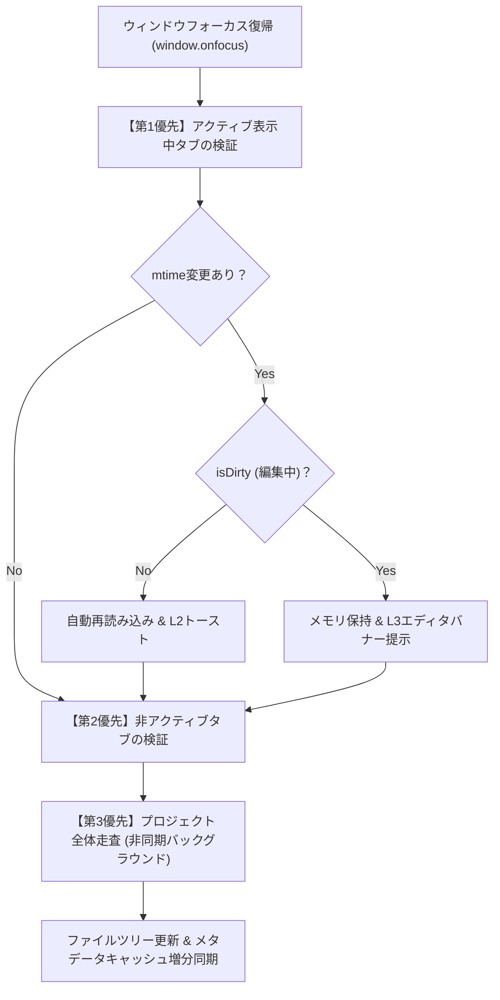

# ウィンドウフォーカス復帰時ファイル同期および競合制御仕様

## 1. 概要と背景

本仕様は、`novelaide` において外部プロセス（Git、外部エディタ、ツール等）による原稿ファイル変更を検知し、ユーザーの執筆内容を損なうことなく安全に同期・競合制御を行うための設計仕様である。

### 1.1. 現行アプリ（`novelaid-editor`）の課題と反省
現行の Electron 版（`novelaid-editor`）では、プロジェクト全域をバックグラウンドで常時監視（chokidar）していた。しかし以下の要因により、**「作家が執筆中に突如『外部で変更されました。破棄して再読み込みしますか？』という確認ダイアログが不要にポップアップする」** という重大な体験阻害が発生していた。
1. **自己保存エコー判定の破綻**:
   - 保存管理用配列（`savingPaths`）に絶対パスで登録していたのに対し、監視イベント判定では相対パスで照合していたため、自らの保存イベントを「外部での変更」と誤認していた。
2. **自動保存とタイピングの競合**:
   - 自動保存（3秒ディレイ）でバックグラウンド保存された直後もタイピングを続けていると `isDirty: true` となる。その状態で直前の保存イベントを受信したため、「外部で変更された未保存ドキュメント」と誤判定されダイアログが表示されていた。
3. **執筆エディタにおける常時監視の過剰性**:
   - 通常の執筆作業中、作家が別アプリで同一プロジェクトのファイルを同時に書き換えるケースは稀である。
   - 常時監視はファイルシステムイベントの遅延・複数回発火（Write/Flush/AttributeChange）のハンドリングが複雑化し、自己保存との競合を招く最大の温床となっていた。

### 1.2. novelaide での基本方針: オンデマンド同期（案A）の採用
`novelaide` では、常時バックグラウンド監視スレッド（`notify` クレート等）による過剰な監視を原則廃止し、**「ウィンドウフォーカス復帰時（`window.onfocus`）のオンデマンド検証」** を採用する。

* **作家の没入を最優先**:
  - 作家が `novelaide` 内で執筆している間は、外部変更チェック自体が走らないため、予期せぬポップアップやバナーで筆が止まることが原理的にゼロになる。
* **低リソース・省電力**:
  - バックグラウンド監視ループやファイルハンドルを維持せず、OSやハードウェアへの負荷を最小化する。
* **確実な同期タイミング**:
  - 外部エディタで修正したり、Git GUI でブランチを切り替えたりした作家が `novelaide` のウィンドウに戻ってきた瞬間にだけ同期が走るため、作家の認知モデルと完全に一致する。

---

## 2. 3段階検証パイプライン（チェック順序）

作家が他アプリから `novelaide` にフォーカスを戻した際（`window.onfocus`）、以下の優先順序でチェックを実行する。



### 2.1. 【第1優先】アクティブ表示中タブの即時チェック
* **対象**: 左右ペインで現在前面に表示されているアクティブドキュメント。
* **動作**:
  - ディスク上の最新 `mtime`（最終更新日時）を取得し、メモリ上の `doc.mtime` と照合。
  - 最前面の原稿のみをチェックするため、数ミリ秒以内で完了し、フォーカス復帰時に即座に最新状態が反映される。

### 2.2. 【第2優先】開かれている非アクティブタブの順次チェック
* **対象**: タブとして開かれているが、現在は裏に回っているドキュメント。
* **動作**:
  - アクティブタブのチェック完了後、順次 `mtime` を照合。
  - 未編集（`isDirty: false`）であればメモリバッファを静かに最新化する。

### 2.3. 【第3優先】プロジェクト全体のディレクトリ走査（非同期バックグラウンド）
* **対象**: プロジェクトフォルダ全体。
* **動作**:
  - 開いているタブのチェックが完了した後、非同期タスクとして `read_directory` / `scan_metadata` を実行。
  - 外部で新規作成されたファイル、削除されたファイル、フォルダ構造の変更を検出し、ファイルエクスプローラツリーを静かに更新する。

---

## 3. ファイル変更時の挙動と競合制御マトリクス

ファイルの変更を検知した際の振る舞いは、**「ファイルが開かれているか」** および **「未保存の編集内容（`isDirty`）があるか」** によって厳格に制御する。

| ファイルの状態 | 編集状態 | 同期動作 | ユーザー通知（統合通知システム） |
| :--- | :--- | :--- | :--- |
| **開いていないファイル** | - | ファイルツリーおよびメタデータキャッシュを自動更新 | **通知なし**（執筆を邪魔しない） |
| **開いているファイル** | **未編集** (`isDirty: false`) | 最新の内容をディスクから自動再読み込み | **L2 トースト通知**<br>「〇〇 を外部の変更に合わせて再読み込みしました」 |
| **開いているファイル** | **編集中** (`isDirty: true`) | **メモリ上の編集内容を絶対保護（上書き禁止）** | **L3 エディタ上部バナー**<br>「外部で変更されました [最新を取り込む] [現在の編集を保持]」 |

> [!IMPORTANT]
> **モーダルダイアログの排除**:
> `novelaide` では、ファイル変更検知において作業を中断させるモーダル確認ダイアログ（`dialog:confirm`）は使用しない。未編集なら自動反映し、競合時のみエディタ上部のインラインバナー（L3）で穏やかに作家の意思決定を仰ぐ。

---

## 4. 保存管理用タイムスタンプ（mtime）のフィードバック仕様

### 4.1. バックエンド（`tauri-plugin-novelaid-fs`）の変更
1. **`NovelaidDocument` 型の拡張**:
   ```rust
   pub struct NovelaidDocument {
       pub path: String,
       pub base_name: String,
       pub file_title: String,
       pub content: String,
       pub metadata: serde_json::Value,
       pub document_type: NovelaidDocumentType,
       pub mtime_ms: u64, // ファイルの最終更新日時（Unixミリ秒）
   }
   ```
2. **`write_document` の返り値更新**:
   - 書き込み完了後に `std::fs::metadata(path)?.modified()?` を取得し、最新の `mtime_ms: u64` を返却する。
3. **高速ステータス確認コマンドの追加**:
   - `get_document_stat(path: String) -> Result<DocumentStat>`
   - 本文を読み込まずに `mtime_ms` のみを取得する軽量コマンドを提供し、フォーカス復帰時のチェックを極小オーバーヘッドで実現する。

### 4.2. フロントエンド（`DocumentState`）の管理
* `DocumentState` インターフェースに `mtime: number` を追加。
* ドキュメント読み込み時および `saveDocument` 完了時に、バックエンドからフィードバックされた `mtime` を保持する。
* フォーカス復帰時判定:
  ```typescript
  const diskStat = await fileService.getDocumentStat(doc.path);
  if (diskStat.mtimeMs > doc.mtime) {
    // 外部で変更されたと判定
  }
  ```

---

## 5. AIエージェント書き込み時の調停方針

* AIエージェント（`novelaid-cli` や将来の内蔵AI）が原稿ファイルを編集する場合、OS直接のファイル上書きを行わず、**`novelaide` のファイル書き込みAPI / ツール** を経由して実行する。
* これにより、AIエージェントによる変更はエディタのドキュメント状態（`updateContent` や `saveDocument`）として直接調停され、`mtime` も即座にフィードバックされるため、「外部からの予期せぬ競合」として扱われることはない。
