# エディターファイルタイトルおよびリネーム仕様書

## 1. 概要と背景

執筆中にファイル名を変更したい場合、従来はサイドバーのエクスプローラーを探し、右クリックメニューから「名前の変更」を選択する必要がありました。
本機能は、**`novelaid-editor`**（Electron版）で作家から好評を得ていた**「エディター上部でのファイルタイトル表示およびインラインリネーム機能」**を `novelaide`（Tauri版）に再実装・拡張したものです。

執筆画面の最上部に現在開いているファイルのタイトル（拡張子なし）が大きく表示され、**タイトルをクリック（または Enter / Space）するだけでその場でインライン編集し、ファイル名を変更**できます。

---

## 2. システムアーキテクチャとデータフロー

```mermaid
sequenceDiagram
    autonumber
    actor User as 執筆者 / 作家
    participant Header as FileNameHeader (React)
    participant Ctx as DocumentContext
    participant FS as fileService (Tauri Plugin)
    participant Disk as ローカルファイルシステム

    User->>Header: ファイルタイトルをクリック
    Header->>Header: インライン入力モードに遷移 (<input />)
    User->>Header: 新しいタイトルを入力して Enter または フォーカス外れ
    Header->>Ctx: renameDocument(oldPath, newTitle)
    
    alt 未保存の変更がある場合
        Ctx->>Ctx: saveDocument(oldPath) を実行
    end

    Ctx->>FS: rename(oldPath, newPath)
    FS->>Disk: 物理ファイルをリネーム
    
    Ctx->>Ctx: openDocuments の path, baseName, fileTitle をアトミック更新
    Ctx->>Ctx: activePathByPane のパスを追従
    Ctx-->>User: 「〇〇に名前を変更しました」通知
```

---

## 3. 機能要件

### 3.1 ファイルタイトルヘッダーコンポーネント (`FileNameHeader`)
エディター領域（`DocumentPane`）の最上部に配置されるタイトル表示・編集コンポーネント。

1. **通常表示モード**:
   - `fileTitle`（拡張子なし）を太字（`font-size: 1.15rem; min-height: 38px;`）で表示。
   - ホバー時に背景がハイライトされ、編集可能を示すペンアイコン（`Pencil`）がふわりと表示。
   - クリック、またはキーボード操作（`Enter` / `Space`）で編集モードへ移行。
   - ツールチップ: `isReadOnly ? '読み取り専用' : 'クリックしてファイル名を変更'`。
2. **インライン編集モード**:
   - タイトル部分がシームレスに入力フィールド（`<input />`）へ変化。
   - 自動フォーカスおよびテキスト全選択。
   - **確定**: `Enter` キー押下、または入力欄外へのクリック（`onBlur`）。
   - **キャンセル**: `Escape` キー押下で変更を破棄して元のタイトルへ復帰。
   - 入力値が空文字、または変更がない場合はリネームAPIを呼び出さず安全にキャンセル。
3. **読み取り専用（`isReadOnly`）制御**:
   - プレビューモード（縦書き文庫プレビューなど）や Git 差分表示、読み取り専用ファイルでは編集を無効化し、タイトル表示のみを行う。

### 3.2 ドキュメントコンテキスト (`DocumentContext.renameDocument`)
ドキュメントのライフサイクルおよび状態と完全に連動したリネーム処理を提供。

1. **バリデーション**:
   - 空文字チェック。
   - OSで使用禁止の記号（`\ / : * ? " < > |`）が含まれる場合の事前警告・ガード。
2. **データの安全性（未保存保護）**:
   - ドキュメントが編集途中で未保存（`isDirty: true`）の場合、**リネーム前に `saveDocument(oldPath)` を自動実行**し、編集内容の消失・不整合を原理的に防止。
3. **アトミックな状態更新**:
   - `fileService.rename(oldPath, newPath)` 成功後、`openDocuments` 配下の該当ドキュメントの `path`, `baseName`, `fileTitle` を即座に更新。
   - 左右分割ペイン（`editor.left` / `editor.right`）のアクティブパス（`activePathByPane`）も追従。
   - タブの再読み込みや再マウントを伴わずにパスとタイトルが切り替わるため、エディターの入力状態やカーソル位置が維持される。
4. **イベント通知**:
   - ファイルエクスプローラー等のツリーを同期するため、`novelaide:project-refresh-needed` カスタムイベントを発火。
