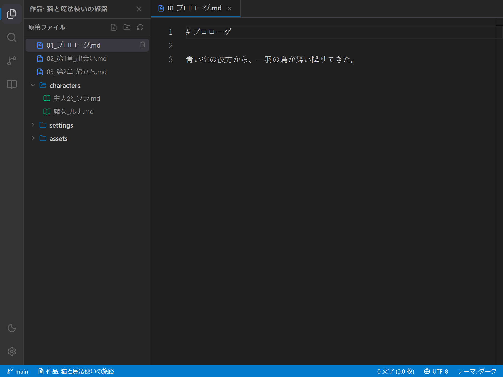
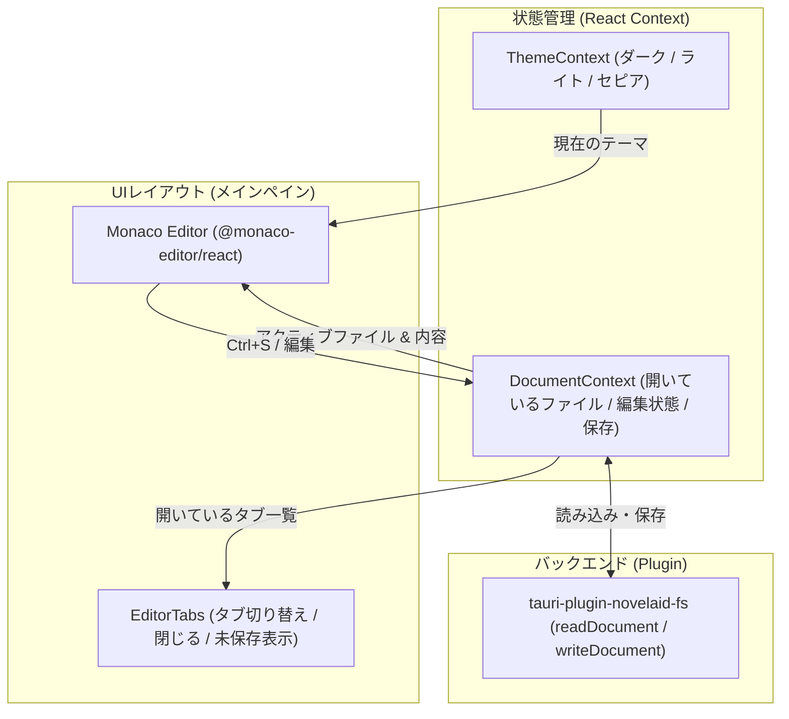

# エディター基盤および小説執筆設定仕様書

## 1. 概要

本ドキュメントは、小説執筆エディター **`novelaide`** における **エディター基盤（Monaco Editor）** の設計仕様および **小説執筆に特化した表示・編集設定** を定義するものです。

一般的なソースコードエディターとは異なり、長文の日本語テキストやセリフ・情景描写・ルビ記法などをストレスなく快適に執筆・推敲できるエディター環境を提供することを目的とします。

---

## 2. アーキテクチャ構成





---

## 3. エディターコアの選定：Monaco Editor

VS Code のコアエンジンである **Monaco Editor（`@monaco-editor/react`）** を採用します。

### 採用理由
1. **圧倒的なパフォーマンス**: 数十万文字の長編小説原稿でもスムーズにスクロール・編集可能。
2. **Monarch トークナイザー**: 独自の構文ハイライト（小説の会話文やルビ記法）を正規表現ベースで容易に定義可能。
3. **キーバインドとアクセシビリティ**: `Ctrl + S`、Undo/Redo、検索・置換など、標準的なデスクトップエディターの操作性を完全に担保。
4. **デコレーション機能**: 全角スペースの可視化や、将来的な校正警告（textlint等）の波線表示を柔軟に実装可能。

---

## 4. 小説執筆向け表示・チューニング仕様

コードエディター特有の邪魔な機能を抑制し、小説の「読みやすさ」「書きやすさ」を最優先にしたパラメータを設定します。

| 設定項目 | 設定値 | 目的・意図 |
|---|---|---|
| **`fontSize`** | `16px` | 長時間見つめても目が疲れにくい適度なサイズ |
| **`lineHeight`** | `28px` (約1.75倍) | 小説の行間に適したゆったりとした余白 |
| **`fontFamily`** | `var(--font-sans)` または明朝体フォントスタック | 日本語フォント（游明朝、メイリオ等）の美しい表示 |
| **`wordWrap`** | `'on'` | ウィンドウ幅に応じた自然な自動折り返し |
| **`wordWrapColumn`** | `80` (設定により可変) | 原稿用紙や文庫本を意識した折り返し位置の制御 |
| **`minimap`** | `{ enabled: false }` | 執筆中の視覚ノイズを減らし本文領域を広く確保 |
| **`lineNumbers`** | `'on'` (または `'relative'` / オフ切り替え可) | 構成の目安となる行番号の表示 |
| **`scrollBeyondLastLine`** | `false` | 末尾の過剰な空白スクロールを防止 |
| **`renderWhitespace`** | `'selection'` | 不要な半角スペース記号を非表示にし、選択時のみ表示 |
| **`unicodeHighlight`** | `{ ambiguousCharacters: false, invisibleCharacters: false }` | 日本語の句読点や記号が警告色になるのを防止 |

### 全角スペースの可視化（`updateDecorations`）
日本語の小説原稿では、**「段落冒頭の全角スペース（字下げ）」** や **「セリフ直後のスペース有無」** の管理が重要です。
Monaco Editor の `deltaDecorations` を利用し、全角スペース（`\u3000`）の箇所に薄い四角い枠（`monaco-full-width-space`）を描画して、入力漏れや不要なスペースを視覚的に判別できるようにします。

---

## 5. 小説専用言語（`novel`）トークナイザー仕様（`novelaid-ruby` 連携）

Monaco の Monarch 構文解析器を用いて、小説特有の記法を登録します。
正規表現パターンおよび判定ロジックは、独自ライブラリ **`novelaid-ruby`**（`NOVEL_MONARCH_PATTERNS` および `NOVEL_PATTERNS`）を直接使用して一元化します。

```typescript
import { NOVEL_MONARCH_PATTERNS, NOVEL_PATTERNS } from 'novelaid-ruby';

monaco.languages.register({ id: 'novel' });
monaco.languages.setMonarchTokensProvider('novel', {
  tokenizer: {
    root: [
      // 会話文（「」『』）
      [/「[^」]*」/, 'novel.dialogue'],
      [/『[^』]*』/, 'novel.dialogue'],

      // ルビ記法（パイプあり・漢字ルビ）
      [NOVEL_MONARCH_PATTERNS.RUBY_PIPE, 'novel.ruby'],
      [NOVEL_MONARCH_PATTERNS.RUBY_KANJI, 'novel.ruby'],

      // 傍点・強調（《《傍点》》）
      [NOVEL_MONARCH_PATTERNS.BOUTEN, 'novel.emphasis'],
    ]
  }
});
```

### 全角スペース可視化（`NOVEL_PATTERNS.FULL_WIDTH_SPACE`）
全角スペース（`\u3000`）の検出にも `NOVEL_PATTERNS.FULL_WIDTH_SPACE` を利用し、エディター内で一貫した判定を行います。

### ハイライト対象記法

| 記法 | パターン（`novelaid-ruby`） | ハイライト色 / スタイル |
|---|---|---|
| **会話文（台詞）** | `「……」`, `『……』` | グリーン系（本文とメリハリをつける） |
| **カクヨム/なろう記法ルビ** | `NOVEL_MONARCH_PATTERNS.RUBY_PIPE` / `RUBY_KANJI` | ターコイズ系 / イタリック |
| **傍点（強調）** | `NOVEL_MONARCH_PATTERNS.BOUTEN` | オレンジ系 / ボールド |

---

## 6. テーマ連動仕様（ダーク / ライト / セピア）

アプリ全体のテーマ設定（`ThemeContext`）に連動し、Monaco Editor のカラースキームを動的に定義・適用します。

| アプリテーマ | Monaco ベース | テーマ名 | 配色の特徴 |
|---|---|---|---|
| **`dark`** | `vs-dark` | `novelaid-dark` | 黒に近いダークグレー背景、目に優しい中間色のテキスト |
| **`light`** | `vs` | `novelaid-light` | 清潔感のある白背景、コントラストの高いダークテキスト |
| **`sepia`** | `vs` | `novelaid-sepia` | 文庫本用紙を模した温かみのある生成り色背景、濃茶テキスト |

---

## 7. 実装ステップ計画

初心者が各機能の役割を理解しながら段階的に実装できるよう、以下のスモールステップで進めます。

1. **Step 3.1: `@monaco-editor/react` の導入と基本エディター表示**
   - パッケージのインストール
   - `Editor.tsx` コンポーネントの作成
   - 小説執筆向けオプション（フォント、行間、折り返し、ミニマップ非表示）の適用
   - テーマ連動（ダーク・ライト・セピア）の実装
2. **Step 3.2: 小説専用トークナイザー（ルビ・会話文）と全角スペース可視化**
   - Monarch による `novel` 言語トークナイザーの登録
   - `deltaDecorations` による全角スペースのハイライト表示
3. **Step 3.3: ドキュメント状態管理（`DocumentContext`）とマルチタブUI**
   - `DocumentContext` の作成（開いているファイル一覧、アクティブファイル、編集内容）
   - ファイルツリー（`FileExplorer`）でファイルをクリックした際にエディターへ読み込む連携
   - メインエリア上部への `EditorTabs`（タブ切り替え・閉じる・未保存インジケーター）の実装
4. **Step 3.4: 保存処理（`Ctrl + S`）と `tauri-plugin-novelaid-fs` 連携**
   - ショートカットキー `Ctrl + S` によるファイル保存
   - 将来的な自動保存（オートセーブ）への布石
