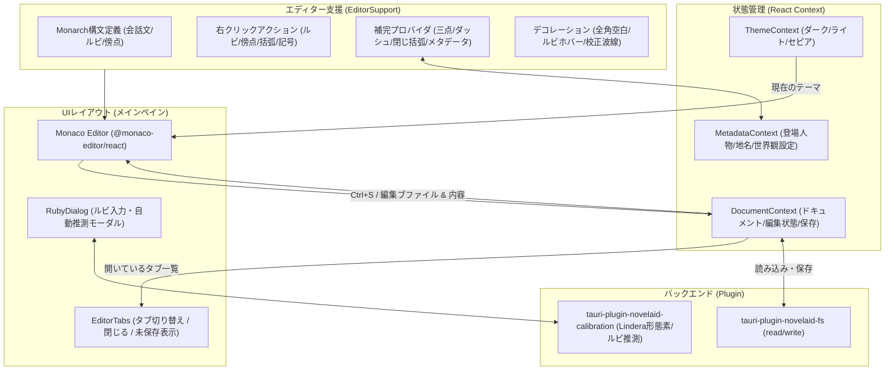
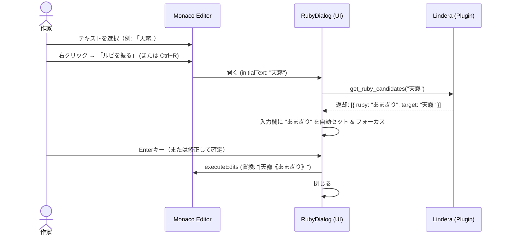

# エディター基盤および小説執筆設定仕様書

## 1. 概要

本ドキュメントは、小説執筆エディター **`novelaide`** における **エディター基盤（Monaco Editor）** の設計仕様および **小説執筆に特化した表示・編集支援・コンテキストメニュー・インテリセンス機能** を定義するものである。

一般的なソースコードエディターとは異なり、長文の日本語テキストやセリフ・情景描写・ルビ記法などをストレスなく快適に執筆・推敲できる専用エディター環境を提供する。

---

## 2. アーキテクチャ構成



---

## 3. 小説執筆向け表示・チューニング仕様

コードエディター特有の不要な機能を抑制し、小説の「読みやすさ」「書きやすさ」を最優先にしたパラメータを設定する。

| 設定項目 | 設定値 | 目的・意図 |
|---|---|---|
| **`fontSize`** | `16px` | 長時間見つめても目が疲れにくい適度なサイズ |
| **`lineHeight`** | `28px` (約1.75倍) | 小説の行間に適したゆったりとした余白 |
| **`fontFamily`** | `var(--font-sans)` または明朝体フォントスタック | 日本語フォント（游明朝、メイリオ等）の美しい表示 |
| **`wordWrap`** | `'on'` | ウィンドウ幅に応じた自然な自動折り返し |
| **`wordWrapColumn`** | `80` (設定により可変) | 原稿用紙や文庫本を意識した折り返し位置の制御 |
| **`minimap`** | `{ enabled: false }` | 執筆中の視覚ノイズを減らし本文領域を広く確保 |
| **`lineNumbers`** | `'on'` (または `'relative'` / オフ切り替え可) | 構成の目安となる行番号の表示 |
| **`scrollBeyondLastLine`** | `false` | 末尾の過剰な空白スクロールを防止 |
| **`renderWhitespace`** | `'all'` | 空白状態の把握 |
| **`unicodeHighlight`** | `{ ambiguousCharacters: false, invisibleCharacters: false }` | 日本語の句読点や記号が警告色になるのを防止 |

### 3.1. Monaco Editor 標準UIの完全ローカル日本語化仕様（Vite静的アセット配信方式）

Monaco Editor の標準右クリックメニュー（「切り取り」「コピー」「貼り付け」「すべての出現箇所を変更」「コマンド パレット」等）および検索ウィジェット（Find Widget）のTooltip（「大文字と小文字を区別する」「正規表現を使用する」等）を含む全UIを、公式言語パックにより完全日本語化する。

* **課題と構造的アプローチ**:
  - `@monaco-editor/react` はデフォルトで外部CDN（jsDelivr）からリソースを取得しようとするため、CDN側のファイル欠損（404）やWebView2のトラッキング防止機構（Tracking Prevention）の警告を招く。
  - 一方で、DOM要素の個別テキスト置換では検索窓のTooltipなど細部が漏れ、保守コストが増大する。
  - 正攻法として、`monaco-editor` npm パッケージに最初から含まれている公式アセット（`min/vs/nls/lang/ja.js` 等）を自前ローカルから配信する。
* **アーキテクチャ**:
  1. **Vite 静的配信設定 (`vite.config.ts`)**:
     - `vite-plugin-static-copy` を使用し、`node_modules/monaco-editor/min/vs` を `/monaco/vs` として配信。
     - **開発時**: Vite のミドルウェアが `node_modules` からオンデマンド直接配信（起動オーバーヘッド0）。
     - **本番時**: `dist/monaco/vs` に静的出力され、Tauriのローカル成果物として完全同梱。
  2. **ローダー設定 (`CodeEditor.tsx`)**:
     - エディターコンポーネント内で以下を設定：
       ```typescript
       loader.config({
         paths: { vs: '/monaco/vs' },
         'vs/nls': { availableLanguages: { '*': 'ja' } },
       });
       ```
     - これにより、エディター内のすべてのUIが公式の網羅的な日本語（約295KB）で一括ローカライズされ、外部通信は一切発生しない。

---

## 4. 小説専用言語（`novel`）トークナイザー仕様（`tauri-plugin-novelaid-ruby-api` 連携）

Monaco の Monarch 構文解析器を用いて小説特有の記法を登録する。正規表現パターンおよび判定ロジックは `tauri-plugin-novelaid-ruby-api`（`NOVEL_MONARCH_PATTERNS` および `NOVEL_PATTERNS`）を使用する。

```typescript
import { NOVEL_MONARCH_PATTERNS, NOVEL_PATTERNS } from 'tauri-plugin-novelaid-ruby-api';

monaco.languages.register({ id: 'novel' });
monaco.languages.setMonarchTokensProvider('novel', {
  tokenizer: {
    root: [
      // 会話文（「」『』）
      [NOVEL_MONARCH_PATTERNS.DIALOGUE_START, { token: 'novel.dialogue', next: '@dialogue' }],
      [NOVEL_MONARCH_PATTERNS.DIALOGUE_DOUBLE_START, { token: 'novel.dialogue', next: '@dialogue_double' }],

      // ルビ記法（パイプあり・漢字ルビ）
      [NOVEL_MONARCH_PATTERNS.RUBY_PIPE, 'novel.ruby'],
      [NOVEL_MONARCH_PATTERNS.RUBY_KANJI, 'novel.ruby'],

      // 傍点・強調（《《傍点》》）
      [NOVEL_MONARCH_PATTERNS.BOUTEN, 'novel.bouten'],
      { include: '@whitespace' },
    ],
    dialogue: [
      [NOVEL_MONARCH_PATTERNS.DIALOGUE_END, { token: 'novel.dialogue', next: '@pop' }],
      [NOVEL_MONARCH_PATTERNS.RUBY_PIPE, 'novel.ruby'],
      [NOVEL_MONARCH_PATTERNS.RUBY_KANJI, 'novel.ruby'],
      [NOVEL_MONARCH_PATTERNS.BOUTEN, 'novel.bouten'],
      [/./, 'novel.dialogue'],
    ],
    dialogue_double: [
      [NOVEL_MONARCH_PATTERNS.DIALOGUE_DOUBLE_END, { token: 'novel.dialogue', next: '@pop' }],
      [NOVEL_MONARCH_PATTERNS.RUBY_PIPE, 'novel.ruby'],
      [NOVEL_MONARCH_PATTERNS.RUBY_KANJI, 'novel.ruby'],
      [NOVEL_MONARCH_PATTERNS.BOUTEN, 'novel.bouten'],
      [/./, 'novel.dialogue'],
    ],
    whitespace: [[/[ \t\r\n]+/, 'white']],
  }
});
```

---

## 5. テーマ連動仕様（ダーク / ライト / セピア）

アプリ全体のテーマ設定（`ThemeContext`）に連動し、Monaco Editor のカラースキームを動的に定義・適用する。

| アプリテーマ | Monaco ベース | テーマ名 | 配色の特徴 |
|---|---|---|---|
| **`dark`** | `vs-dark` | `novel-dark` | 黒に近いダークグレー背景、目に優しい中間色のテキスト、緑の会話文、水色のルビ |
| **`light`** | `vs` | `novel-light` | 清潔感のある白背景、コントラストの高いダークテキスト、濃い緑の会話文、ブルーのルビ |
| **`sepia`** | `vs` | `novel-sepia` | 文庫本用紙を模した温かみのある生成り色（#F4ECD8）背景、濃茶テキスト |

---

## 6. エディター装飾・デコレーション仕様

### 6.1. 全角スペースの可視化
日本語の小説原稿では、「段落冒頭の全角スペース（字下げ）」や「セリフ直後のスペース有無」の管理が重要である。
`deltaDecorations` を利用し、全角スペース（`\u3000`）の箇所に薄い四角い枠（`monaco-full-width-space`）を描画する。

### 6.2. ルビ・傍点ホバー表示
エディタ上のルビ箇所（`|親文字《ルビ》`）および傍点箇所（`《《強調》》`）にデコレーションを付与し、マウスホバー時に「ルビ」「傍点」のツールチップを表示する。

### 6.3. 校正波線表示（MarkerSeverity）
校正パネル（Calibration）の解析結果を受け取り、`monaco.editor.setModelMarkers` により該当行・列に波線を描画する。
* 作法違反（novel_style）: `MarkerSeverity.Info`
* 表記ゆれ・警告（warning）: `MarkerSeverity.Warning`
* 文法エラー（grammar）: `MarkerSeverity.Error`

---

## 7. コンテキストメニュー（右クリック）および執筆支援アクション仕様

Monaco Editor の右クリックコンテキストメニュー（`navigation` グループ）に小説執筆特有のアクションを登録する。

### 7.1. アクション定義一覧

| ID | ラベル | 順序 | 動作内容 | ショートカット（推奨） |
| :--- | :--- | :---: | :--- | :---: |
| **`insert-ruby`** | **ルビを振る** | 1.5 | 選択文字列を対象に `RubyDialog` を表示。読みを入力して `\|対象《ルビ》` に置換 | `Ctrl + R` |
| **`insert-bouten`** | **傍点を振る** | 1.6 | 選択範囲を `《《` と `》》` で囲む（選択なし時は中にカーソル） | `Ctrl + B` |
| **`insert-corner-brackets`** | **「」を追加** | 1.7 | 選択範囲を `「` と `」` で囲む（選択なし時は中にカーソル） | `Ctrl + [` |
| **`insert-corner-brackets2`**| **『』を追加** | 1.8 | 選択範囲を `『` と `』` で囲む（選択なし時は中にカーソル） | `Ctrl + Shift + [` |
| **`insert-dash`** | **―― を追加** | 2.1 | カーソル位置にダッシュ（2マス `――`）を挿入 | `Alt + -` |
| **`insert-ellipsis`** | **…… を追加** | 2.2 | カーソル位置に三点リーダー（2マス `……`）を挿入 | `Alt + .` |

### 7.2. ルビダイアログ (`RubyDialog`) と Lindera 読み自動推測連携
`novelaid-editor` では入力欄が常に空欄であったが、`novelaide` では内蔵形態素解析エンジン（`tauri-plugin-novelaid-calibration`）を活用した**「読み自動推測」**を標準導入する。



* **作家の体験**: 漢字を選択して `Ctrl+R` → `Enter` を押すだけで、形態素解析に基づいた正確なルビが1秒未満で入力完了する。

---

## 8. インテリセンス（入力補完 / サジェスト）仕様

Monaco の `registerCompletionItemProvider` を活用し、作家のタイピングを阻害せず適切な候補をサジェストする。

### 8.1. 補完アイテム一覧

1. **三点リーダー・ダッシュ補完 (`novel` 言語)**:
   - 句読点（`。` `、`）や閉じ括弧（`」` `』`）の直後以外の位置で、`……`（2マス三点リーダー）および `――`（2マスダッシュ）をサジェスト。
2. **スマート閉じ括弧補完 (`novel` 言語)**:
   - カーソル以前にある開いた括弧（`「`, `『`, `（`, `［`, `【`）と閉じた括弧の数を走査。
   - 未閉じの括弧が存在する場合、対応する閉じ括弧（例: `」 を閉じる`）を最優先でサジェスト。
3. **設定資料（メタデータ）連携補完 (`novel`, `markdown` 言語)**:
   - `MetadataContext` と連動し、プロジェクト内の登場人物設定（`tags: [character]`）や場所・地名設定（`tags: [location]`）を検索。
   - キャラクター名や地名を Monaco の補完候補（Kind: `User` / `Class`、Detail: `登場人物` / `場所`）として提示。
   - 固有名詞のタイポを防止し、設定資料との整合性をタイピング時から担保。

---

## 9. 実装ロードマップ

* [x] **Step 1: エディター基盤表示と小説オプション適用** (`CodeEditor.tsx`)
* [x] **Step 2: Monarch 小説構文ハイライトと全角スペース可視化** (`EditorSupport.ts`)
* [x] **Step 3: 基本インテリセンス（三点・ダッシュ・閉じ括弧補完）** (`EditorSupport.ts`)
* [x] **Step 4: 校正波線ハイライトおよび該当位置ジャンプ** (`CodeEditor.tsx`)
* [x] **Step 5: コンテキストメニュー登録と記号囲みアクション** (`wrapSelection` / `insertWord`)
* [x] **Step 6: RubyDialog コンポーネントおよび Lindera 読み自動推測連携** (`RubyDialog.tsx`)
* [x] **Step 7: 設定資料（メタデータ）連携インテリセンスの接続** (`MetadataContext` 連動)
* [x] **Step 8: Monaco 公式日本語パックのローカル配信と先行注入** (`vite-plugin-static-copy`, `CodeEditor.tsx`)

---

## 10. Monaco Editor ローカル配信および日本語ローカライズ（NLS）仕様

### 10.1. 背景と課題
Monaco Editor の標準UI（右クリックメニュー、検索窓の各種Tooltip、コマンドパレット等）はデフォルトで英語表記となっている。
これを公式の日本語パック（`monaco-editor/min/vs/nls/lang/ja.js`）で日本語化する際、`loader.config` に `'vs/nls': { availableLanguages: { '*': 'ja' } }` を指定すると、Monacoの内部AMDローダーがモジュール定義（`define(...)`）の存在しない `ja.js` の解決を永久に待ち続け、エラーも出ずに `Loading...` のままハング（停止）する問題が存在した。

### 10.2. アーキテクチャ設計（事前NLS注入方式）
1. **静的リソースのローカル配信 (`vite-plugin-static-copy`)**:
   - `node_modules/monaco-editor/min/vs` 配下を `/monaco/vs` として配信（開発サーバーではオンデマンド提供、本番ビルドでは `dist/monaco/vs` にコピー）。
   - 外部 CDN（jsdelivr）へのアクセスをゼロにし、完全オフライン保証とトラッキング防止警告の完全解消を実現。
2. **事前 NLS メッセージ注入 (`loadJapaneseNLS`)**:
   - `loader.config` の `vs/nls`（ハングの原因）は指定せず、エディター初期化前に `/monaco/vs/nls/lang/ja.js` を `<script>` タグで評価。
   - `globalThis._VSCODE_NLS_MESSAGES`（約295KBの全日本語翻訳）および `globalThis._VSCODE_NLS_LANGUAGE = 'ja'` を事前にグローバルへ注入。
   - Monaco の各モジュール（`editor.main.js`）初期化時にこれらが参照され、コンテキストメニュー、検索Tooltip、コマンドパレット等、すべてのUIパーツが完全かつ安全に日本語化される。

