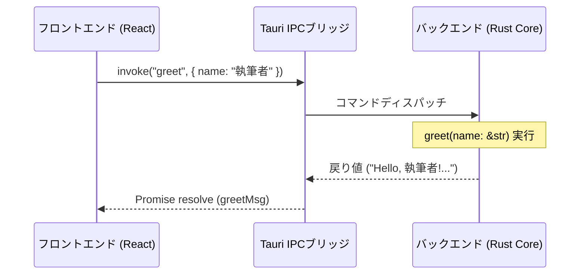

# システム環境および初期構成仕様書

## 1. 概要

本ドキュメントは、小説執筆エディター **`novelaide`** の基盤環境である **Tauri 2.x + Vite + React 19 + TypeScript** の構成およびバックエンド（Rust）とフロントエンド（React）の連携仕様を定義するものです。

---

## 2. 採用技術スタック

| レイヤー | 採用技術 | バージョン / 特徴 |
|---|---|---|
| デスクトップ基盤 | Tauri | 2.x（軽量・高セキュリティ・マルチプラットフォーム） |
| バックエンド | Rust | 2024 edition（高速性・メモリ安全性） |
| ビルドツール | Vite | 8.x（高速HMR・モダンフロントエンドビルド） |
| UIライブラリ | React | 19.x（コンポーネントベースUI） |
| 言語 | TypeScript | 6.x（厳格な型安全性の確保） |

---

## 3. ディレクトリ構成

```
novelaide/
├─ index.html               # アプリのエントリーポイントHTML
├─ package.json             # フロントエンド依存関係・スクリプト定義
├─ tsconfig.json            # TypeScriptコンパイラ設定
├─ vite.config.ts           # Viteバンドラー設定（Tauri統合ポート設定含む）
├─ public/                  # 静的アセット（ファビコン、ロゴ等）
├─ src/                     # フロントエンド（React + TypeScript）
│  ├─ assets/               # 画像・ベクターアセット
│  ├─ App.tsx               # ルートコンポーネント
│  ├─ App.css               # グローバル・コンポーネントCSS
│  ├─ main.tsx              # Reactマウントエントリー
│  └─ vite-env.d.ts         # Vite環境および静的アセット型定義
└─ src-tauri/               # バックエンド（Rust / Tauri）
   ├─ Cargo.toml            # Rust依存関係（Tauri 2.xプラグイン等）
   ├─ tauri.conf.json       # Tauri設定（ウィンドウサイズ、識別子、プラグイン設定）
   ├─ build.rs              # Tauriビルドスクリプト
   ├─ capabilities/         # Tauri 2.x 権限設定（パーミッション）
   │  └─ default.json
   └─ src/
      ├─ lib.rs             # Tauriアプリケーション本体・IPCコマンド定義
      └─ main.rs            # 実行エントリーポイント
```

---

## 4. プロセス間通信（IPC）の基本アーキテクチャ

Tauriでは、ブラウザレンダラー（Webview）上のフロントエンドと、OSネイティブで動作するバックエンド（Rust）がメッセージング形式で通信します。



### 4.1 Rust側コマンド定義（`src-tauri/src/lib.rs`）
```rust
#[tauri::command]
fn greet(name: &str) -> String {
    format!("Hello, {}! You've been greeted from Rust!", name)
}

pub fn run() {
    tauri::Builder::default()
        .plugin(tauri_plugin_opener::init())
        .invoke_handler(tauri::generate_handler![greet])
        .run(tauri::generate_context!())
        .expect("error while running tauri application");
}
```

### 4.2 フロントエンド側呼び出し（`src/App.tsx`）
```typescript
import { invoke } from "@tauri-apps/api/core";

const response = await invoke<string>("greet", { name: "執筆者" });
```

---

## 5. ウィンドウおよびアプリ基本仕様

- **製品名**: `novelaide`
- **バンドル識別子**: `jp.restar.novelaide`
- **初期ウィンドウサイズ**: 幅 1024px / 高さ 768px（小説執筆に適した初期ワークスペース領域）
- **開発サーバー**: `http://localhost:1420`（Vite + Tauri dev）
