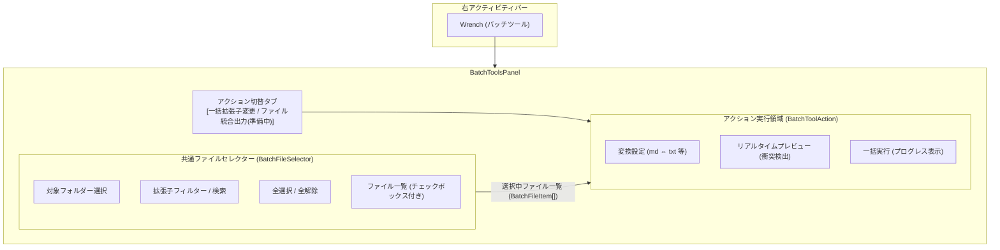

# システム設計 - バッチツール基盤仕様書

## 1. 概要

本ドキュメントは、小説執筆デスクトップIDE `novelaide`（コードネーム: `novelaid-e`）における **バッチ処理ツール基盤（Batch Tools Framework）** および **一括拡張子変更（BatchExtensionChanger）** のアーキテクチャと設計仕様を定義するものです。

プロジェクト内の複数ファイルに対する一括処理（リネーム、結合エクスポート、変換など）を安全かつ柔軟に実行するため、**「ファイル選択UIの共通化」** と **「処理アクションのプラグイン化」** を中核アーキテクチャとして採用しています。

---

## 2. アーキテクチャと配置方針

### 2.1 パネル配置（右サイドバー）
- **パネルID**: `novelaid.panel.batch`
- **タイトル**: `バッチツール`
- **アイコン**: `Wrench`
- **デフォルト配置**: `right`（右サイドバー）
- **許容配置**: `['left', 'right']`（ユーザー設定により左側への移動も可能）
- **配置理由**:
  - 左サイドバーのファイルエクスプローラーでフォルダ構造やファイル配置を確認しながら、右サイドバーでバッチツールを並行操作できるため、視線移動と作業動線が最適化されます。
  - 右ペインはAI執筆や文章校正など「執筆支援・ツール系」が集約されているため、機能的にも自然に調和します。

---

## 3. 主要コンポーネント仕様

### 3.1 共通ファイルセレクター (`BatchFileSelector.tsx`)
プロジェクト内の指定フォルダー配下のファイルを走査し、フィルタリングとチェックボックスによる選択/除外機能を提供します。

- **フォルダー選択**: プロジェクトルート全体または特定のサブフォルダー（例: `novels/`、`characters/` 等）を選択可能。
- **ドラッグ＆ドロップ（D&D）による対象指定**:
  - **アプリ内ファイルエクスプローラーからのD&D**: 左ペインのファイルツリーからフォルダーノードをドラッグしてバッチツールの対象フォルダー領域へドロップすることで、対象フォルダーを即座に切り替え可能。
  - **親フォルダー自動解決**: フォルダーではなくファイルを誤ってドロップした場合でも、そのファイルが属する親フォルダーを自動特定して選択対象に設定。
  - **OSエクスプローラー（Windows Explorer）からのD&D**: 外部エクスプローラーからフォルダーをドロップした場合も受付可能（プロジェクト外のパスは安全ガードにより警告・除外）。
  - **視覚的フィードバック**: ドラッグオーバー時にドロップゾーンが点線ハイライト＋アクセントカラー背景に変化し、直感的なドロップ案内を表示。
- **拡張子フィルター**: 存在する拡張子を自動収集し、ワンクリックで絞り込み。
- **検索フィルター**: ファイル名や相対パスの部分一致で即座に絞り込み。
- **選択・除外制御**:
  - 全選択 / 全解除ボタン。
  - 個別行クリックまたはチェックボックスによるトグル（除外したいファイルのみチェックを外す操作が可能）。

### 3.2 拡張子一括変更アクション (`BatchExtensionChanger.tsx`)
Markdown (`.md`) と Plain Text (`.txt`) の相互変換をはじめ、任意の拡張子への一括リネームを行います。

- **プリセット**: `.md → .txt`、`.txt → .md` のワンタッチ切り替え。
- **プレビュー**: 変更前ファイル名から変更後ファイル名をリアルタイム導出。
- **同名衝突の検知**: 同一フォルダ内に変更後のファイル名が既に存在する場合に警告表示。
- **実行と連動**:
  - 開いているドキュメントの未保存変更を自動保存。
  - `fileService.rename` によるディスク上の実体リネーム。
  - `DocumentContext.updateDocumentPath` により開いているタブのパスをインプレース追従。
  - `novelaide:project-refresh-needed` イベントを発行してエクスプローラーツリーを最新化。

---

## 4. 将来拡張：ファイル統合出力（Concatenator）

共通ファイルセレクターの選択結果（`BatchFileItem[]`）をそのまま受け取ることで、以下の機能を持つ「ファイル統合出力」アクションを容易に追加できます：

- **章単位テキスト結合**: 選択したエピソード群を1つの `.txt` や原稿用紙形式ファイルに統合。
- **見出し自動挿入**: エピソードタイトルやFrontmatterの `title` を見出しとして挟むオプション。
- **改ページ記号・区切り線の挿入**: 章末・エピソード末尾への自動区切り記号挿入。
