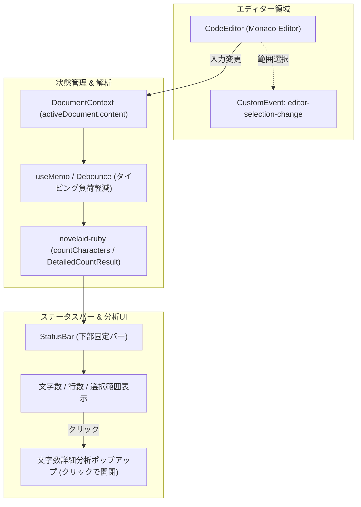

# ステータスバーおよびリアルタイム文字数カウント仕様書

## 1. 概要と設計理念

本ドキュメントは、**`novelaide`** における **ステータスバー（`StatusBar`）** および **リアルタイム文字数・原稿用紙換算・文体分析機能** の設計仕様を定義するものです。

### なぜ小説執筆において文字数カウントが決定的なのか
1. **執筆進捗の実感とモチベーション**:
   「今日何文字書けたか」「いま何枚分書いたか」をリアルタイムに把握できることは、長編小説を書き切るための最大の原動力です。
2. **投稿サイト・公募規定への適合**:
   「カクヨム」「小説家になろう」等の投稿サイトや各種新人賞公募では、それぞれ文字数の計算基準（ルビや空白の扱い、400字詰原稿用紙換算など）が厳密に定められています。
3. **文体とテンポ（セリフと地の文のバランス）の可視化**:
   会話文が多すぎて軽くなりすぎていないか、あるいは地の文が続きすぎてテンポが落ちていないかを客観的に数値・グラフで把握できます。

---

## 2. アーキテクチャ構成



---

## 3. カウントメトリクスと計算基準（`novelaid-ruby` 準拠）

文字数の集計には、シリーズ共通ライブラリ **`novelaid-ruby`** の `countCharacters(text)` を使用します。

| 項目名 | 定義 / 計算ルール | 用途・該当サイト |
|---|---|---|
| **基本文字数 (`charCount`)** | ルビ文字（ふりがな）・ルビ記号（`｜` `《》`）・空白（全角/半角）・改行を**すべて除外**した文字数 | カクヨム、小説家になろう等の標準公開文字数 |
| **文字数 (空白・改行含む)** | ルビ・ルビ記号のみを除外し、空白類と改行をそのままカウント | 小説家になろうの1話システム制限（最大7万文字）等 |
| **総文字数 (RAW)** | `text.length`（ルビ記号や装飾を含む全文字列長） | ファイル容量・全体サイズ目安 |
| **総行数 (`lineCount`)** | 改行で分割した全行数 | 原稿全体のボリューム感 |
| **原稿用紙換算枚数** | 日本の標準組版（20字×20行＝400字詰め）換算。改行や字下げによる行消費を計算 | 文学賞公募規定、同人誌・商業出版のページ数試算 |
| **文体分析 (セリフ / 地の文)** | `「……」` や `『……』` の会話文と地の文の文字数・行数、および全体比率（%） | 会話テンポや文章密度のセルフチェック |

---

## 4. UI仕様

### 4.1. ステータスバー（常時表示エリア）
エディター最下部の 24px のバーに、以下の情報をコンパクトに配置します。

* **左側グループ**:
  - 書庫（ホーム）ボタン
  - サイドバー開閉トグルボタン
  - 現在開いているファイル名とドキュメント種別アイコン
* **右側グループ**:
  - **通常時**: `文字数: 3,450` / `行数: 120` / `原稿用紙: 12.3枚`
  - **テキスト選択時**: `選択中: 120 / 3,450字`（視覚的ハイライト色で強調）
  - クリックすると詳細分析ポップアップが展開するトリガーとして機能。

### 4.2. 文字数詳細分析ポップアップ
ステータスバーの文字数表示部分をクリックすると、上向きにフロート表示されるモーダルポップアップです。

```
+-------------------------------------------------------+
|  文字数詳細分析                                   [×] |
+-------------------------------------------------------+
| 【基本カウント】                                      |
|  基本文字数 (空白・改行除く) :  3,450 字 (カクヨム準拠) |
|  文字数 (空白・改行含む)     :  3,820 字 (なろう上限用) |
|  総文字数 (RAW)              :  4,100 字               |
|  総行数                      :    142 行               |
|  原稿用紙換算 (400字詰め)    :   12.3 枚               |
+-------------------------------------------------------+
| 【文体分析 (セリフ / 地の文)】                        |
|  [=========セリフ (35%)========|=====地の文 (65%)====] |
|  - セリフ : 35.0% (1,207字 / 45行)                    |
|  - 地の文 : 65.0% (2,243字 / 97行)                    |
+-------------------------------------------------------+
| 【空白・改行の内訳】                                  |
|  全角スペース: 142 / 半角スペース: 8 / 改行: 141       |
+-------------------------------------------------------+
```

---

## 5. 実装ステップ計画

1. **Step 4.1.1: `novelaid-ruby` によるリアルタイムカウントフックの作成**
   - `useCharacterCount(content)`: 本文の変更を受け取り、`countCharacters` を実行して `DetailedCountResult` を返すカスタムフック。
   - 長文執筆時（数万〜数十万文字）のタイピングレスポンス低下を防ぐため、150ms の Debounce または `useDeferredValue` を適用。
2. **Step 4.1.2: 選択テキスト（Selection）連動機能の実装**
   - `CodeEditor.tsx` から発火される `editor-selection-change` イベントを受信し、選択範囲のみの文字数を算出。
3. **Step 4.1.3: `StatusBar.tsx` および詳細ポップアップコンポーネントの実装**
   - 現行 `novelaid-editor` の優れたUI構成を踏襲したスタイリング（`StatusBar.css`）。
   - セリフ／地の文のツートン比率バー（Progress Bar）の実装。
4. **Step 4.1.4: 画面自動撮影 & ドキュメント反映**
   - Playwright 自動撮影スクリプトにより、ステータスバーおよび詳細分析ポップアップが表示された状態を自動記録。
