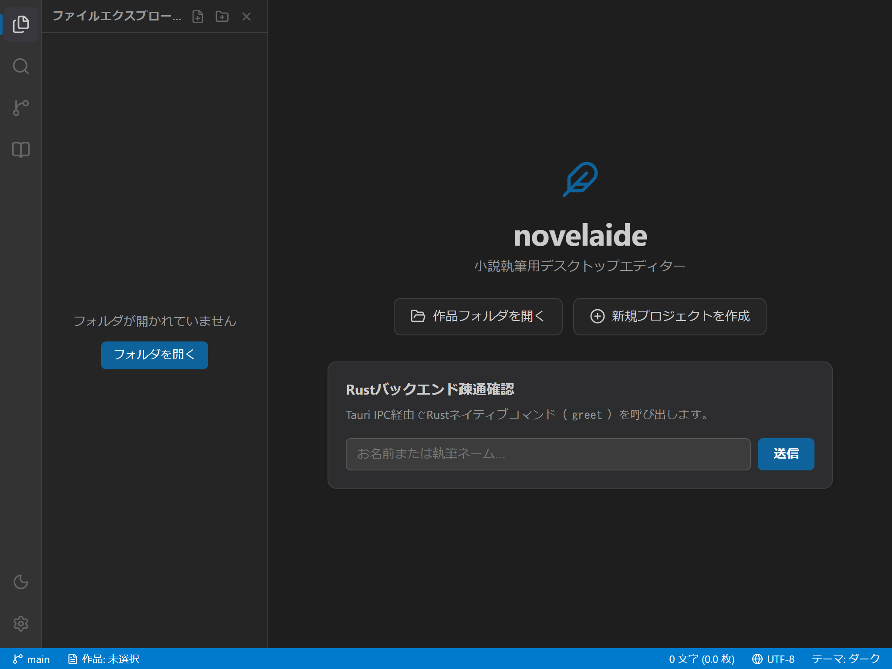
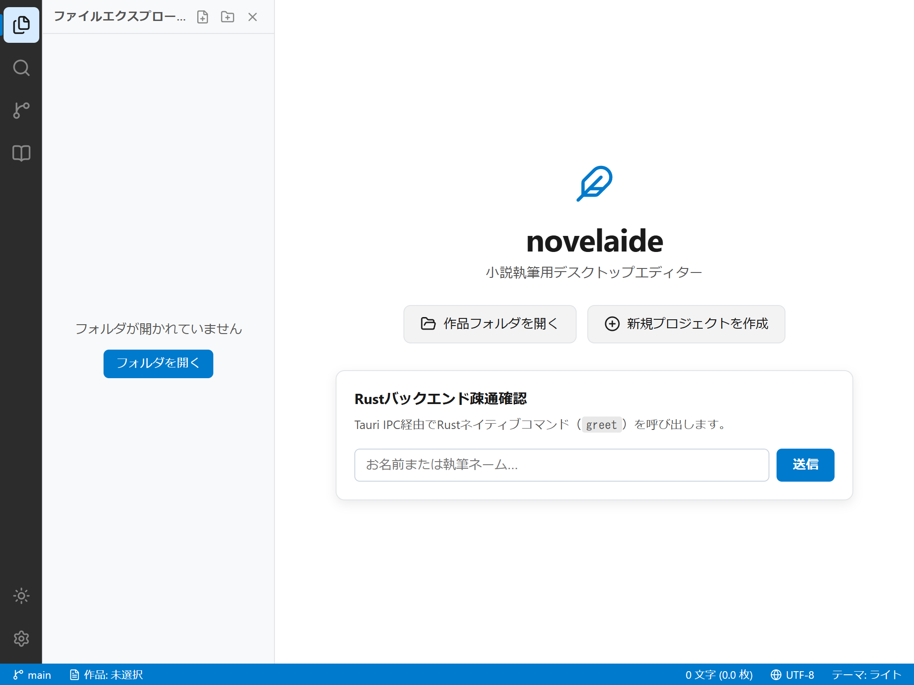
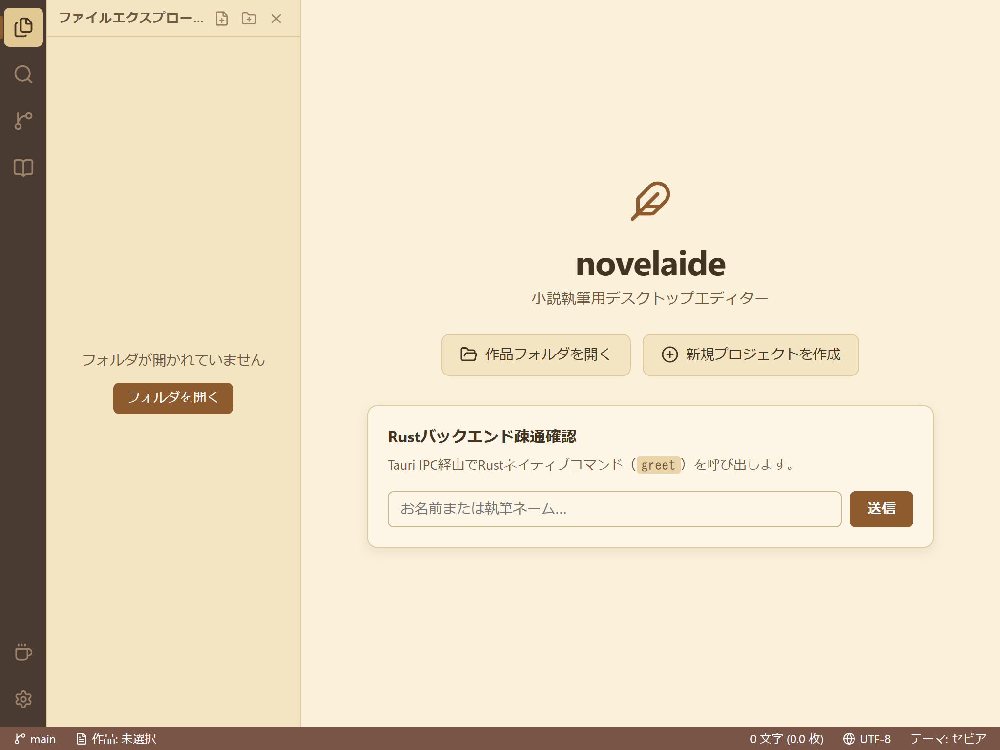

# テーマシステムおよびUIレイアウト仕様書

## 1. 概要

本ドキュメントは、小説執筆エディター **`novelaide`** の **テーマシステム（CSS変数 & React Context）** および **基本3ペインレイアウト（ActivityBar / SidePane / MainArea / StatusBar）** の設計仕様を定義するものです。

---

## 2. テーマシステム仕様

### 2.1 サポートするテーマ
小説執筆という長時間画面を見つめる用途に配慮し、以下の4つのテーマ状態をサポートします。

| テーマ種別 | 属性値 (`data-theme`) | 特徴・用途 |
|---|---|---|
| **ダーク (Dark)** | `dark` (デフォルト) | 暗所での執筆や目への刺激を抑えたい場合 |
| **ライト (Light)** | `light` | 明るい室内での執筆用 |
| **セピア (Sepia)** | `sepia` | 原稿用紙を想起させる温かみのあるクリーム色調。ブルーライト軽減 |
| **システム (System)** | なし（未設定） | OS（Windows/macOS）の外観モード設定に自動追従 |

### 2.2 CSS変数設計（抜粋）
全カラーパレットは `src/styles/theme.css` にてCSSカスタムプロパティとして一元定義されています。

```css
:root {
  --bg-primary: #1e1e1e;       /* メイン執筆エリア背景 */
  --bg-secondary: #252526;     /* 補助パネル背景 */
  --bg-activity-bar: #333333;  /* 左端アイコンバー背景 */
  --bg-side-pane: #252526;     /* 開閉サイドパネル背景 */
  --bg-status-bar: #007acc;    /* 最下部ステータスバー背景 */
  --text-primary: #cccccc;     /* 主テキスト色 */
  --text-secondary: #999999;   /* 補助テキスト色 */
  --border-color: #3e3e42;     /* 境界線 */
  --accent-color: #0e639c;     /* アクセンカラー */
}
```

### 2.3 状態管理（`ThemeContext`）
- `localStorage` のキー `novelaide-theme` に現在の選択状態を永続化。
- OS側の配色切り替えイベント（`window.matchMedia('(prefers-color-scheme: light)')`）を常時監視し、`system` 選択時に即時同期。

---

## 3. 基本3ペインUIレイアウト仕様

エディター画面は、VS Code風の直感的なワークスペース構成を採用しています。

```
+----+--------------------+------------------------------------+
|    |                    |                                    |
| A  |    SidePane        |             MainArea               |
| c  | (ファイル一覧・    |     (エディター・執筆ワークスペース) |
| t  |  検索・Git等)      |                                    |
| .  |                    |                                    |
|    | <-> [ResizeHandle] |                                    |
+----+--------------------+------------------------------------+
|                      StatusBar                               |
+--------------------------------------------------------------+
```

### 3.1 コンポーネント構成
1. **`ActivityBar` (幅: 48px 固定)**:
   - 最左端のアイコン帯。
   - 上部: 「ファイル一覧」「作品内検索」「執筆履歴 (Git)」「登場人物・設定資料」
   - 下部: 「テーマ切り替え（ワンクリック切替）」「環境設定」
2. **`SidePane` (幅: 180px〜500px 可変、初期値: 260px)**:
   - アクティビティバーで選択された機能に応じたサイドパネル。
   - 右端のリサイズハンドル（`ResizeHandle`）をドラッグして自由に幅調整可能。
   - 閉じるボタン（×）または同一アイコンの再クリックで非表示（折りたたみ）。
3. **`MainArea` (可変 flex: 1)**:
   - ドキュメントタブやMonacoエディターが展開される主領域。
4. **`StatusBar` (高さ: 24px 固定)**:
   - 最下部の情報バー。
   - 左側: Gitブランチ、現在の作品プロジェクト名
   - 右側: リアルタイム文字数、400字詰原稿用紙換算枚数、文字コード（UTF-8）、現在のテーマ

---

## 4. UIスクリーンショット

### ダークモード


### ライトモード


### セピアモード（小説執筆特化）

