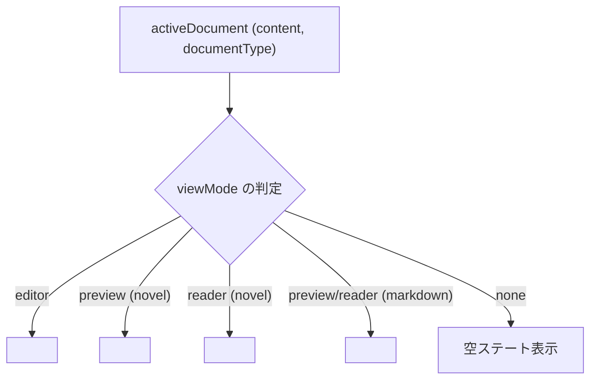

# ドキュメントビューモード実装仕様書

## 1. 概要とアーキテクチャ

本ドキュメントは、**`novelaide`** における **ドキュメントの表示モード（`DocumentViewMode`）** の型定義、状態管理、およびビュー切り替えの実装仕様を定義するものです。

プレビュー表示やリーダー（縦書き読書）、スプリットビュー（2画面分割）は、すべてこの **「ドキュメントのビューモード仕様」** の基盤の上に構築されます。

---

## 2. 型定義（`src/types/document.ts`）

### 2.1. `DocumentViewMode`
```typescript
/**
 * ドキュメント領域で表示するViewの種類
 */
export type DocumentViewMode = 'none' | 'editor' | 'canvas' | 'reader' | 'preview';
```

| モード名 | 表示コンポーネント | 用途・特徴 |
|---|---|---|
| **`editor`** | `CodeEditor` (Monaco Editor) | 小説執筆・プロット編集（全角スペース枠、ルビハイライト、補完） |
| **`reader`** | `NovelPreview` (縦書き文庫本) | 編集ノイズを消した純粋な縦書き組版による通読・推敲 |
| **`preview`** | `NovelPreview` (横書き組版) / `MarkdownPreview` | ルビ `<ruby>` 組版確認、Markdown設定資料の閲覧 |
| **`canvas`** | `ChView` (将来実装) | 会話劇・インタビュー形式（`.chat`）の対話吹き出し表示 |
| **`none`** | なし（非表示） | ペイン未分割時や非アクティブ時 |

### 2.2. ドキュメント種別との対応判定（`documentSupport.ts`）

```typescript
export function getSupportedViewModes(docType: NovelaidDocumentType | string | undefined): DocumentViewMode[] {
  switch (docType) {
    case 'novel':
    case 'markdown':
      return ['editor', 'reader', 'preview'];
    case 'chat':
      return ['editor', 'canvas'];
    case 'image':
      return ['reader'];
    case 'css':
      return ['editor'];
    default:
      return ['editor'];
  }
}
```

---

## 3. 状態管理（`DocumentContext.tsx`）での管理構造

`DocumentState` において、左右各ペインの表示状態を独立して保持します。

```typescript
export interface DocumentState {
  path: string;
  baseName: string;
  fileTitle: string;
  content: string;
  metadata: Record<string, any>;
  documentType: NovelaidDocumentType;
  isDirty: boolean;

  // 各ペインにおける表示ビューモード
  leftViewMode: DocumentViewMode;   // 左ペインの表示モード (デフォルト: 'editor')
  rightViewMode: DocumentViewMode;  // 右ペインの表示モード (デフォルト: 'none')
}
```

### Context が提供するビューモードAPI
- **`changeViewMode(path: string, viewMode: DocumentViewMode, side?: 'left' | 'right')`**:
  対象ドキュメントの指定ペインでの表示モードを切り替える。
- **`openPreview(path: string)`**:
  右ペインで同一ファイルの `preview` または `reader` モードを開き、自動的に左右スプリットビューを展開する。

---

## 4. UIコンポーネントレンダリングの分岐設計

ペイン内のコンテンツ描画は、現在の `viewMode` に応じて以下のように振り分けられます。



---

## 5. 実装ステップ計画

1. **Step 4.2.0: ビューモードの型定義とヘルパー整備**
   - `src/types/document.ts` に `DocumentViewMode` を追加。
   - `src/utils/documentSupport.ts` に `getSupportedViewModes` および `isViewModeSupported` を実装。
2. **Step 4.2.1: `DocumentContext.tsx` へのビューモード管理の統合**
   - `leftViewMode`, `rightViewMode` および `changeViewMode` API の追加。
3. **Step 4.2.2: `NovelPreview` および `MarkdownPreview` の実装**
   - ビューモードに応じたレンダラーの作成。
4. **Step 4.2.3: `MainLayout` およびタブバーでのスプリット・ビュー切り替えUI**
   - タブ上のバッジ表示、ツールバーでのビュー切り替えボタンの実装。
