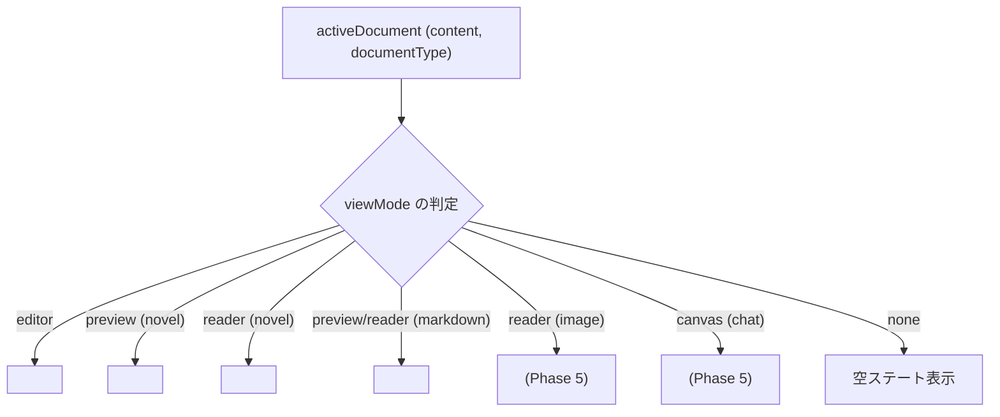

# ドキュメントビューモード実装仕様書

## 1. 概要とアーキテクチャ

本ドキュメントは、**`novelaide`** における **ドキュメントの表示モード（`DocumentViewMode`）** の型定義、状態管理、および全ドキュメント種別（`NovelaidDocumentType`）とのマッピング実装仕様を定義するものです。

エディター（Monaco Editor）やプレビュー表示、リーダー（縦書き読書）、画像ビューアー、会話劇UI、スプリットビュー（2画面分割）は、すべてこの **「ドキュメントのビューモード仕様」** の基盤の上に構築されます。

---

## 2. 型定義（`src/types/document.ts`）

### 2.1. `DocumentViewMode`
```typescript
/**
 * ドキュメント領域で表示するViewの種類
 */
export type DocumentViewMode = 'none' | 'editor' | 'canvas' | 'reader' | 'preview';
```

| モード名 | 表示コンポーネント | 用途・特徴 |
|---|---|---|
| **`editor`** | `CodeEditor` (Monaco Editor) | 小説執筆・設定編集・CSS編集（全角スペース枠、ルビハイライト、補完） |
| **`reader`** | `NovelPreview` (縦書き文庫本) / `ImageViewer` (画像閲覧) | 編集ノイズを消した純粋な縦書き組版による通読・推敲、および画像資料の閲覧 |
| **`preview`** | `NovelPreview` (横書き組版) / `MarkdownPreview` | ルビ `<ruby>` 組版確認、Markdown設定資料の整形閲覧 |
| **`canvas`** | `ChatView` / `PlotCanvas` (将来実装) | 会話劇・インタビュー形式（`.chat`）の対話吹き出し表示、プロット相関図 |
| **`none`** | なし（非表示） | ペイン未分割時や非アクティブ時 |

---

## 3. 全ドキュメント種別 (`NovelaidDocumentType`) とビューモード対応

Rustプラグイン（`tauri-plugin-novelaid-fs`）により定義された全ドキュメント種別と、それぞれのサポートするビューモードのマッピングです。

```typescript
export type NovelaidDocumentType = 
  | 'novel'     // 小説本文原稿 (.txt)
  | 'markdown'  // プロット・設定資料 (.md)
  | 'image'     // 立ち絵・地図・挿絵 (.png, .jpg, .webp, .svg 等)
  | 'chat'      // 会話劇・対話プロット (.chat, .ch)
  | 'gitDiff'   // 執筆履歴差分ビュー (gitDiff://)
  | 'browser'   // 内蔵Webブラウザ (browser://)
  | 'css'       // カスタム組版スタイル (.css)
  | 'unknown'   // 未知の形式 (フォールバック)
  | 'external'; // OS既定アプリ連携 (.pdf, .docx 等)
```

### 3.1 マッピング表と実装計画

| 種別 (`NovelaidDocumentType`) | サポート ViewMode | デフォルト | 主な用途・振る舞い | 実装状況 |
|---|---|---|---|:---:|
| **`novel`** | `['editor', 'reader', 'preview']` | `editor` | 小説執筆、縦書き文庫本リーダー、組版プレビュー | **Phase 3-4 実装中** |
| **`markdown`** | `['editor', 'reader', 'preview']` | `editor` | 設定資料・プロット編集、HTMLプレビュー | **Phase 4 実装中** |
| **`chat`** | `['editor', 'canvas']` | `canvas` | キャラクター対話劇・壁打ちの吹き出しUI (`canvas`) と生テキスト編集 (`editor`) | Phase 5 予定 |
| **`image`** | `['reader']` | `reader` | 立ち絵・世界地図・挿絵の拡大縮小・回転ビューアー | Phase 5 予定 |
| **`css`** | `['editor']` | `editor` | テーマ・プレビュー組版カスタマイズ用CSSエディター | Phase 5 予定 |
| **`gitDiff`** | 特殊 (Monaco Diff) | 特殊 | 前の版や過去セーブポイントとの2画面Diff比較 | Phase 6 予定 |
| **`browser`** | 特殊 (Tauri Webview) | 特殊 | カクヨム・なろう投稿画面や辞書・資料調査ブラウザ | Phase 6 予定 |
| **`external`** | 外部アプリ起動 | 外部起動 | PDFやWordなどのOS既定アプリによる外部オープン | Phase 5 予定 |
| **`unknown`** | `['editor']` | `editor` | 未知ファイルのテキストエディター表示 | 実装済み |

### 3.2 判定ユーティリティ（`src/utils/documentSupport.ts`）

```typescript
import { NovelaidDocumentType, DocumentViewMode } from '../types/document';

export function getSupportedViewModes(docType: NovelaidDocumentType | string | undefined): DocumentViewMode[] {
  switch (docType) {
    case 'novel':
    case 'markdown':
      return ['editor', 'reader', 'preview'];
    case 'chat':
      return ['editor', 'canvas'];
    case 'image':
      return ['reader'];
    case 'css':
      return ['editor'];
    case 'gitDiff':
    case 'browser':
      return []; // 特殊仮想ビュー
    default:
      return ['editor'];
  }
}

export function isViewModeSupported(
  docType: NovelaidDocumentType | string | undefined,
  viewMode: DocumentViewMode,
): boolean {
  if (!docType) return viewMode === 'editor';
  const supported = getSupportedViewModes(docType);
  return supported.includes(viewMode);
}

export function getInitialViewMode(docType?: NovelaidDocumentType): DocumentViewMode {
  if (docType === 'chat') return 'canvas';
  if (docType === 'image') return 'reader';
  return 'editor';
}
```

---

## 4. 状態管理（`DocumentContext.tsx`）での管理構造

`DocumentState` において、左右各ペインの表示状態を独立して保持します。

```typescript
export interface DocumentState {
  path: string;
  baseName: string;
  fileTitle: string;
  content: string;
  metadata: Record<string, any>;
  documentType: NovelaidDocumentType;
  isDirty: boolean;

  // 各ペインにおける表示ビューモード
  leftViewMode: DocumentViewMode;   // 左ペインの表示モード (デフォルト: 'editor')
  rightViewMode: DocumentViewMode;  // 右ペインの表示モード (デフォルト: 'none')
}
```

### 提供するビューモード操作API
- **`changeViewMode(path: string, viewMode: DocumentViewMode, side?: 'left' | 'right')`**:
  対象ドキュメントの指定ペインでの表示モードを切り替える。
- **`openPreview(path: string)`**:
  右ペインで同一ファイルの `preview` または `reader` モードを開き、自動的に左右スプリットビューを展開する。

---

## 5. UIコンポーネントレンダリングの分岐設計

ペイン内のコンテンツ描画は、現在の `viewMode` に応じて以下のように振り分けられます。



---

## 6. 実装ステップ計画

1. **Step 4.2.0: ビューモードの型定義とヘルパー整備**
   - `src/types/document.ts` に `DocumentViewMode` を追加。
   - `src/utils/documentSupport.ts` に `getSupportedViewModes`, `isViewModeSupported`, `getInitialViewMode` を実装。
2. **Step 4.2.1: `DocumentContext.tsx` へのビューモード管理の統合**
   - `leftViewMode`, `rightViewMode` および `changeViewMode` API の追加。
3. **Step 4.2.2: `NovelPreview` および `MarkdownPreview` の実装**
   - ビューモードに応じたレンダラーの作成。
4. **Step 4.2.3: `MainLayout` およびタブバーでのスプリット・ビュー切り替えUI**
   - タブ上のバッジ表示、ツールバーでのビュー切り替えボタンの実装。
