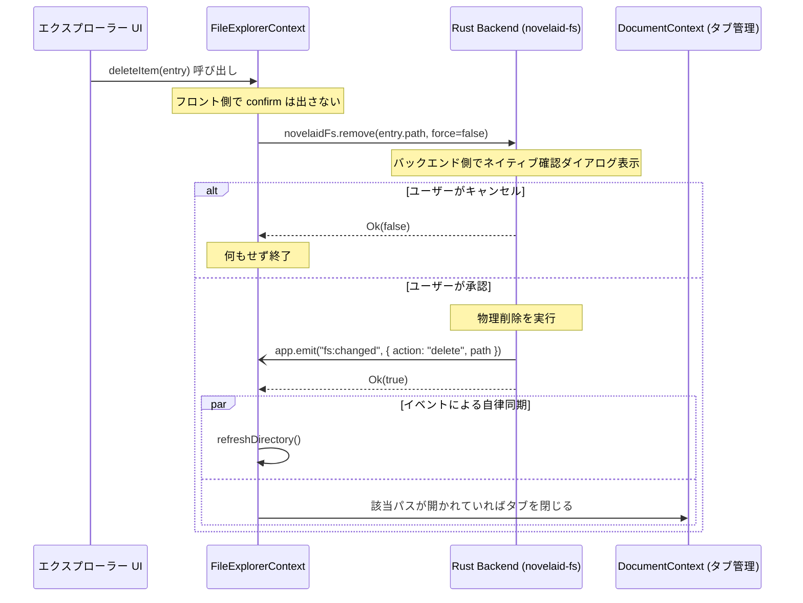

# バックエンド主導型コマンド実行とファイル変更イベント通知仕様

## 1. 概要と設計思想

本仕様書は、`novelaide` におけるファイル操作（作成・名前変更・移動・コピー・削除など）を **「バックエンド主導型コマンド実行」** および **「イベント駆動型自律更新」** として統一するための設計原則と実装規約を定めます。

### 1.1 従来の方式（方式1: フロントエンド先行確認）の課題
従来のUI実装では、以下のようにフロントエンド側で確認ダイアログを表示してからバックエンドコマンドを呼び出し、コマンド完了後にフロントエンド側で手動リフレッシュを行っていました。

```text
[UI操作] ──(フロントでconfirm)──> [バックエンド実行] ──(戻り値)──> [フロントでrefreshDirectory]
```

この方式には以下の深刻な課題がありました：
1. **処理の分散と重複**: エクスプローラーの右クリックメニュー、ゴミ箱ボタン、Deleteキー、コマンドパレット、そして内蔵予定の **AIエージェント（`novelaid-ai` / `novelaid-cli`）** など、ファイル操作を要求するトリガーが増えるたびに、フロントエンド側でダイアログ確認と画面リフレッシュを多重実装しなければならない。
2. **スレッド競合とタイミングバグ**: Windows WebView2環境において、ブラウザ組み込みの `window.confirm()` を同期的に呼ぶと、UIレンダリングとJSスレッドのタイミングのズレにより、確認ダイアログが表示される前にファイル削除が先行してしまうなどの不整合が発生する。
3. **自律同期の欠如**: バックエンドが変更されたこと（外部ツールやAIによる変更を含む）をフロントエンドが即座に知る仕組みがなく、手動リフレッシュ頼みになっていた。

---

## 2. 参照プロジェクト（`novelaid-editor`）の構成調査

現行の Electron 版 `novelaid-editor` の実装を調査した結果、以下の構成となっていました。

* **削除フロー**:
  * レンダラープロセス（UI）側が `window.electron.ipcRenderer.invoke('dialog:confirm', ...)` を呼び出して確認を取得。
  * ユーザーがOKした場合のみ、`ipcRenderer.invoke('fs:delete', path)` を呼び出す。
  * 削除後、UI側で明示的に `refreshRoot()` を呼び出す。
* **判定**:
  * 現行の `novelaid-editor` も **方式1（フロントエンド先行確認・手動リフレッシュ）** の構成を採用していました。
* **本プロジェクト（`novelaid-e`）での進化**:
  * 今回 `novelaide` では、現行版の課題を乗り越え、**方式2（バックエンド主導型・イベント駆動通知）** へとアーキテクチャを刷新・進化させます。

---

## 3. バックエンド主導型アーキテクチャ（方式2）の原則

### 3.1 原則1: 確認（Confirmation）はバックエンドコマンドが制御する
* コマンド呼び出し元は、単に「削除したい」「上書きしたい」という意図をバックエンドに伝えます。
* バックエンド（Rust）は、対象の存在や破壊的操作であることを自律判断し、必要に応じて OS ネイティブダイアログ（`tauri-plugin-dialog`）を立ち上げてユーザーに確認を求めます。
* **`force: Option<bool>` の標準装備**:
  * すべての破壊的コマンドは `force: bool`（または `skip_confirm: bool`）フラグを受け取れるようにします。
  * UIからの通常操作では `force = false`（ダイアログ確認あり）。
  * AIエージェントの自動処理やスクリプト実行、一括処理などでは `force = true`（ダイアログをスキップして即座に実行）を指定可能にします。

### 3.2 原則2: 操作完了時はイベント（`fs:changed`）をブロードキャストする
* バックエンドコマンドは、ファイルシステムの変更を伴う操作が成功した際、必ず共通イベント `fs:changed` を発行します。
* 戻り値で成否を返すだけでなく、アプリ全体へイベントを発信することで、誰が（UI、キーボード、AI、Git操作等）コマンドを実行しても、すべてのビューが自律的に同期されます。

### 3.3 原則3: フロントエンドはイベントを購読してリアクティブに自律更新する
* フロントエンド（`FileExplorerContext`, `DocumentContext` 等）は、個々の操作の直後に手動でリフレッシュ関数を呼ぶ必要はありません。
* `fs:changed` を一箇所でリッスン（購読）し、イベントが届いた際に自律的に以下の処理を行います：
  1. ツリーの再読み込み（`refreshDirectory`）
  2. 削除・移動されたファイルに対応する開いているタブの自動破棄・パス追従（`closeTab`, `updatePath`）

---

## 4. イベント構造とデータ型定義

### 4.1 `FsChangeEvent` (Rust)
```rust
#[derive(Clone, Debug, serde::Serialize)]
#[serde(rename_all = "camelCase")]
pub struct FsChangeEvent {
    pub action: String, // "delete" | "create" | "rename" | "copy"
    pub path: String,
    pub new_path: Option<String>,
}
```

### 4.2 TypeScript 型定義 (`guest-js/models.ts`)
```typescript
export interface FsChangeEvent {
  action: 'delete' | 'create' | 'rename' | 'copy';
  path: string;
  newPath?: string | null;
}
```

---

## 5. 各コマンドの仕様と水平展開規約

今後、ファイル操作や関連機能を実装する際は、本規約に沿って実装します。

| コマンド | 引数 | 確認ダイアログ (force=false時) | 発行イベント (`fs:changed`) |
| :--- | :--- | :--- | :--- |
| **`remove`** | `path: String`, `force: Option<bool>` | 「『〇〇』を削除してもよろしいですか？」 | `action: "delete", path` |
| **`create_file`** | `path: String`, `content: Option<String>` | 既存重複時は上書き確認 | `action: "create", path` |
| **`create_next_file`** | `dir_path: String` | なし（自動連番のため安全） | `action: "create", path` |
| **`create_directory`**| `path: String` | なし（既存時は create_dir_all） | `action: "create", path` |
| **`rename`** | `old_path: String`, `new_path: String` | 移動先に同名が存在する場合は上書き確認 | `action: "rename", path: old_path, new_path` |
| **`copy`** | `source_path: String`, `target_path: String` | 移動先に同名が存在する場合は上書き確認 | `action: "copy", path: source_path, new_path: target_path` |

---

## 6. フロントエンド側の連携フロー



このアーキテクチャにより、将来導入される AI エージェントが直接バックエンド経由でファイルを操作した際も、フロントエンドのエクスプローラーやタブが完全にリアルタイムで同期される基盤が整います。
