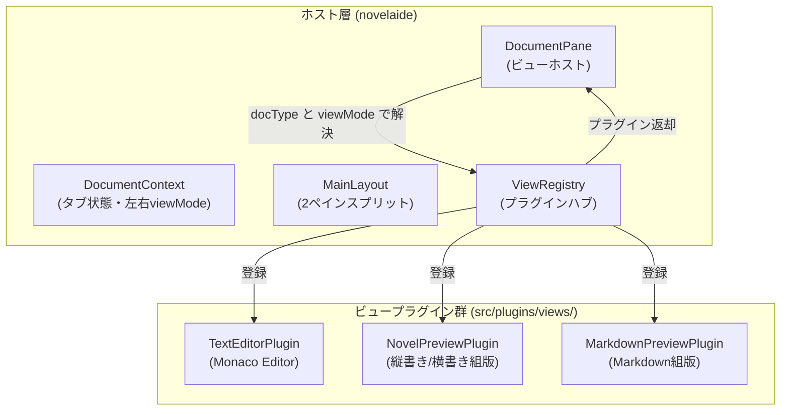

# ビュープラグインアーキテクチャ実装仕様書

## 1. 概要とアーキテクチャ方針

本ドキュメントは、**`novelaide`** における **各ビュー（エディター、縦書き文庫本プレビュー、Markdownプレビュー、画像ビューアー、会話劇UI等）のコア実装をモジュールとして分離し、プラグイン的に登録・差し替え・他プロジェクトへの流用を可能にする「ビュープラグイン（View Plugin）基盤」** の実装仕様を定義するものです。

### 設計方針
1. **開放閉鎖原則（OCP）**: 新しいドキュメント種別やビューを追加する際、既存のレイアウト（`MainLayout`）やコンテキスト（`DocumentContext`）のソースコードを変更せず、プラグインの登録のみで完結させる。
2. **完全な疎結合**: 各ビューコンポーネントは最小限の標準プロパティ（`DocumentViewProps`）のみに依存し、アプリの内部実装詳細を知らないようにする。
3. **将来のパッケージ化容易性**: `@novelaid/novel-preview` や `@novelaid/editor-core` として将来切り出せるよう、フォルダ構造を整理する。



---

## 2. ディレクトリ構成

```text
src/
├── types/
│   ├── document.ts         # DocumentState, DocumentViewMode, DocumentType
│   └── viewPlugin.ts       # DocumentViewProps, DocumentViewPlugin 定義
├── core/
│   └── viewRegistry/
│       ├── ViewRegistry.ts # プラグイン登録・検索レジストリクラス
│       └── index.ts        # シングルトンインスタンス & 組み込みプラグイン自動登録
├── components/
│   ├── Editor/
│   │   └── CodeEditor.tsx  # Monaco Editor 実装
│   ├── Preview/
│   │   ├── NovelPreview.tsx    # 縦書き/横書き文庫本組版
│   │   ├── NovelPreview.css
│   │   ├── MarkdownPreview.tsx # Markdown組版
│   │   └── MarkdownPreview.css
│   └── DocumentPane/
│       ├── DocumentPane.tsx    # レジストリ解決コンテナ
│       └── DocumentPane.css
└── plugins/
    └── views/
        ├── TextEditorPlugin.ts     # テキストエディター用プラグイン定義
        ├── NovelPreviewPlugin.ts   # 小説プレビュー用プラグイン定義
        ├── NovelReaderPlugin.ts    # 小説縦書きリーダー用プラグイン定義
        └── MarkdownPreviewPlugin.ts # Markdownプレビュー用プラグイン定義
```

---

## 3. 型定義（`src/types/viewPlugin.ts`）

```typescript
import React from 'react';
import { NovelaidDocumentType, DocumentViewMode } from './document';

/**
 * ビューコンポーネントに渡される標準プロパティ
 */
export interface DocumentViewProps {
  /** ドキュメントパス */
  path: string;
  /** ドキュメントのテキスト内容 */
  content: string;
  /** ドキュメント種別 */
  documentType: NovelaidDocumentType;
  /** 読み取り専用かどうか (プレビューやリーダーでは true) */
  isReadOnly?: boolean;
  /** テキスト内容変更時のコールバック */
  onChangeContent?: (newContent: string) => void;
  /** 左右どちらのペインに配置されているか ('left' | 'right') */
  paneSide?: 'left' | 'right';
  /** 追加メタデータ (YAMLフロントマターなど) */
  metadata?: Record<string, any>;
}

/**
 * ビュープラグイン定義インターフェース
 */
export interface DocumentViewPlugin {
  /** 一意なプラグイン識別子 (例: 'novelaid.view.novel.preview') */
  readonly id: string;
  /** 表示名 (ツールバーやタブ等で表示されるラベル) */
  readonly name: string;
  /** 対応する表示モード ('editor' | 'reader' | 'preview' | 'canvas') */
  readonly viewMode: DocumentViewMode;
  /** サポートするドキュメント種別配列 */
  readonly supportedDocumentTypes: NovelaidDocumentType[];
  /** 優先度 (同一条件で競合した場合に高い値が優先。通常 0) */
  readonly priority?: number;

  /** 描画を行うReactコンポーネント */
  readonly component: React.ComponentType<DocumentViewProps>;

  /** ツールバーに追加配置するアクションコンポーネント (任意) */
  readonly toolbarComponent?: React.ComponentType<{
    path: string;
    viewMode: DocumentViewMode;
    paneSide?: 'left' | 'right';
  }>;
}
```

---

## 4. プラグインレジストリ（`src/core/viewRegistry/ViewRegistry.ts`）

```typescript
import { DocumentViewPlugin } from '../../types/viewPlugin';
import { NovelaidDocumentType, DocumentViewMode } from '../../types/document';

export class ViewRegistry {
  private plugins: Map<string, DocumentViewPlugin> = new Map();

  /**
   * プラグインを登録
   */
  register(plugin: DocumentViewPlugin): void {
    this.plugins.set(plugin.id, plugin);
  }

  /**
   * プラグインの登録を解除
   */
  unregister(pluginId: string): void {
    this.plugins.delete(pluginId);
  }

  /**
   * ドキュメント種別とビューモードから最適なプラグインを検索
   */
  findPlugin(
    documentType: NovelaidDocumentType,
    viewMode: DocumentViewMode
  ): DocumentViewPlugin | undefined {
    const candidates = Array.from(this.plugins.values()).filter(
      (p) => p.viewMode === viewMode && p.supportedDocumentTypes.includes(documentType)
    );

    if (candidates.length === 0) return undefined;

    return candidates.sort((a, b) => (b.priority ?? 0) - (a.priority ?? 0))[0];
  }

  /**
   * 特定のドキュメント種別がサポートしている全ビューモードを取得
   */
  getSupportedViewModes(documentType: NovelaidDocumentType): DocumentViewMode[] {
    const modes = new Set<DocumentViewMode>();
    for (const plugin of this.plugins.values()) {
      if (plugin.supportedDocumentTypes.includes(documentType)) {
        modes.add(plugin.viewMode);
      }
    }
    return Array.from(modes);
  }

  /**
   * 特定のドキュメント種別で特定のビューモードがサポートされているか判定
   */
  isViewModeSupported(documentType: NovelaidDocumentType, viewMode: DocumentViewMode): boolean {
    return this.getSupportedViewModes(documentType).includes(viewMode);
  }
}
```

---

## 5. ホスト描画（`src/components/DocumentPane/DocumentPane.tsx`）

`DocumentPane` は渡された `document` と `viewMode` に応じてプラグインを動的に解決してレンダリングします。

```tsx
import React from 'react';
import { DocumentState, DocumentViewMode } from '../../types/document';
import { viewRegistry } from '../../core/viewRegistry';
import './DocumentPane.css';

interface DocumentPaneProps {
  document: DocumentState;
  viewMode: DocumentViewMode;
  paneSide: 'left' | 'right';
  onChangeContent: (content: string) => void;
}

export const DocumentPane: React.FC<DocumentPaneProps> = ({
  document,
  viewMode,
  paneSide,
  onChangeContent,
}) => {
  const plugin = viewRegistry.findPlugin(document.documentType, viewMode);

  if (!plugin) {
    return (
      <div className="document-pane-empty">
        <p>「{document.documentType}」形式の「{viewMode}」表示に対応するプラグインが見つかりません。</p>
      </div>
    );
  }

  const Component = plugin.component;

  return (
    <div className={`document-pane-container pane-${paneSide} view-mode-${viewMode}`}>
      <Component
        path={document.path}
        content={document.content}
        documentType={document.documentType}
        isReadOnly={viewMode !== 'editor'}
        onChangeContent={onChangeContent}
        paneSide={paneSide}
        metadata={document.metadata}
      />
    </div>
  );
};
```

---

## 6. 実装ステップ計画

1. **Step 1: プラグイン型定義とレジストリ基盤の作成**
   - `src/types/viewPlugin.ts`
   - `src/core/viewRegistry/ViewRegistry.ts`
   - `src/core/viewRegistry/index.ts`
2. **Step 2: 既存エディターのプラグイン化**
   - `src/plugins/views/TextEditorPlugin.ts`
3. **Step 3: プレビュー・リーダーコンポーネントおよびプラグインの実装**
   - `src/components/Preview/NovelPreview.tsx` (縦書き文庫本 / 横書き組版)
   - `src/components/Preview/NovelPreview.css`
   - `src/components/Preview/MarkdownPreview.tsx` (Markdown組版)
   - `src/components/Preview/MarkdownPreview.css`
   - `src/plugins/views/NovelPreviewPlugin.ts`
   - `src/plugins/views/NovelReaderPlugin.ts`
   - `src/plugins/views/MarkdownPreviewPlugin.ts`
4. **Step 4: `DocumentPane` と `MainLayout` / `EditorTabs` への統合**
   - `src/components/DocumentPane/DocumentPane.tsx`
   - 左右スプリットビュー、スプリッターリサイズバー
   - タブ上のプレビュー切り替えトグルボタン
5. **Step 5: 動作検証とスクリーンショット撮影**
