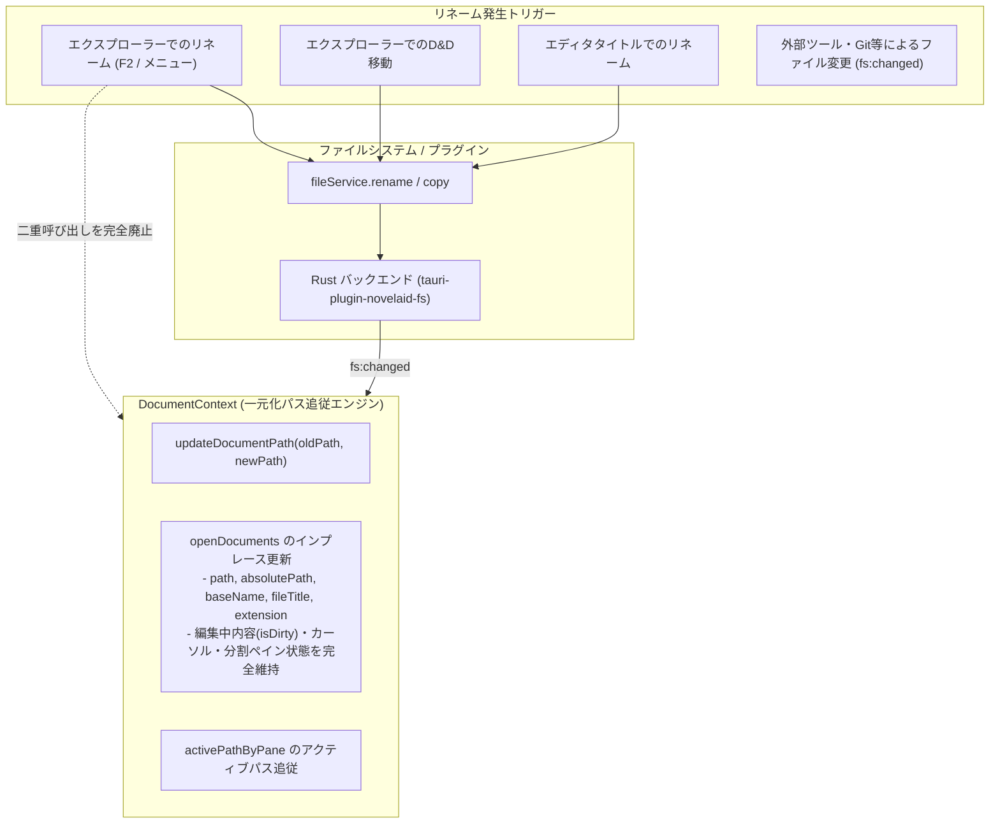

# ファイルリネーム・移動時のタブ自動追従およびパス一元化仕様書

## 1. 概要と背景

### 1.1 課題と問題の所在
執筆エディタ `novelaide` において、サイドバーのファイルエクスプローラー等からファイル名を変更（例: `A.md` → `B.md`）した際に、以下の重大な不整合が発生していました：
1. **タブの多重増殖**: リネーム実行後、新しいファイルのタブが 2 個以上重複して追加される。
2. **古いタブの残存**: リネーム前の古いファイル（`A.md`）のタブが削除されずに画面上に残存する。
3. **編集状態・UI状態の喪失**: リネームのたびにタブが一度閉じられてディスクから再ロードされるため、未保存データやカーソル位置、ペイン分割（左右）の設定がリセットされる。

### 1.2 原因分析
- **多重呼び出し（レースコンディション）**:
  `FileExplorerContext.submitRename` 内で `closeTab` + `openDocument` を実行していると同時に、Rust バックエンド（`tauri-plugin-novelaid-fs`）から emit される `fs:changed` イベントを受信したリスナー側でも同様に `closeTab` + `openDocument` が並行して走り、非同期の `readFile` 中に両者が「タブ未存在」と誤認して重複追加していた。
- **Windows パス表記の不一致**:
  パスの完全一致比較（`doc.path === path`）において、セパレータ（`/` vs `\`）や大文字小文字の差異により不一致となり、古いタブの削除（`closeTab`）が空振りしていた。
- **「閉じて開き直す」アプローチの限界**:
  既存のタブオブジェクトのパス・タイトルをインプレースで書き換えるべきところを、再ロード方式としていたため、ディスク I/O のオーバーヘッドとタイミング競合を誘発していた。

---

## 2. システムアーキテクチャとデータフロー

### 2.1 全体アーキテクチャ



---

## 3. インターフェースおよびコンポーネント仕様

### 3.1 パス同一性判定ヘルパー (`fileService.isSamePath`)
Windows 環境および Unix 環境の双方で安全にパスの完全一致を判定する共通関数を提供する。

```typescript
export function isSamePath(p1: string, p2: string): boolean {
  if (!p1 || !p2) return false;
  return normalizePath(p1).toLowerCase() === normalizePath(p2).toLowerCase();
}
```

### 3.2 ドキュメントコンテキスト (`DocumentContext.updateDocumentPath`)
ファイルまたはフォルダがリネーム・移動された際、現在開いているドキュメント（`openDocuments`）および各ペインのアクティブパス（`activePathByPane`）を**タブを閉じずにアトミックにインプレース更新**する。

```typescript
// DocumentContextType に追加
updateDocumentPath: (oldPath: string, newPath: string) => void;
```

#### 処理要件:
1. **単一ファイルのリネーム**:
   - `isSamePath(doc.path, oldPath)` に一致するドキュメントを検索。
   - `path`, `absolutePath`, `baseName`, `fileTitle`, `extension`, `parentDir` を新しいパスに基づいて即座に更新。
   - タブの再作成や再マウントを行わないため、エディタバッファ、未保存（`isDirty`）状態、カーソル位置が完全に保たれる。
2. **フォルダのリネーム / 配下ファイルの移動**:
   - `isSubPath(doc.path, oldPath)` に一致するすべてのドキュメントを検索。
   - 古い親ディレクトリのプレフィックスを除去し、`newPath` と結合した新しいパスを算出して一括インプレース更新。
3. **アクティブパスの追従**:
   - `activePathByPane`（`editor.left`, `editor.right`）内に該当するパスがあれば、新しいパスへアトミックに更新する。
4. **内部 Ref の即時同期**:
   - React state 更新（`setOpenDocuments`）と同時に、最新の参照を保持する `openDocumentsRef.current` も同期更新する。

### 3.3 エクスプローラーコンテキスト (`FileExplorerContext`)
- **`submitRename()` の改善**:
  - `fileService.rename(oldPath, newPath)` を実行後、直接の `closeTab` / `openDocument` 呼び出しを**完全撤廃**する。
  - `updateDocumentPath(oldPath, newPath)` を直接呼び出すか、または `fs:changed` リスナーにタブ追従を一任する。
- **`fs:changed` イベントリスナーの改修**:
  - `action === 'rename'` 時:
    - 従来の `closeTab` / `openDocument` のループを廃止。
    - `updateDocumentPath(path, newPath)` を 1 度だけ呼び出す。
  - `action === 'delete'` 時:
    - `isSamePath` および `isSubPath` を用いて、削除されたファイルまたはフォルダ配下のドキュメントのみを確実に `closeDocument` する。
- **`moveOrCopyItem()` の改善**:
  - ファイル/フォルダ移動（`isCopy === false`）時のタブ追従処理を、`updateDocumentPath(sourcePath, destPath)` に統一する。

---

## 4. 次回再開時の実装チェックリスト

次回作業開始時は、以下の手順で実装と検証を進めること：

1. [ ] **`src/services/fileService.ts`**:
   - `isSamePath` 関数の追加と export。
2. [ ] **`src/contexts/DocumentContext.tsx`**:
   - `updateDocumentPath(oldPath, newPath)` の実装。
   - `renameDocument`（エディタタイトル編集）の内部パス更新処理を `updateDocumentPath` と共通化。
   - `DocumentContextType` への公開。
3. [ ] **`src/contexts/FileExplorerContext.tsx`**:
   - `submitRename()` 内の多重タブ処理を撤廃し `updateDocumentPath` 連携へ変更。
   - `fs:changed` リスナー内のリネーム・削除処理を `updateDocumentPath` および `isSamePath` を用いた堅牢な処理へ置換。
   - `moveOrCopyItem()` 内の移動処理を `updateDocumentPath` へ統一。
4. [ ] **ビルド・型検査検証**:
   - `pwsh -c "npm run build"` の通過確認。
5. [ ] **動作検証**:
   - エクスプローラーからのファイルリネーム（タブが1つのままパス追従するか、重複・残存がないか）。
   - フォルダのリネーム時の配下タブ追従。
   - エディタタイトルからのリネーム時の動作。
6. [ ] **バージョン更新およびコミット**:
   - `npm version patch --no-git-tag-version`（バグ修正）
   - 日次作業ログの記録と Git コミット。
