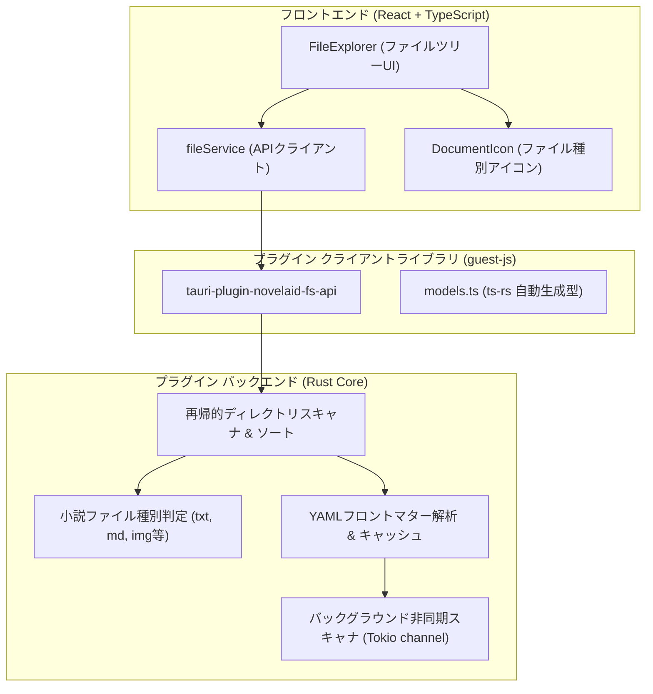

# ファイル操作基盤およびエクスプローラー仕様書

## 1. 概要

本ドキュメントは、小説執筆エディター **`novelaide`** における **ファイルアクセス基盤（`tauri-plugin-novelaid-fs`）** および **小説ファイルツリー（`FileExplorer`）** の設計仕様を定義するものです。

---

## 2. アーキテクチャ構成

ファイルアクセス処理は、アプリ本体から **`tauri-plugin-novelaid-fs` プラグイン** として完全に分離されています。

詳細なプラグインアーキテクチャおよび型生成手順については、[プラグインアーキテクチャおよびRust型定義自動生成仕様書](./プラグインアーキテクチャおよびRust型定義自動生成仕様.md) を参照してください。

---

## 3. ドキュメント種別と判定ロジック

小説執筆では、一般的なコードエディターとは異なり、本文原稿・プロット・設定資料・画像などを明確に区別することが執筆効率に直結します。
判定ロジックは Rust プラグイン側の Enum `NovelaidDocumentType` で厳密に定義され、`ts-rs` を介して TypeScript へ自動同期されます。

| 種別 (`NovelaidDocumentType`) | 拡張子 / 命名規則 | アイコン / 配色 | 用途 |
|---|---|---|---|
| **`novel`** | `.txt`, または「小説」「novel」を含むフォルダ | `FileText` (ブルー) | 本文ファイル |
| **`markdown`** | `.md`, または「設定」「プロット」「plot」を含むフォルダ | `BookOpen` (グリーン) | プロット・設定資料・キャラクター |
| **`image`** | `.png`, `.jpg`, `.webp`, `.svg` 等、または「画像」「image」を含むフォルダ | `Image` (ピンク) | 挿絵・キャラクターイラスト・世界地図 |
| **`chat`** | `.chat` | `MessageSquare` (パープル) | AIとの壁打ち対話履歴 |
| **`css`** | `.css` | `FileCode` (イエロー) | プレビュー・組版スタイルシート |
| **`unknown`** | その他のファイル | `FileCode` (グレー) | その他ファイル |

### 3.1 `.novelaidattributes` によるカスタマイズ判定
特定のフォルダ内の `.md` ファイルを小説原稿（`novel`）として扱いたい場合など、フォルダ直下に `.novelaidattributes` 設定ファイルを配置することでデフォルトの種別判定を上書きできます（非再帰・局所適用の原則）。

構文規則、ワイルドカード照合、判定アルゴリズムなどのプログラム言語に依存しない共通仕様は、共通ドキュメントリポジトリに集約されています：
- **共通仕様書**: [novelaidattributes 共通仕様](../../novelaid-editor-docs/docs/dev/novelaidattributes仕様.md)

---

## 4. 提供するプラグインAPI一覧

`tauri-plugin-novelaid-fs-api` から以下の関数がフロントエンド向けに提供されます。

| 関数名 | 引数 | 戻り値 | 説明 |
|---|---|---|---|
| `readDirectory` | `path: string`, `recursive?: boolean`, `parentType?: NovelaidDocumentType` | `Promise<NovelaidDirEntry[]>` | 指定フォルダ内のファイル・フォルダを再帰取得（`.` で始まる隠しフォルダは自動除外、ディレクトリ優先ソート） |
| `readDocument` | `path: string` | `Promise<NovelaidDocument>` | ファイル内容およびYAMLフロントマターを分離抽出して読み込み |
| `writeDocument` | `path: string`, `document: NovelaidDocument` | `Promise<void>` | フロントマターと本文を再結合してファイル書き込み |
| `createFile` | `path: string`, `content?: string` | `Promise<void>` | 新規ファイル作成（親ディレクトリも自動作成） |
| `createDirectory` | `path: string` | `Promise<void>` | 新規フォルダ作成（親ディレクトリも再帰作成） |
| `remove` | `path: string` | `Promise<void>` | ファイルまたはフォルダの削除 |
| `rename` | `oldPath: string`, `newPath: string` | `Promise<void>` | ファイルまたはフォルダの名前変更・移動 |
| `setProjectDirectory` | `path: string \| null` | `Promise<void>` | プロジェクトルートディレクトリの設定およびキャッシュクリア |
| `getProjectDirectory` | なし | `Promise<string \| null>` | 現在設定されているプロジェクトルートパスを取得 |
| `getMetadataCache` | なし | `Promise<Record<string, any>>` | バックグラウンドで非同期解析された全ドキュメントのメタデータキャッシュを取得 |

---

## 5. UIコンポーネント構成

- **`FileExplorer` (`src/components/FileExplorer/FileExplorer.tsx`)**:
  - 開いているプロジェクトの階層ツリーを再帰的に展開・折りたたみ表示。
  - 選択中ファイルのハイライト、アクティブドキュメントの管理。
- **`DocumentIcon` (`src/components/FileExplorer/DocumentIcon.tsx`)**:
  - `documentType` および `isDirectory` に応じて適切な Lucide アイコンと配色を適用。
