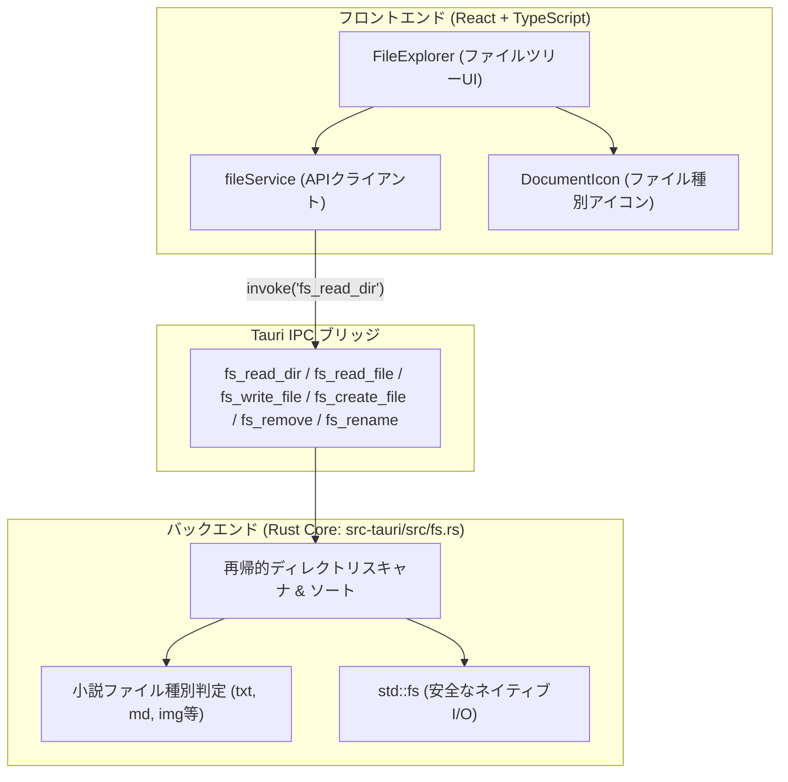
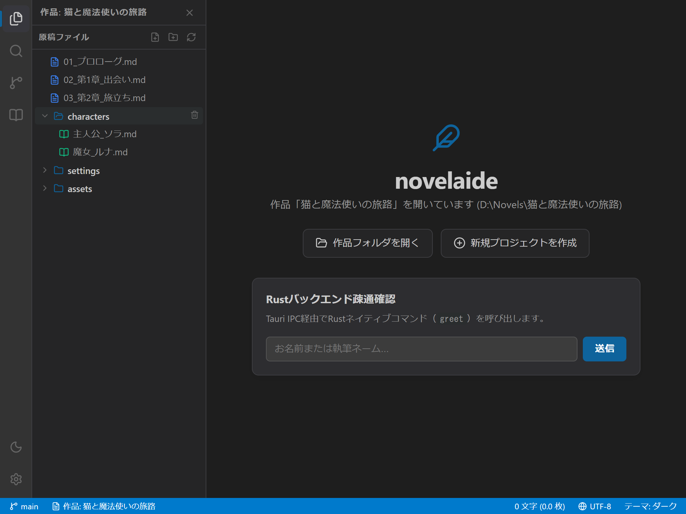
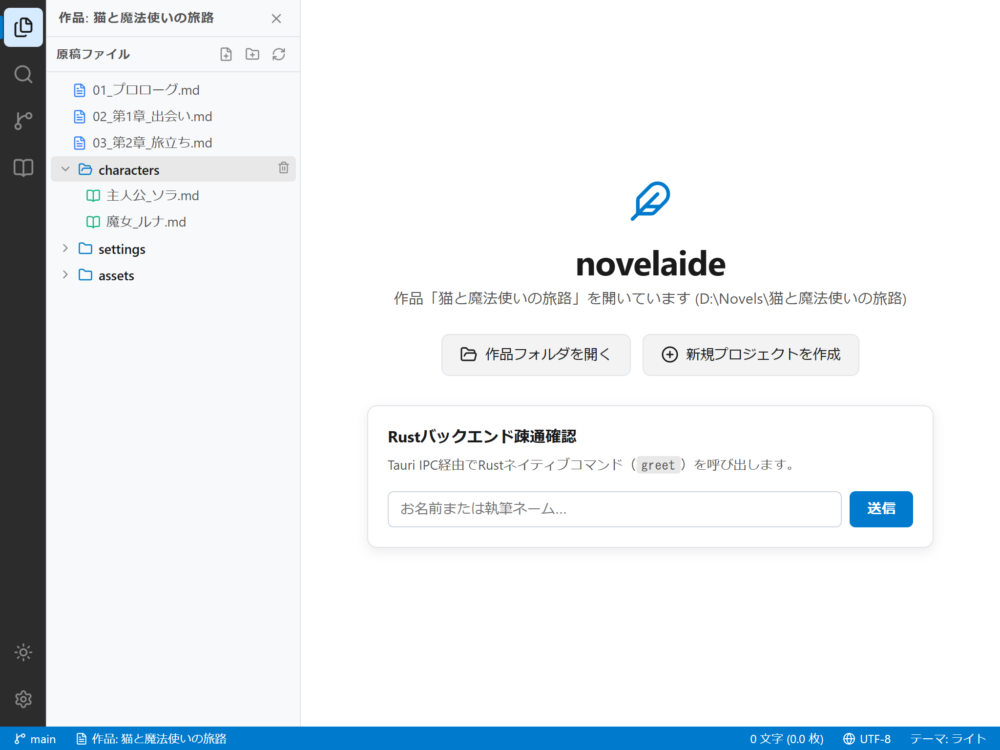
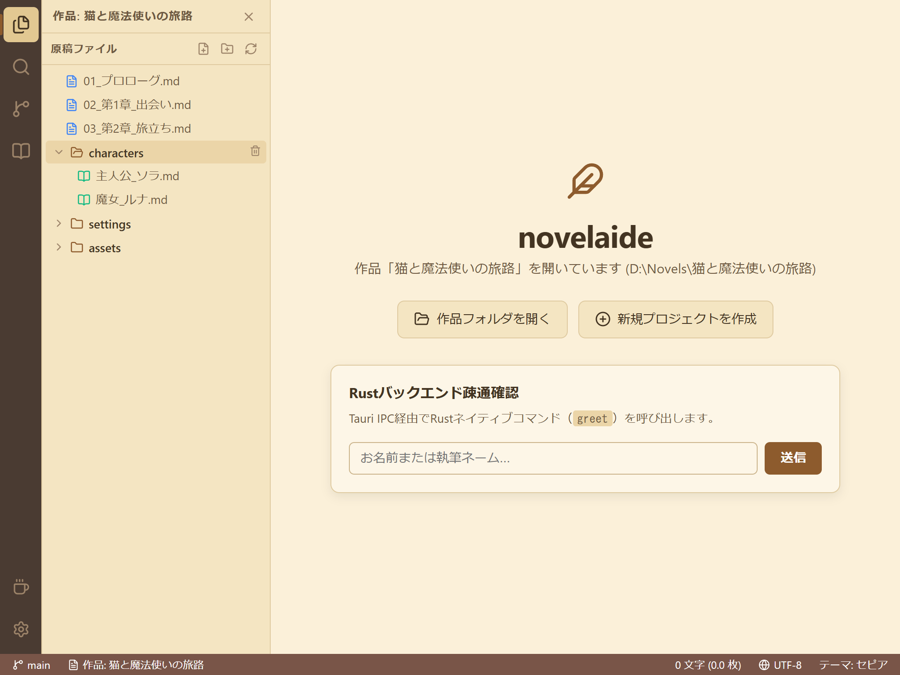

# ファイル操作基盤およびエクスプローラー仕様書

## 1. 概要

本ドキュメントは、小説執筆エディター **`novelaide`** における **ファイルアクセス基盤（RustバックエンドFSコマンド）** および **小説ファイルツリー（`FileExplorer`）** の設計仕様を定義するものです。

---

## 2. アーキテクチャ構成

---

## 3. ドキュメント種別と判定ロジック

小説執筆では、一般的なコードエディターとは異なり、本文原稿・プロット・設定資料・画像などを明確に区別することが執筆効率に直結します。

| 種別 (`DocumentType`) | 拡張子 / 命名規則 | アイコン / 配色 | 用途 |
|---|---|---|---|
| **`novel`** | `.txt`, または「小説」「novel」「原稿」を含むフォルダ | `FileText` (ブルー) | 本文ファイル |
| **`markdown`** | `.md`, または「設定」「プロット」「plot」を含むフォルダ | `BookOpen` (グリーン) | プロット・設定資料・キャラクター |
| **`image`** | `.png`, `.jpg`, `.webp`, `.svg` 等 | `Image` (ピンク) | 挿絵・キャラクターイラスト・世界地図 |
| **`chat`** | `.chat` | `MessageSquare` (パープル) | AIとの壁打ち対話履歴 |
| **`metadata`** | `.json`, `.yaml`, `.yml` | `FileCode` (オレンジ) | 作品メタデータ・設定 |
| **`directory`** | ディレクトリ全般 | `Folder` / `FolderOpen` (テーマアクセント色) | フォルダ（展開・折りたたみ対応） |

---

## 4. 提供するRust IPCコマンド一覧

| コマンド名 | 引数 | 戻り値 | 説明 |
|---|---|---|---|
| `fs_read_dir` | `path: String`, `recursive: bool` | `Vec<NovelaidDirEntry>` | 指定フォルダ内のファイル・フォルダを再帰取得（`.git` 等の隠しフォルダは自動除外、ディレクトリ優先ソート） |
| `fs_read_file` | `path: String` | `NovelaidDocument` | ファイル内容をUTF-8文字列として読み込み |
| `fs_write_file` | `path: String`, `content: String` | `()` | ファイルへの書き込み（親フォルダが存在しない場合は自動生成） |
| `fs_create_file`| `path: String` | `()` | 新規ファイルの作成（空ファイル） |
| `fs_create_dir` | `path: String` | `()` | 新規フォルダの作成（`create_dir_all`） |
| `fs_remove`     | `path: String` | `()` | ファイルまたはフォルダの削除 |
| `fs_rename`     | `old_path: String`, `new_path: String` | `()` | ファイルまたはフォルダの名前変更 |

---

## 5. UIスクリーンショット

作品フォルダーを開いた状態で、サイドパネルに原稿ツリーが展開されます。

### ダークモード

### ライトモード

### セピアモード（小説執筆特化）

