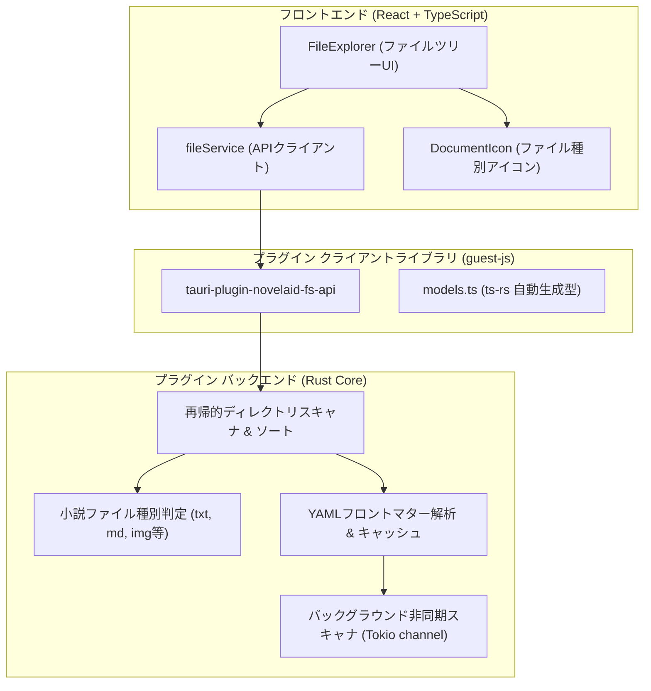

# ファイル操作基盤およびエクスプローラー仕様書

## 1. 概要

本ドキュメントは、小説執筆エディター **`novelaide`** における **ファイルアクセス基盤（`tauri-plugin-novelaid-fs`）** および **小説ファイルツリー（`FileExplorer`）** の設計仕様を定義するものです。

---

## 2. アーキテクチャ構成

ファイルアクセス処理は、アプリ本体から **`tauri-plugin-novelaid-fs` プラグイン** として完全に分離されています。

詳細なプラグインアーキテクチャおよび型生成手順については、[プラグインアーキテクチャおよびRust型定義自動生成仕様書](./プラグインアーキテクチャおよびRust型定義自動生成仕様.md) を参照してください。

---

## 3. ドキュメント種別と判定ロジック

小説執筆では、一般的なコードエディターとは異なり、本文原稿・プロット・設定資料・画像などを明確に区別することが執筆効率に直結します。
判定ロジックは Rust プラグイン側の Enum `NovelaidDocumentType` で厳密に定義され、`ts-rs` を介して TypeScript へ自動同期されます。

| 種別 (`NovelaidDocumentType`) | 拡張子 / 命名規則 | アイコン / 配色 | 用途 |
|---|---|---|---|
| **`novel`** | `.txt`, または「小説」「novel」を含むフォルダ | `FileText` (ブルー) | 本文ファイル |
| **`markdown`** | `.md`, または「設定」「プロット」「plot」を含むフォルダ | `BookOpen` (グリーン) | プロット・設定資料・キャラクター |
| **`image`** | `.png`, `.jpg`, `.webp`, `.svg` 等、または「画像」「image」を含むフォルダ | `Image` (ピンク) | 挿絵・キャラクターイラスト・世界地図 |
| **`chat`** | `.chat` | `MessageSquare` (パープル) | AIとの壁打ち対話履歴 |
| **`css`** | `.css` | `FileCode` (イエロー) | プレビュー・組版スタイルシート |
| **`unknown`** | その他のファイル | `FileCode` (グレー) | その他ファイル |

### 3.1 `.novelaidattributes` によるカスタマイズ判定
特定のフォルダ内の `.md` ファイルを小説原稿（`novel`）として扱いたい場合など、フォルダ直下に `.novelaidattributes` 設定ファイルを配置することでデフォルトの種別判定を上書きできます（非再帰・局所適用の原則）。

構文規則、ワイルドカード照合、判定アルゴリズムなどのプログラム言語に依存しない共通仕様は、共通ドキュメントリポジトリに集約されています：
- **共通仕様書**: [novelaidattributes 共通仕様](../../novelaid-editor-docs/docs/dev/novelaidattributes仕様.md)

---

## 4. 提供するプラグインAPI一覧

`tauri-plugin-novelaid-fs-api` から以下の関数がフロントエンド向けに提供されます。

| 関数名 | 引数 | 戻り値 | 説明 |
|---|---|---|---|
| `readDirectory` | `path: string`, `recursive?: boolean`, `parentType?: NovelaidDocumentType` | `Promise<NovelaidDirEntry[]>` | 指定フォルダ内のファイル・フォルダを再帰取得（`.` で始まる隠しフォルダは自動除外、ディレクトリ優先ソート） |
| `readDocument` | `path: string` | `Promise<NovelaidDocument>` | ファイル内容およびYAMLフロントマターを分離抽出して読み込み |
| `writeDocument` | `path: string`, `document: NovelaidDocument` | `Promise<void>` | フロントマターと本文を再結合してファイル書き込み |
| `createFile` | `path: string`, `content?: string` | `Promise<void>` | 新規ファイル作成（親ディレクトリも自動作成） |
| `createNextFile` | `dirPath: string` | `Promise<NovelaidDirEntry>` | フォルダー内の命名規則から次のファイル名を自動推測し、即時作成してファイル情報を返却 |
| `createDirectory` | `path: string` | `Promise<void>` | 新規フォルダ作成（親ディレクトリも再帰作成） |
| `remove` | `path: string` | `Promise<void>` | ファイルまたはフォルダの削除 |
| `rename` | `oldPath: string`, `newPath: string` | `Promise<void>` | ファイルまたはフォルダの名前変更・移動 |
| `setProjectDirectory` | `path: string \| null` | `Promise<void>` | プロジェクトルートディレクトリの設定およびキャッシュクリア |
| `getProjectDirectory` | なし | `Promise<string \| null>` | 現在設定されているプロジェクトルートパスを取得 |
| `getMetadataCache` | なし | `Promise<Record<string, any>>` | バックグラウンドで非同期解析された全ドキュメントのメタデータキャッシュを取得 |

---

## 5. UIコンポーネント構成

- **`FileExplorer` (`src/components/FileExplorer/FileExplorer.tsx`)**:
  - 開いているプロジェクトの階層ツリーを再帰的に展開・折りたたみ表示。
  - 選択中ファイルのハイライト、アクティブドキュメントの管理。
- **`DocumentIcon` (`src/components/FileExplorer/DocumentIcon.tsx`)**:
  - `documentType` および `isDirectory` に応じて適切な Lucide アイコンと配色を適用。

---

## 6. 新旧エディタ・CLIとの機能比較と実装状況

先行プロダクトである `novelaid-editor`（現行Electron版）および `novelaid-cli`（CLIツール）との比較に基づき、現在の `novelaide` のファイル操作・エクスプローラー機能の実装状況を以下に整理します。

### 6.1 バックエンド・ファイルシステム機能

| 機能 | `novelaide` (Tauri) | `novelaid-editor` (Electron) | `novelaid-cli` (CLI) | 状況・備考 |
| :--- | :--- | :--- | :--- | :--- |
| **ディレクトリ一覧** | `read_directory` （再帰/非再帰、隠しフォルダ除外） | `readDirectory` （再帰/非再帰、隠しフォルダ除外） | `listEntries` （現在位置一覧） | 実装済み |
| **非同期メタデータ抽出** | 実装済み （Tokioバックグラウンドキュー） | 実装済み （キュー方式） | 読み込み時パース | 実装済み |
| **ドキュメント読込・保存** | `read_document` `write_document` | `readDocument` `saveDocument` | `parseFrontmatter` / fs直接書込 | フロントマター分離・再構成対応 |
| **新規作成** | `create_file` `create_next_file`（自動推測生成） `create_directory` | `createFile` `createDirectory` | - | 実装済み（推測エンジン内蔵） |
| **未命名・連番命名** | 実装済み (`create_next_file`) | `createUntitledDocument` `getUniquePath` | - | バックエンド側推測エンジンにより完全対応 |
| **名前変更 (リネーム)** | `rename` | `rename` | - | 実装済み |
| **移動 (Move)** | `rename` で代用 | `move` | - | 実装済み（D&D移動連動） |
| **コピー (Copy)** | 実装済み (`copy` 再帰コピー対応) | `copy` (`fs.cp` 再帰) | - | バックエンド・ゲストAPI実装完了 |
| **削除 (Delete)** | `remove` (`fs::remove_dir_all` 等) | `delete` （タブ解放猶予後に `fs.rm`） | - | 実装済み（完全物理削除） |
| **属性判定** | 実装済み (`AttributesManager`) | 実装済み (`FileService`) | 実装済み (`attributes.ts`) | 3者共通仕様に完全準拠 |
| **外部ファイル監視** | ❌ 未実装 | `watcher.ts` (chokidar) `fs:onFileChange` | - | `notify` クレートによる監視が未実装 |

### 6.2 エクスプローラーUI・ファイル操作

| UI機能 / 操作 | `novelaide` (現状) | `novelaid-editor` (現行) | 改善方針 |
| :--- | :--- | :--- | :--- |
| **新規ファイル作成** | **ワンクリック即時作成 & 自動オープン** （既存ファイルから命名規則を自動推測） | 選択フォルダ直下にインライン作成 | **実装完了**（思考を止めない即時作成） |
| **新規フォルダー作成**| 選択コンテキストに応じたインライン作成 | 選択フォルダ直下にインライン作成 | **実装完了**（ツリー内インライン作成） |
| **名前変更** | **インライン編集** （F2キー / コンテキストメニュー対応） | 右クリックメニュー → **インライン編集** | **実装完了**（F2 / コンテキストメニュー連携） |
| **削除** | 行末ゴミ箱アイコン / コンテキストメニュー / Deleteキー（確認ダイアログ） | 右クリックメニュー → 確認ダイアログ | **実装完了**（コンテキストメニュー・Deleteキー対応） |
| **コンテキストメニュー**| **実装済み** （エクスプローラーで表示、新規作成、名前変更、パスコピー、削除） | **実装済み**（表示、名前変更、削除） | **実装完了**（右クリックメニュー新設） |
| **ドラッグ＆ドロップ** | **実装済み** （D&D移動、Ctrl+D&Dコピー、循環移動防止、タブ追従） | **実装済み**（D&D移動、Ctrl+D&Dコピー） | **実装完了**（直感的なファイル再編・複製） |
| **アクティブ追従** | **手動同期ボタン実装済み** （常時同期のツリー揺れを排除、ボタン押下時のみ親フォルダ展開＆スクロール） | **実装済み**（自動展開 & スクロール） | **実装完了**（ユーザー要望による手動同期方式） |
| **ファイル監視連動** | ❌ 未実装（手動リフレッシュのみ） | **リアルタイム部分リロード** | 外部変更時の自動更新 |

---

## 7. エクスプローラー改善・拡張ロードマップと進捗

以下のステップでエクスプローラーの操作性を段階的に現行エディタ水準へ引き上げます。

1. **ステップ1: ファイル作成先の柔軟化・ファイル名自動推測とインラインリネームの導入**
   - [x] **新規作成位置の柔軟化（実装完了）**:
     - 選択中のアイテム（フォルダならその中、ファイルなら同一親階層、未選択ならルート直下）を自動認識。
   - [x] **バックエンド側ファイル名自動推測エンジン (`create_next_file`) の実装（実装完了）**:
     - 既存ファイル群の `_` 区切りトークンを解析し、数値パート・話数パート・末尾番号（全角数字対応）のインクリメントおよび桁数ゼロパディングを自動算出。
     - 入力待ちを行わずワンクリックでファイルを作成し、エディターで即座に開いて本文執筆にフォーカス。
     - フォルダ作成はツリー内インライン入力を維持。
   - [x] **エキスパンダーヘッダーへのプロジェクトフォルダー・操作ボタン統合（実装完了）**:
     - 二重見出しを解消し、アコーディオンヘッダーに現在のプロジェクトフォルダー名（`projectName`）とフォルダーアイコン（📁）を直接表示。
     - 操作ボタン（新規ファイル、新規フォルダー、再読み込み）をヘッダー右端（`headerActions`）に集約し、ツリーの縦スクロールに影響されず常に最上部に固定表示。
     - `FileExplorerContext` によりヘッダーアクションとツリー状態を完全同期。
   - [x] **インライン名前変更（リネーム）の実装（実装完了）**:
     - F2キーおよび右クリックコンテキストメニューからのインライン名前変更（Enterで確定、Escapeでキャンセル）を実装。
     - 入力フォーカス時に拡張子（`.txt`, `.md`）を除いたベースネーム部分を自動選択。
     - リネーム成功時、開いているエディタタブ（`openDocuments`）のパスを自動追従。
2. **ステップ2: 右クリック・コンテキストメニューの実装**
   - [x] **ファイル／フォルダーの右クリックメニュー（`FileContextMenu`）の実装（実装完了）**:
     - 項目: 「エクスプローラーで表示 (revealItemInDir)」「新規原稿ファイル作成」「新規フォルダー作成」「名前を変更 (F2)」「パスのコピー」「相対パスのコピー」「削除 (Delete)」。
     - ウィンドウ端でのメニュー見切れを防ぐ自動座標補正、外側クリック/Escapeキーでの自動クローズ。
3. **ステップ3: ドラッグ＆ドロップ（D&D）によるファイル移動・コピー（実装完了）**
   - [x] **Tauri設定におけるHTML5 D&Dの有効化 (`tauri.conf.json`)**:
     - `app.windows[0]` に `"dragDropEnabled": false` を設定。OSネイティブの外部ドロップ待機を無効化し、WebView内でのHTML5ドラッグ＆ドロップイベントの正常発火を保証。
   - [x] **バックエンド側 `copy` API の実装 (`tauri-plugin-novelaid-fs`)**:
     - 単一ファイルおよびディレクトリ再帰コピーのRustコマンド (`copy`)、ゲストJS API (`copy`)、パーミッション (`allow-copy`) を実装。
   - [x] **エクスプローラー・ツリーのD&D操作対応**:
     - HTML5 Drag and Drop API によるノードのドラッグ＆ドロップ移動。
     - ドラッグ中の半透明表示 (`dragging`)、ドロップ先フォルダーおよびルート背景のハイライト表示 (`drag-over`, `drag-over-root`)。
     - `Ctrl` キー押下時のコピーモード切り替え（移動ではなく複製を実行し、`〜 - コピー` の重複回避パスを自動付与）。
     - 移動時、開かれているエディタタブ（`openDocuments`）のパス自動追従（フォルダ配下のドキュメントも一括追従）。
   - [x] **循環移動・不正ドロップの防止ガード**:
     - 同一フォルダーへの移動や、自身またはその配下（子孫フォルダー）への移動禁止判定。
4. **ステップ4: アクティブファイル追従（Reveal）とファイル監視（Watcher）**
   - [x] **手動アクティブファイル追従（Reveal）ボタンの実装（実装完了）**:
     - 常時自動追従による「頻繁なツリースクロールや意図しない位置ズレで使いづらい」問題を解消するため、**ヘッダーの同期ボタン（Locateアイコン）を押下した時のみ追従する方式**を採用。
     - 押下時にプロジェクトルートから対象ファイルまでの親ディレクトリ群を展開し、該当行へスムーズスクロール（`scrollIntoView`）。
   - [ ] Rust側での `notify` クレートによる外部変更検知と、フロントエンドでのピンポイント部分リロード。

---

## 8. 次回作業計画（詳細タスクリスト）

次回再開時は以下の順序で作業を実施します。

1. **ステップ4後半: 外部ファイル監視（Watcher）の統合とリアルタイム自律同期**:
   - `tauri-plugin-novelaid-fs` において、`notify` クレートを用いたプロジェクトフォルダ内の外部ファイル監視を実装。
   - 外部エディタやGit操作による変更を検知した際にも、共通の `fs:changed` イベントを発行。
   - 今回整備したフロントエンド側のイベント購読機構（ツリー再読み込み・タブ追従・タブ破棄）とシームレスに結合。
2. **メイキング記事の執筆・更新 (`making/notes/`)**:
   - 直近で実現した「思考を止めないファイル自動推測作成」「エクスプローラー刷新」「コンテキストメニュー」「D&D移動・コピー」「バックエンド主導型コマンド実行とイベント駆動同期」をテーマにしたメイキング連載記事を執筆。

