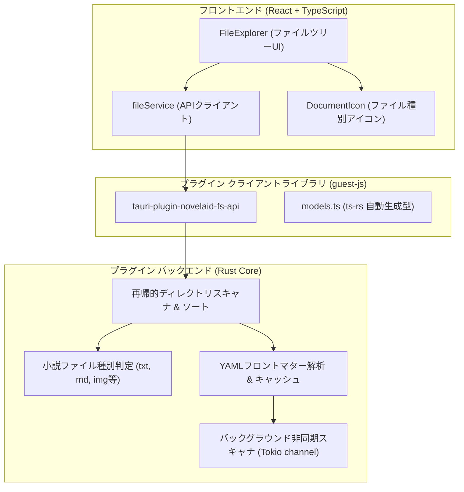

# ファイル操作基盤およびエクスプローラー仕様書

## 1. 概要

本ドキュメントは、小説執筆エディター **`novelaide`** における **ファイルアクセス基盤（`tauri-plugin-novelaid-fs`）** および **小説ファイルツリー（`FileExplorer`）** の設計仕様を定義するものです。

---

## 2. アーキテクチャ構成

ファイルアクセス処理は、アプリ本体から **`tauri-plugin-novelaid-fs` プラグイン** として完全に分離されています。

詳細なプラグインアーキテクチャおよび型生成手順については、[プラグインアーキテクチャおよびRust型定義自動生成仕様書](./プラグインアーキテクチャおよびRust型定義自動生成仕様.md) を参照してください。

---

## 3. ドキュメント種別と判定ロジック

小説執筆では、一般的なコードエディターとは異なり、本文原稿・プロット・設定資料・画像などを明確に区別することが執筆効率に直結します。
判定ロジックは Rust プラグイン側の Enum `NovelaidDocumentType` で厳密に定義され、`ts-rs` を介して TypeScript へ自動同期されます。

| 種別 (`NovelaidDocumentType`) | 拡張子 / 命名規則 | アイコン / 配色 | 用途 |
|---|---|---|---|
| **`novel`** | `.txt`, または「小説」「novel」を含むフォルダ | `FileText` (ブルー) | 本文ファイル |
| **`markdown`** | `.md`, または「設定」「プロット」「plot」を含むフォルダ | `BookOpen` (グリーン) | プロット・設定資料・キャラクター |
| **`image`** | `.png`, `.jpg`, `.webp`, `.svg` 等、または「画像」「image」を含むフォルダ | `Image` (ピンク) | 挿絵・キャラクターイラスト・世界地図 |
| **`chat`** | `.chat` | `MessageSquare` (パープル) | AIとの壁打ち対話履歴 |
| **`css`** | `.css` | `FileCode` (イエロー) | プレビュー・組版スタイルシート |
| **`unknown`** | その他のファイル | `FileCode` (グレー) | その他ファイル |

### 3.1 `.novelaidattributes` によるカスタマイズ判定
特定のフォルダ内の `.md` ファイルを小説原稿（`novel`）として扱いたい場合など、フォルダ直下に `.novelaidattributes` 設定ファイルを配置することでデフォルトの種別判定を上書きできます（非再帰・局所適用の原則）。

構文規則、ワイルドカード照合、判定アルゴリズムなどのプログラム言語に依存しない共通仕様は、共通ドキュメントリポジトリに集約されています：
- **共通仕様書**: [novelaidattributes 共通仕様](../../novelaid-editor-docs/docs/dev/novelaidattributes仕様.md)

---

## 4. 提供するプラグインAPI一覧

`tauri-plugin-novelaid-fs-api` から以下の関数がフロントエンド向けに提供されます。

| 関数名 | 引数 | 戻り値 | 説明 |
|---|---|---|---|
| `readDirectory` | `path: string`, `recursive?: boolean`, `parentType?: NovelaidDocumentType` | `Promise<NovelaidDirEntry[]>` | 指定フォルダ内のファイル・フォルダを再帰取得（`.` で始まる隠しフォルダは自動除外、ディレクトリ優先ソート） |
| `readDocument` | `path: string` | `Promise<NovelaidDocument>` | ファイル内容およびYAMLフロントマターを分離抽出して読み込み |
| `writeDocument` | `path: string`, `document: NovelaidDocument` | `Promise<void>` | フロントマターと本文を再結合してファイル書き込み |
| `createFile` | `path: string`, `content?: string` | `Promise<void>` | 新規ファイル作成（親ディレクトリも自動作成） |
| `createDirectory` | `path: string` | `Promise<void>` | 新規フォルダ作成（親ディレクトリも再帰作成） |
| `remove` | `path: string` | `Promise<void>` | ファイルまたはフォルダの削除 |
| `rename` | `oldPath: string`, `newPath: string` | `Promise<void>` | ファイルまたはフォルダの名前変更・移動 |
| `setProjectDirectory` | `path: string \| null` | `Promise<void>` | プロジェクトルートディレクトリの設定およびキャッシュクリア |
| `getProjectDirectory` | なし | `Promise<string \| null>` | 現在設定されているプロジェクトルートパスを取得 |
| `getMetadataCache` | なし | `Promise<Record<string, any>>` | バックグラウンドで非同期解析された全ドキュメントのメタデータキャッシュを取得 |

---

## 5. UIコンポーネント構成

- **`FileExplorer` (`src/components/FileExplorer/FileExplorer.tsx`)**:
  - 開いているプロジェクトの階層ツリーを再帰的に展開・折りたたみ表示。
  - 選択中ファイルのハイライト、アクティブドキュメントの管理。
- **`DocumentIcon` (`src/components/FileExplorer/DocumentIcon.tsx`)**:
  - `documentType` および `isDirectory` に応じて適切な Lucide アイコンと配色を適用。

---

## 6. 新旧エディタ・CLIとの機能比較と実装状況

先行プロダクトである `novelaid-editor`（現行Electron版）および `novelaid-cli`（CLIツール）との比較に基づき、現在の `novelaide` のファイル操作・エクスプローラー機能の実装状況を以下に整理します。

### 6.1 バックエンド・ファイルシステム機能

| 機能 | `novelaide` (Tauri) | `novelaid-editor` (Electron) | `novelaid-cli` (CLI) | 状況・備考 |
| :--- | :--- | :--- | :--- | :--- |
| **ディレクトリ一覧** | `read_directory` （再帰/非再帰、隠しフォルダ除外） | `readDirectory` （再帰/非再帰、隠しフォルダ除外） | `listEntries` （現在位置一覧） | 実装済み |
| **非同期メタデータ抽出** | 実装済み （Tokioバックグラウンドキュー） | 実装済み （キュー方式） | 読み込み時パース | 実装済み |
| **ドキュメント読込・保存** | `read_document` `write_document` | `readDocument` `saveDocument` | `parseFrontmatter` / fs直接書込 | フロントマター分離・再構成対応 |
| **新規作成** | `create_file` `create_directory` | `createFile` `createDirectory` | - | 実装済み |
| **未命名・連番命名** | ❌ 未実装 | `createUntitledDocument` `getUniquePath` | - | `新規小説(2).txt` 等の自動連番命名 |
| **名前変更 (リネーム)** | `rename` | `rename` | - | 実装済み |
| **移動 (Move)** | `rename` で代用 | `move` | - | 独立API化の検討余地あり |
| **コピー (Copy)** | ❌ 未実装 | `copy` (`fs.cp` 再帰) | - | バックエンド側未実装 |
| **削除 (Delete)** | `remove` (`fs::remove_dir_all` 等) | `delete` （タブ解放猶予後に `fs.rm`） | - | 実装済み（完全物理削除） |
| **属性判定** | 実装済み (`AttributesManager`) | 実装済み (`FileService`) | 実装済み (`attributes.ts`) | 3者共通仕様に完全準拠 |
| **外部ファイル監視** | ❌ 未実装 | `watcher.ts` (chokidar) `fs:onFileChange` | - | `notify` クレートによる監視が未実装 |

### 6.2 エクスプローラーUI・ファイル操作

| UI機能 / 操作 | `novelaide` (現状) | `novelaid-editor` (現行) | 改善方針 |
| :--- | :--- | :--- | :--- |
| **新規作成先** | **選択コンテキストに応じたインライン作成** （選択フォルダ直下 / 親階層 / ルート） | 選択フォルダ直下にインライン作成 | **実装完了**（ツリー内インライン作成対応） |
| **名前変更** | ❌ UI操作なし | 右クリックメニュー → **インライン編集** | F2キー / メニューからのインラインリネーム導入 |
| **削除** | 行末のゴミ箱アイコン（確認ダイアログ） | 右クリックメニュー → 確認ダイアログ | コンテキストメニューへの統合 |
| **コンテキストメニュー**| ❌ なし | **実装済み**（表示、名前変更、削除） | 右クリックメニューの新設 |
| **ドラッグ＆ドロップ** | ❌ 未実装 | **実装済み**（D&D移動、Ctrl+D&Dコピー） | D&D移動・コピー・循環移動防止の導入 |
| **アクティブ追従** | ❌ 未実装 | **実装済み**（自動展開 & スクロール） | Reveal機能の実装 |
| **ファイル監視連動** | ❌ 未実装（手動リフレッシュのみ） | **リアルタイム部分リロード** | 外部変更時の自動更新 |

---

## 7. エクスプローラー改善・拡張ロードマップと進捗

以下のステップでエクスプローラーの操作性を段階的に現行エディタ水準へ引き上げます。

1. **ステップ1: ファイル作成先の柔軟化とインラインリネームの導入**
   - [x] **新規作成位置の柔軟化（実装完了）**:
     - 選択中のアイテム（フォルダならその中、ファイルなら同一親階層、未選択ならルート直下）を自動認識。
     - 対象フォルダを自動展開し、ツリー内の該当階層に直接インライン入力行（アイコン付き）を表示。
     - Enterで作成確定（作成後エディタ自動オープン）、Escapeでキャンセル。
     - ツールバーボタンに作成先ターゲットの動的ヒントツールチップを表示。
   - [ ] **インライン名前変更（リネーム）の実装**:
     - F2キーおよびUIアクションからのインライン名前変更（Enterで確定、Escapeでキャンセル）の実装。
2. **ステップ2: 右クリック・コンテキストメニューの実装**
   - ツリーアイテムの右クリックメニュー（「OSのエクスプローラーで開く」「名前を変更」「削除」「パスをコピー」等）の新設。
3. **ステップ3: ドラッグ＆ドロップ（D&D）によるファイル移動・コピー**
   - ツリー内での直感的なD&D移動、Ctrlキー押下によるコピー、自分自身や子孫フォルダーへの移動禁止ガードの実装。
4. **ステップ4: アクティブファイル追従（Reveal）とファイル監視（Watcher）**
   - 開いたドキュメントに対応するツリーノードの自動展開・スクロール表示（Reveal機能）。
   - Rust側での `notify` クレートによる外部変更検知と、フロントエンドでのピンポイント部分リロード。

