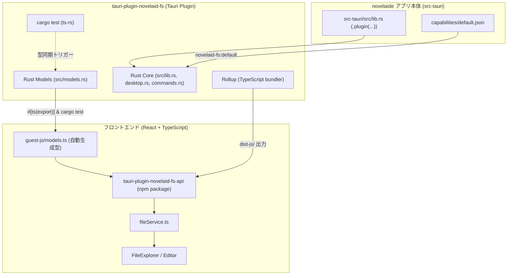

# プラグインアーキテクチャおよびRust型定義自動生成仕様書

## 1. 概要

本ドキュメントは、**`novelaide`** における **プラグイン分離設計（Tauri Plugin Architecture）** および **RustからTypeScriptへの型定義自動生成（`ts-rs`）** のシステム構成と運用仕様を定義するものです。

小説エディターとして今後追加される機能（ファイルアクセス、Git連携、AI対話、EPUB出力など）をアプリ本体から分離し、疎結合かつ堅牢な設計を維持することを目的とします。

---

## 2. プラグイン分離の設計思想

### なぜプラグインとして分離するのか

1. **関心事の分離（Separation of Concerns）**:
   - アプリ本体（UI/エディタ操作）と OS依存・低レイヤ操作（ファイルI/O、非同期キャッシュ、プロセス制御）の責任境界を明確化。
2. **単体テストと独立した検証**:
   - プラグインクレート単体で `cargo test` によるユニットテストや型生成を高速に実行可能。
3. **将来的な再利用性とモジュール性**:
   - Tauriのプラグインエコシステムに準拠し、将来的に別アプリへの転用やコミュニティへの公開、WASM版への差し替えが容易。
4. **型安全性の担保**:
   - Rust側のデータ構造（EnumやStruct）を変更した際、TypeScript側の型不整合をコンパイル時・型チェック時に即座に検知。

---

## 3. 全体アーキテクチャ構成



---

## 4. Rust型からTypeScript型への自動生成（`ts-rs`）

### 4.1 仕組み

Rustクレート **`ts-rs` (v12)** を使用し、構造体や列挙型（Enum）に `#[derive(TS)]` を付与することで、Rustのデータ型に対応する TypeScript の `type` 定義を自動生成します。

```rust
// tauri-plugin-novelaid-fs/src/models.rs
use serde::{Deserialize, Serialize};
use ts_rs::TS;

#[derive(TS, Debug, Clone, Copy, PartialEq, Eq, Serialize, Deserialize)]
#[ts(export, export_to = "../guest-js/models.ts")]
#[serde(rename_all = "camelCase")]
pub enum NovelaidDocumentType {
    Novel,
    Markdown,
    Image,
    Chat,
    GitDiff,
    Browser,
    Css,
    Unknown,
    External,
}

#[derive(Debug, Clone, Serialize, Deserialize, TS)]
#[ts(export, export_to = "../guest-js/models.ts")]
#[serde(rename_all = "camelCase")]
pub struct NovelaidDirEntry {
    pub name: String,
    pub path: String,
    pub base_name: String,
    pub file_title: String,
    pub is_directory: bool,
    pub document_type: NovelaidDocumentType,
    pub children: Option<Vec<NovelaidDirEntry>>,
}
```

`cargo test` を実行すると、`ts-rs` がテストスイート内で型定義を評価し、`guest-js/models.ts` へ以下のTypeScriptコードを自動出力します。

```typescript
// tauri-plugin-novelaid-fs/guest-js/models.ts
// This file was generated by [ts-rs](https://github.com/Aleph-Alpha/ts-rs). Do not edit this file manually.

export type NovelaidDirEntry = {
  name: string;
  path: string;
  baseName: string;
  fileTitle: string;
  isDirectory: boolean;
  documentType: NovelaidDocumentType;
  children: Array<NovelaidDirEntry> | null;
};

export type NovelaidDocument = {
  path: string;
  baseName: string;
  fileTitle: string;
  content: string;
  metadata: any;
  documentType: NovelaidDocumentType;
};

export type NovelaidDocumentType =
  | "novel"
  | "markdown"
  | "image"
  | "chat"
  | "gitDiff"
  | "browser"
  | "css"
  | "unknown"
  | "external";
```

---

## 5. 開発ワークフローとビルドコマンド

型定義の変更からフロントエンドへの反映は、以下のnpmスクリプト1回で完結します。

```bash
# novelaide ルートディレクトリにて実行
npm run typegen
```

### コマンドの内訳

1. **`cargo test --manifest-path tauri-plugin-novelaid-fs/Cargo.toml`**
   - プラグインクレートのテストを実行し、`ts-rs` により `guest-js/models.ts` を出力。
2. **`npm run build:plugin` (`rollup -c`)**
   - `guest-js/` を Rollup でコンパイルし、`dist-js/` 配下に ESM / CJS / `.d.ts` 定義ファイルを生成。
3. **フロントエンド側の型同期**
   - `fileService.ts` やコンポーネントが即座に最新の型定義を参照可能。

---

## 6. 今後のプラグイン分離計画

`novelaide` では、ファイルアクセスに留まらず、以下のモジュールについても順次プラグイン分離を実施していきます。

| プラグイン予定名 | 担当機能 | 分離のメリット |
|---|---|---|
| **`tauri-plugin-novelaid-fs`** | ファイルI/O、フロントマター解析、非同期メタデータキャッシュ | 済（高負荷I/Oの非同期隔離、型自動生成） |
| **`tauri-plugin-novelaid-git`** | 執筆履歴管理、リビジョン分岐・マージ、Git差分抽出 | Gitコマンド実行やlibgit2の隔離、UIの軽量化 |
| **`tauri-plugin-novelaid-ai`** | ローカル/リモートLLM接続、推敲・校正アシスト、プロンプト管理 | ストリーミング通信やAPIキー保護の局所化 |
| **`tauri-plugin-novelaid-export`**| EPUB, PDF, テキスト原稿出力、縦書きフォーマット整形 | 出力エンジン依存関係（PandocやCSS Paged Media）の分離 |
