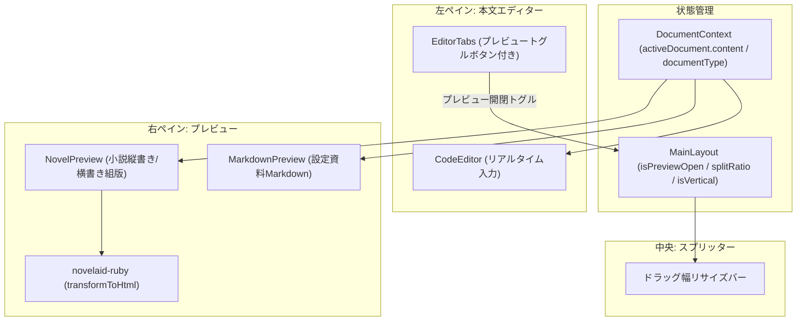

# プレビュー機能およびスプリットビュー仕様書

## 1. 概要と設計理念

本ドキュメントは、**`novelaide`** における **小説組版プレビュー（縦書き・横書き）、Markdownプレビュー、およびエディターとの左右分割表示（スプリットビュー）** の実装仕様を定義するものです。

### 小説執筆におけるプレビューの意義
- **読者視点でのテンポ確認**:
  エディター上の横書き原稿では気づきにくい「行頭の揃い」「会話文の連続感」「地の文のボリューム」を、文庫本と同じ縦書き組版でリアルタイムに確認できます。
- **ルビ・傍点の仕上がり確認**:
  独自記法（`｜親文字《るび》`、`《《強調》》`）が実際の組版でどうレンダリングされるかを `<ruby>` / `<rt>` タグで正確に確認できます。
- **2画面リアルタイム連動（スプリットビュー）**:
  左側で執筆しながら、右側に読者目線の縦書きプレビューを並べて表示することで、推敲速度と文章の完成度を飛躍させます。

---

## 2. アーキテクチャ構成

---

## 3. コンポーネント仕様

### 3.1. `NovelPreview.tsx` & `NovelPreview.css`（小説組版プレビュー）
現行 `novelaid-editor` の `NovelPreview` をベースに構築します。

* **プロパティ**: `content: string`, `documentType?: NovelaidDocumentType`
* **ルビ・傍点変換**:
  `novelaid-ruby` の `transformToHtml(text)` を使用して、カクヨム/なろう記法を組版用HTMLへ変換。
* **ツールバー**:
  - `[横書きへ]` / `[縦書きへ]` 切り替えボタン（`Type` / `Languages` アイコン）
* **スタイル設計**:
  - **縦書きモード (`vertical-rl`)**:
    - `writing-mode: vertical-rl`
    - `text-orientation: upright`
    - 右から左へのスクロール（`flex-direction: row-reverse`）
  - **文庫本用紙スタイル (`novel-page`)**:
    - 本物の書籍のような余白（`padding: 40px 50px`）とドロップシャドウ。
    - セピアテーマ時は生成り色用紙（`#F4ECD8`）と墨色フォントにより、文庫本そのものの読書体験を再現。

### 3.2. `MarkdownPreview.tsx` & `MarkdownPreview.css`（マークダウンプレビュー）
* プロットや設定資料（`.md`）の閲覧用。
* 見出し、箇条書き、テーブル、引用を美しくレンダリング。

### 3.3. スプリットビュー制御（`MainLayout.tsx`）
* **`isPreviewOpen` ステート**:
  - デフォルトは `false`（エディター全画面）。
  - エディタータブバー右端の「プレビュー表示ボタン（`BookOpen`）」をクリックすると `true` になり、画面が左右2分割（デフォルト 50:50）で表示される。
* **スプリッタードラッグ**:
  - 中央の分割バーを左右にドラッグして、エディターとプレビューの比率を自由に調整可能。

---

## 4. 実装ステップ計画

1. **Step 4.2.1: `NovelPreview.tsx` & `NovelPreview.css` の作成**
   - `novelaid-ruby` の `transformToHtml` によるルビ・傍点変換
   - 縦書き（`vertical-rl`）および横書きの切り替えロジック
   - 文庫本用紙風のスタイリング（ダーク・ライト・セピア連動）
2. **Step 4.2.2: `MarkdownPreview.tsx` & `MarkdownPreview.css` の作成**
   - 設定資料・マークダウンファイルの閲覧ビュー
3. **Step 4.3.1: エディタータブバーおよび `MainLayout.tsx` へのスプリット統合**
   - `EditorTabs.tsx` 右端にプレビュー表示トグルボタンを追加
   - `MainLayout.tsx` でエディターとプレビューの左右2ペインレイアウトを実装
4. **Step 4.3.2: スプリッター（ドラッグリサイズ）の実装**
   - マウスドラッグによるペイン幅の動的調整
5. **Step 4.3.3: 自動撮影 & ドキュメント作成**
   - 縦書きプレビューおよび左右スプリットビュー画面の自動スクリーンショット撮影
   - ユーザーマニュアルおよびメイキング記事の作成
