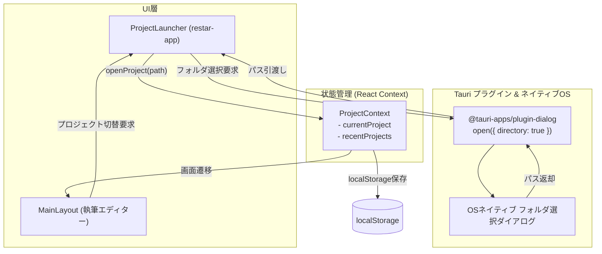
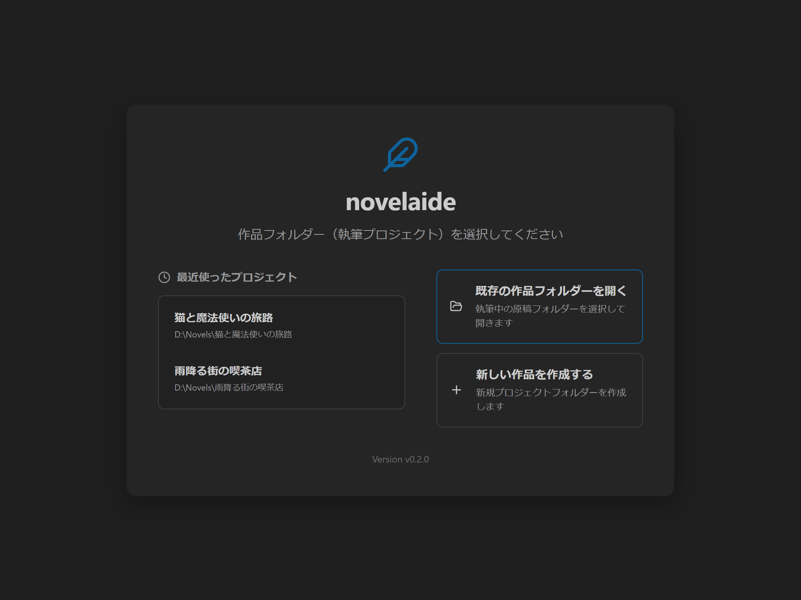
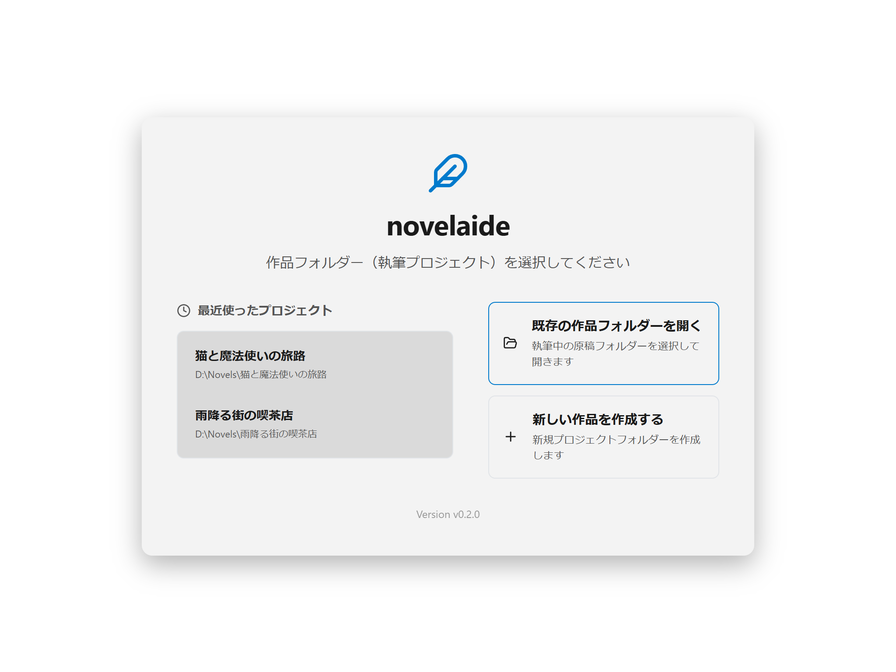
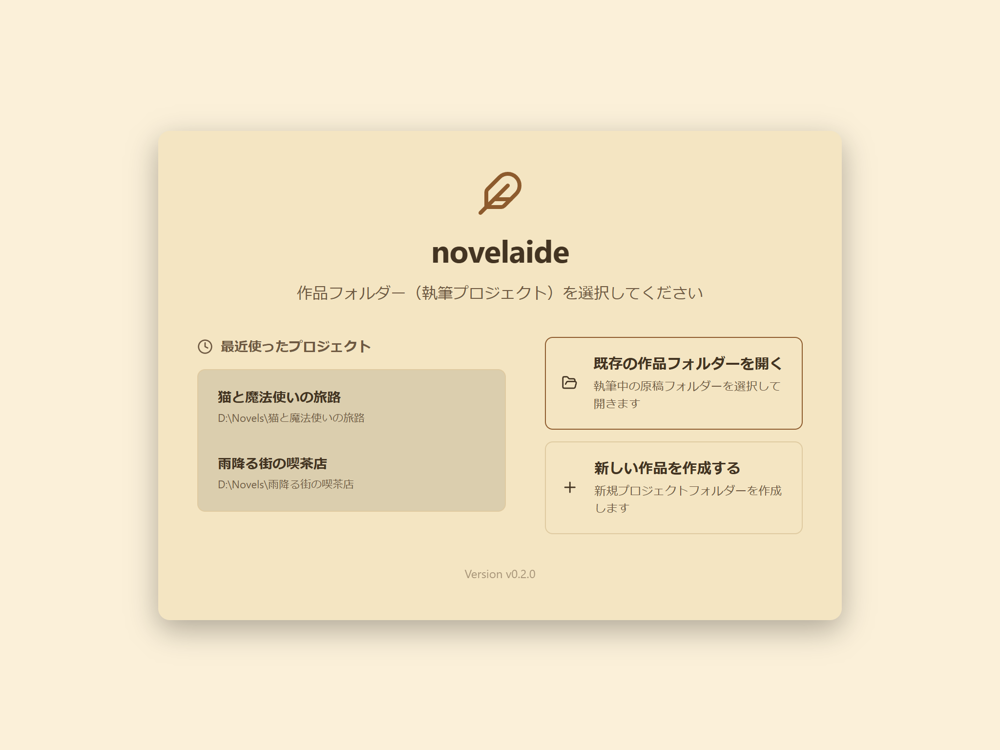

# プロジェクト選択および管理仕様書

## 1. 概要

本ドキュメントは、小説執筆エディター **`novelaide`** における **プロジェクト選択・ランチャー画面（`ProjectLauncher`）** および **プロジェクト状態管理（`ProjectContext`）** の設計仕様を定義するものです。

UI層には自作の共通コンポーネントライブラリ **`restar-app`** の `ProjectLauncher` を採用しています。

---

## 2. アーキテクチャとコンポーネント連携

---

## 3. 主要機能と仕様

### 3.1 `ProjectContext` 仕様
- **管理する状態**:
  - `projectPath: string | null`: 現在開いている作品フォルダーの絶対パス
  - `projectName: string | null`: 作品タイトル（フォルダー名から自動導出または指定名称）
  - `recentProjects: ProjectItem[]`: 最近開いた作品リスト（最大10件、`localStorage` 永続化）
- **提供する操作関数**:
  - `openProject(path: string, customName?: string)`: 作品を開き、最近のプロジェクト先頭に追加
  - `closeProject()`: プロジェクトを閉じ、ランチャー画面へ遷移
  - `removeRecentProject(path: string)`: 履歴一覧から指定パスを削除

### 3.2 `ProjectLauncherPage` 仕様
- **採用ライブラリ**: `restar-app` (`ProjectLauncher`)
- **テーマ連動**: `novelaide` の CSS変数（`--bg-primary`, `--bg-secondary`, `--text-primary`, `--accent-color` 等）に完全自動追従
- **フォルダ選択ダイアログ**: Tauri 2.x の `@tauri-apps/plugin-dialog`（Rust側 `tauri-plugin-dialog`）を呼び出し、OSネイティブのフォルダ選択ウィンドウを表示

---

## 4. UIスクリーンショット

### ダークモード

### ライトモード

### セピアモード（小説執筆特化）

