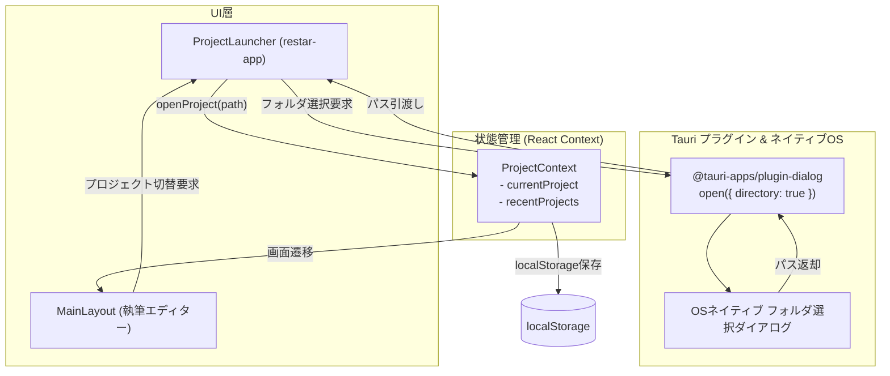
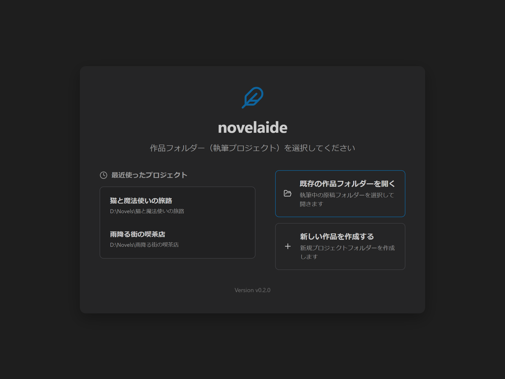
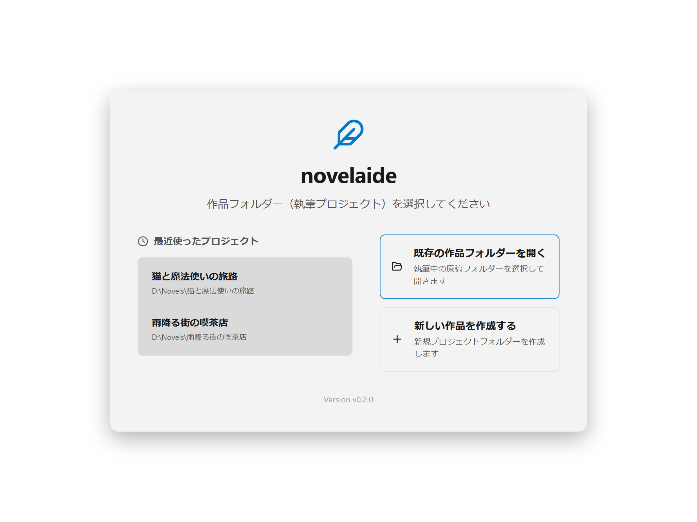
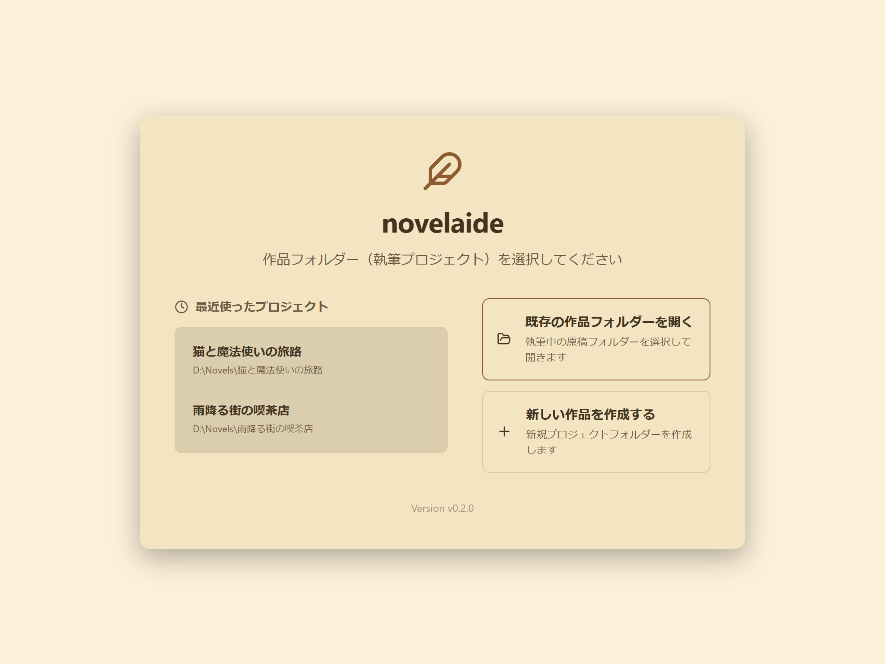

# プロジェクト選択および管理仕様書

[← 開発仕様書一覧に戻る](./index.md) ｜ [トップポータル](../index.md)

## 1. 概要

本ドキュメントは、小説執筆エディター **`novelaide`** における **プロジェクト選択・ランチャー画面（`ProjectLauncher`）** および **プロジェクト状態管理（`ProjectContext`）** の設計仕様を定義するものです。

UI層には自作の共通コンポーネントライブラリ **`restar-app`** の `ProjectLauncher` を採用しています。

---

## 2. アーキテクチャとコンポーネント連携

---

## 3. 主要機能と仕様

### 3.1 `ProjectContext` 仕様
- **管理する状態**:
  - `projectPath: string | null`: 現在開いている作品フォルダーの絶対パス
  - `projectName: string | null`: 作品タイトル（フォルダー名から自動導出または指定名称）
  - `recentProjects: ProjectItem[]`: 最近開いた作品リスト（最大10件、`localStorage` 永続化）
- **提供する操作関数**:
  - `openProject(path: string, customName?: string)`: 作品を開き、最近のプロジェクト先頭に追加。**既存プロジェクトが開かれている場合は、事前に `closeProject()` を呼び出して未保存ドキュメントの保存と状態クリアを完了してから新プロジェクトをロード**する。
  - `closeProject()`: 非同期関数。登録されたクローズハンドラ（`DocumentContext` の `closeAllDocuments` 等）を実行して未保存ドキュメントの安全な保存とドキュメント破棄を行い、プロジェクト状態をクリアする。
  - `registerCloseHandler(handler)`: プロジェクトクローズ時に実行すべき処理（未保存ドキュメントの自動保存・タブ破棄等）を外部コンテキスト（`DocumentContext`）から登録するフック。
  - `removeRecentProject(path: string)`: 履歴一覧から指定パスを削除

### 3.2 アプリ終了（Window Close）ライフサイクル仕様
- **フック**: `useWindowCloseHandler`
- **目的**: アプリケーション終了時に未保存原稿をディスクに安全保存し、次回起動時もその作品を即座に再開できるようにする（作品選択画面への画面リセットは行わない）。
- **Tauri ネイティブイベント連携**:
  - `@tauri-apps/api/window` の `getCurrentWindow().onCloseRequested` を購読。
  - ウィンドウの「×」ボタンが押下された際、一旦イベントの即時破棄を抑止（`event.preventDefault()`）。
  - `saveAllDocuments()` を実行し、開いている未保存ドキュメントをすべて自動保存。プロジェクト状態（`projectPath`）や `localStorage` の起動キーはそのまま保持。
  - ケーパビリティ（`core:window:allow-destroy`, `core:window:allow-close`）に基づき、`getCurrentWindow().destroy()` を呼び出してウィンドウを破棄。
  - 万一の例外発生時もフォールバックとして `@tauri-apps/plugin-process` の `exit(0)` により確実にプロセスを終了。
- **Web / ブラウザフォールバック**:
  - `window.addEventListener('beforeunload', ...)` でも `saveAllDocuments()` をトリガーし、予期せぬリロードやブラウザ環境での終了時にも安全性を担保。

### 3.3 `ProjectLauncherModal` 仕様
- **採用ライブラリ**: `restar-app` (`ProjectLauncher`)
- **表示形態（モーダルダイアログ化）**:
  - **編集中（プロジェクト選択中）**: ステータスバー左下の「Home」アイコンボタン（`<Home size={13} />`）またはウェルカム画面のボタンから呼び出し可能。エディタ（`MainLayout`）をアンマウントせず、半透明のブラーオーバーレイ（`backdrop-filter: blur(4px)`）の上に中央ダイアログカードとしてオーバーレイ表示。
  - **エディタへの復帰**: 右上の「✕（執筆エディターに戻る）」ボタン、外側の暗いオーバーレイ領域のクリック、またはキーボードの `Esc` キーで、現在の執筆状態を維持したまま即座にエディタへ復帰可能。
  - **初回起動時（`projectPath === null`）**: プロジェクトが選択されるまで全画面モードで表示（戻るボタンは非表示）。
- **テーマ連動**: `novelaide` の CSS変数（`--bg-primary`, `--bg-secondary`, `--text-primary`, `--accent-color` 等）に完全自動追従
- **フォルダ選択ダイアログ**: Tauri 2.x の `@tauri-apps/plugin-dialog`（Rust側 `tauri-plugin-dialog`）を呼び出し、OSネイティブのフォルダ選択ウィンドウを表示

---

## 4. UIスクリーンショット

### ダークモード

### ライトモード

### セピアモード（小説執筆特化）

---

[← 開発仕様書一覧に戻る](./index.md) ｜ [トップポータル](../index.md)
