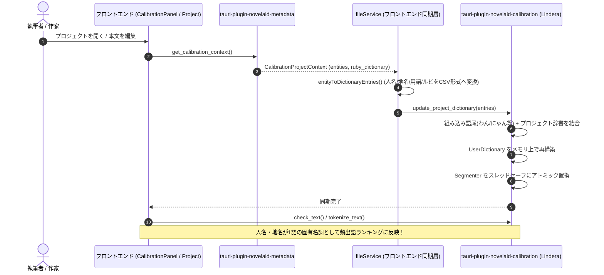

# メタデータと形態素解析エンジン辞書同期仕様書

## 1. 概要と背景

`novelaide` では、設定資料（登場人物・地名・世界観用語・アイテム等）から抽出された `ProjectEntity` や、作品固有のルビ辞書 `ProjectRubyEntry` が `tauri-plugin-novelaid-metadata` によって収集・インデックス化されています。

しかし、これらの固有名詞が形態素解析エンジン（Lindera 6.2.0）に登録されていない場合、以下の課題が生じます：
1. **固有名詞の分断**:
   「ソラ・アルスター」「東雲美羽」「アルテリア帝国」などの重要名詞が細切れの形態素に分断されたり、未知語として誤判定される。
2. **頻出語ランキングの不整合**:
   本文中の主要な登場人物や地名が断片として集計され、作者が把握したいキーワードの出現傾向が歪んでしまう。
3. **読み（ルビ）情報の断絶**:
   設定資料で定義された正式な読み（ルビ）が形態素情報に反映されない。

本仕様は、メタデータで収集された人名・地名・用語・ルビ辞書を、形態素解析エンジンのユーザー辞書（UserDictionary）へ動的に同期・ホットリロードするデータマッピングおよび連携アーキテクチャを定義するものです。

---

## 2. アーキテクチャおよびデータフロー



---

## 3. 品詞および辞書マッピング仕様

IPADIC のユーザー辞書形式（`surface,part_of_speech,reading`）に合わせて、メタデータを以下のように分類・正規化して登録します。

| メタデータ種別 | 判定条件 / カテゴリ | 登録品詞 (`part_of_speech`) | 読み (`reading`) の処理 | 例 |
| :--- | :--- | :--- | :--- | :--- |
| **登場人物名** | `EntityCategory::Character` | `名詞,固有名詞,人名,一般` | 平仮名・スペースを除去し全角カタカナに変換 | `ソラ・アルスター,"名詞,固有名詞,人名,一般",ソラアルスター` |
| **人物の別名・愛称** | `character.aliases` | `名詞,固有名詞,人名,一般` | 本人の読みに準拠（または表層形） | `ソラ,"名詞,固有名詞,人名,一般",ソラ` |
| **地名・国名** | `EntityCategory::Location` | `名詞,固有名詞,地域,一般` | 平仮名・スペースを除去し全角カタカナに変換 | `アルテリア帝国,"名詞,固有名詞,地域,一般",アルテリアテイコク` |
| **用語・アイテム** | `EntityCategory::Term` / `Item` | `名詞,固有名詞,一般,*` | 定義された読み（または表層形） | `オリハルコン,"名詞,固有名詞,一般,*",オリハルコン` |
| **作品固有ルビ語句** | `ProjectRubyEntry` | `名詞,固有名詞,一般,*` | カタカナ化した代表ルビ（`canonical_ruby`） | `運命,"名詞,固有名詞,一般,*",サダメ` |
| **組み込みキャラクター語尾** | `DEFAULT_NOVEL_USER_DICT_CSV` | `助詞,終助詞` | 定義済みカタカナ読み | `わん,"助詞,終助詞",ワン` |

---

## 4. API および実装仕様

### 4.1 バックエンド: `tauri-plugin-novelaid-calibration`
- **データモデル (`ProjectDictionaryEntry`)**:
  ```rust
  #[derive(Debug, Clone, Serialize, Deserialize, ts_rs::TS)]
  #[ts(export, export_to = "../guest-js/")]
  #[serde(rename_all = "camelCase")]
  pub struct ProjectDictionaryEntry {
      pub surface: String,
      pub pos: Option<String>,
      pub reading: Option<String>,
  }
  ```
- **IPC コマンド**:
  ```rust
  #[command]
  pub(crate) async fn update_project_dictionary<R: Runtime>(
      app: AppHandle<R>,
      entries: Vec<ProjectDictionaryEntry>,
  ) -> Result<()>;
  ```
- **内部処理**:
  渡されたエントリ群を CSV 形式に整形し、組み込みの `DEFAULT_NOVEL_USER_DICT_CSV`（キャラクター語尾）と結合した上で、`reload_user_dictionary` によりメモリ上で `Segmenter` をアトミックに再生成・置換する。

### 4.2 フロントエンド統合: `fileService.syncProjectMetadataToMorphology`
`fileService.ts` に統合同期メソッドを用意し、メタデータプラグインから `getCalibrationContext()` で取得したエンティティおよびルビ辞書を一括変換して `novelaidCalibration.updateProjectDictionary` を呼び出す。

---

## 5. 検証手順
1. `cargo test --manifest-path tauri-plugin-novelaid-calibration/Cargo.toml` による単体テストの通過。
   - 人名「ソラ・アルスター」、地名「アルテリア帝国」、別名「ソラ」が 1 トークンとして抽出され、品詞・読みが正しく付与されること。
   - 組み込み語尾（「にゃん」「わん」等）との共存が正常であること。
2. `npm run build` による TypeScript 型検査およびバンドル検証の通過。
3. 校正パネル（`CalibrationPanelPlugin.tsx`）にて、人名・地名が分断されず頻出語ランキングに正しく集計されること。
