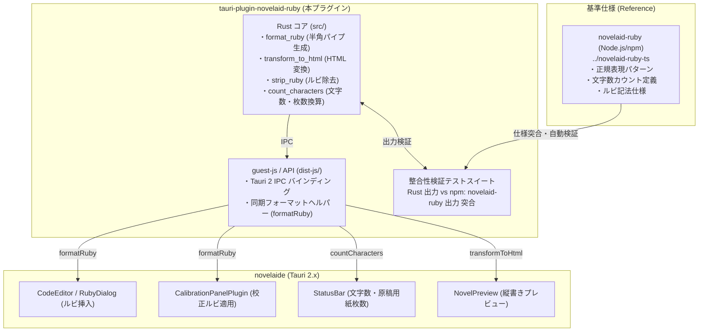

# 小説ルビ記法・文字数処理プラグイン（tauri-plugin-novelaid-ruby）仕様書

## 1. 概要と背景

本ドキュメントは、小説執筆用エディター **`novelaide`** における **ルビ（ふりがな）・傍点記法の生成・パース・HTML変換、および詳細文字数カウント** を一元的に司る専用バックエンドプラグイン **`tauri-plugin-novelaid-ruby`** の設計仕様を定義するものである。

### 1.1. 課題と目的

1. **ルビ生成ロジックの分散と書式不整合の解消**:
   - 従来は `CodeEditor.tsx`（ダイアログ）と `CalibrationPanelPlugin.tsx`（校正パネル）で独自にルビ文字列を生成していたため、半角パイプ（`|親文字《ルビ》`）と全角パイプ（`｜親文字《ルビ》`）の表記揺れが発生していた。
   - これらをバックエンド側で定義する統一関数 `format_ruby` に一本化し、記法不整合を根絶する。
2. **長文原稿における処理の高速化とUIスレッドの解放**:
   - プレビュー時のルビ/傍点 HTML 変換（`transformToHtml`）や、リアルタイム文字数・原稿用紙換算カウント（`countCharacters`）を Rust 側で並行・高速処理し、フロントエンドの描画パフォーマンスを最大化する。
3. **npm 版 `novelaid-ruby`（リファレンス実装）との整合性保証**:
   - `novelaid-editor`（Electron版）や `novelaid-cli`（AI特化CLI版）では、今後も npm 版 `novelaid-ruby`（`../novelaid-ruby-ts`）を使用する。
   - 本プラグイン内部で npm 版 `novelaid-ruby` を `devDependencies` として参照し、**「Rust の実行結果」と「npm 版の実行結果」が完全に一致することを検証する整合性テスト**を常設する。

---

## 2. システムアーキテクチャ



---

## 3. データ構造と API 仕様

### 3.1. 文字数カウント結果（`DetailedCountResult`）

`ts-rs` により TypeScript 型定義（`guest-js/types.ts`）へ自動同期する。

```rust
#[derive(Debug, Clone, Serialize, Deserialize, TS)]
#[ts(export, export_to = "../guest-js/bindings/")]
pub struct DetailedCountResult {
    /// 単純な text.chars().count() (ルビ記号や改行、空白すべてを含む)
    pub raw_length: usize,
    /// ルビ・記号・空白類を除外した文字数（カクヨム準拠・小説基本文字数）
    pub char_count: usize,
    /// ルビ・記号を除外し、空白類を含めた文字数（改行含む）
    pub char_count_with_spaces: usize,
    /// 総行数
    pub line_count: usize,

    /// 空白の内訳
    pub spaces: SpaceBreakdown,
    /// 改行コードの数
    pub newlines: usize,

    /// セリフ（鉤括弧・二重鉤括弧内）
    pub dialogue: TextSegmentMetrics,
    /// 地の文
    pub narrative: TextSegmentMetrics,

    /// 原稿用紙換算枚数 (400字詰等、小数)
    pub manuscript_sheets: f64,
}

#[derive(Debug, Clone, Serialize, Deserialize, TS)]
pub struct SpaceBreakdown {
    pub half_width: usize,
    pub full_width: usize,
    pub total: usize,
}

#[derive(Debug, Clone, Serialize, Deserialize, TS)]
pub struct TextSegmentMetrics {
    pub char_count: usize,
    pub char_count_with_spaces: usize,
    pub line_count: usize,
}

#[derive(Debug, Clone, Serialize, Deserialize, TS)]
pub struct CountOptions {
    pub manuscript_chars_per_line: Option<usize>,  // 既定値: 20
    pub manuscript_lines_per_sheet: Option<usize>, // 既定値: 20
}
```

---

### 3.2. Tauri IPC コマンド一覧

| コマンド名 | 引数 | 戻り値 | 概要 |
| :--- | :--- | :--- | :--- |
| **`plugin:novelaid-ruby\|format_ruby`** | `surface: String, ruby: String` | `String` | 基本書式 `\|親文字《ルビ》` を生成（半角パイプ統一） |
| **`plugin:novelaid-ruby\|transform_to_html`** | `text: String` | `String` | ルビ（`<ruby><rt>`）および傍点（`<span class="bouten">`）に変換 |
| **`plugin:novelaid-ruby\|strip_ruby`** | `text: String` | `String` | ルビ記法や傍点記号を除去した親文字テキストを取得 |
| **`plugin:novelaid-ruby\|extract_ruby_text`** | `text: String` | `String` | テキスト内のルビ読みのみをスペース区切りで抽出 |
| **`plugin:novelaid-ruby\|count_characters`** | `text: String, options?: CountOptions` | `DetailedCountResult` | 詳細文字数・行数・セリフ比率・原稿用紙換算を高速算出 |

---

### 3.3. フロントエンド向け簡易 API (`guest-js`)

フロントエンドコンポーネントが直感的に呼び出せるよう、`tauri-plugin-novelaid-ruby-api` パッケージとしてエクスポートする。

```typescript
// 1. ルビ記法の組み立て (同期関数・即時フォーマット)
export function formatRuby(surface: string, ruby: string): string {
  return `|${surface}《${ruby}》`;
}

// 2. スマート送り仮名分離ルビ生成 (同期関数・適用段階で自動最適化)
export function formatSmartRuby(surface: string, ruby: string): string;

// 3. HTML 変換 (Tauri IPC 経由)
export async function transformToHtml(text: string): Promise<string>;

// 4. ルビ除去 (Tauri IPC 経由)
export async function stripRuby(text: string): Promise<string>;

// 5. 文字数カウント (Tauri IPC 経由)
export async function countCharacters(text: string, options?: CountOptions): Promise<DetailedCountResult>;
```

---

### 3.4. スマート送り仮名分離ルビ生成仕様 (`format_smart_ruby` / `formatSmartRuby`)

#### 3.4.1. 背景と設計方針
日本語の出版・組版（JIS X 4051）では、「送り仮名（ひらがな）にはルビを振らず、漢字部分にのみルビを振る」ことが標準作法である。
一方、エディターのルビ入力ダイアログや校正パネルの一覧表示では、作家がどの単語を操作しているかの文脈を直感的に保つため、**選択状態のまま単語全体（例: 「見下ろす」「みおろす」）を表示**する。

そして、**本文への適用（Enter確定や挿入クリック）の段階でスマートに送り仮名を自動分離**し、理想的な記法へ変換して挿入する。

#### 3.4.2. 入力パターンと適用結果一覧

| 入力パターン | 表層形 (`surface`) | 入力ルビ (`ruby`) | 適用結果 (生成される記法) | 判定理由 |
| :--- | :--- | :--- | :--- | :--- |
| **動詞の送り仮名 (通常)** | `見下ろす` | `みおろす` | `\|見下《みお》ろす` | 末尾ひらがな「ろす」を自動検出して外出し |
| **作家による手入力短縮** | `見下ろす` | `みお` | `\|見下《みお》ろす` | 表層形の末尾送り仮名「ろす」を自動検出して外出し |
| **接頭辞を含む複合語** | `お見舞い` | `おみまい` | `お\|見舞《みま》い` | 先頭「お」および末尾「い」を自動検出して外出し |
| **送り仮名のない熟語** | `天霧` | `あまぎり` | `\|天霧《あまぎり》` | ひらがな送り仮名なし（通常ルビ） |
| **当て字・特殊ルビ** | `見下ろす` | `ルックダウン` | `\|見下ろす《ルックダウン》` | ひらがな一致なし（意図的な全体ルビとして保持） |

#### 3.4.3. トリミングアルゴリズム
1. **先頭共通ひらがなの走査（prefix）**:
   - `surface` と `ruby` の先頭から双方が同一のひらがなである限り抽出し、`prefix` とする。
2. **末尾共通ひらがなの走査（suffix）**:
   - `surface` と `ruby` の末尾から双方が同一のひらがなである限り抽出し、`suffix` とする。
   - `ruby` がすでに短縮されている場合（例: `surface: "見下ろす"`, `ruby: "みお"`）は、`surface` 末尾のひらがな連続部分を `suffix` とする。
3. **コア文字列の生成**:
   - 残った漢字部分（`core_surface`）と読み部分（`core_ruby`）を取り出し、`|core_surface《core_ruby》` を組み立てる。
   - 最終文字列 `{prefix}|{core_surface}《{core_ruby}》{suffix}` を返す。
   - 共通ひらがなが存在しない場合、または漢字を含まない場合はそのまま通常ルビ `|{surface}《{ruby}》` を返す。


---

## 4. npm 版 `novelaid-ruby` との整合性テスト仕様

プラグインの `package.json` に npm パッケージ `novelaid-ruby`（`../novelaid-ruby-ts`）を依存追加し、以下の突合テストを実施する。

1. **ルビ・傍点パース変換突合**:
   - 入力: `|親文字《ルビ》と漢字《かんじ》、および《《強調》》`
   - 検証: `Rust(transform_to_html) === npm(transformToHtml)`
2. **文字数・原稿用紙換算突合**:
   - 入力: カクヨム・なろう形式の複数段落・会話文を含む短編テキスト
   - 検証: `Rust(count_characters).char_count === npm(countCharacters).charCount`
   - 検証: `Rust(count_characters).dialogue === npm(countCharacters).dialogue`
   - 検証: `Rust(count_characters).manuscript_sheets === npm(countCharacters).manuscriptSheets`
