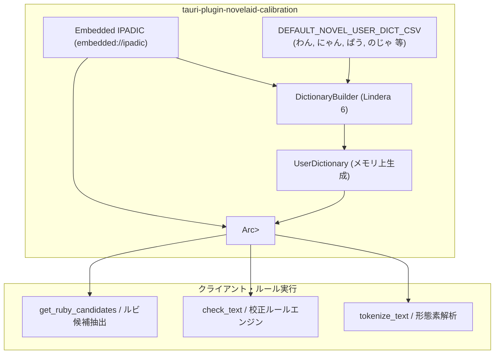

# 形態素解析エンジン辞書登録およびキャラクター語尾仕様書

## 1. 概要と背景

ライトノベルやキャラクター小説では、特有の役割語・キャラクター語尾（「わん」「にゃん」「ぱう」「のじゃ」等）が頻繁に使用されます。
しかし、標準の形態素解析辞書（IPADIC）では、これらの語尾が以下のように不適切に細切れに分断されたり、未知語として扱われる問題がありました：

1. **分断による助詞誤検知**:
   「あっちにゃん」が「あっち（名詞）＋ にゃ（助詞）＋ ん（助動詞）」に分断され、文末の助詞重複チェック等で誤検知を引き起こす。
2. **未知語と読みの喪失**:
   「ぱう」などが未知語として処理され、読み情報（発音・カタカナ）が得られない。
3. **古風・役割語の分断**:
   「知っておるのじゃ」の「のじゃ」が「の（助詞）＋ じゃ（助動詞）」に分断される。

本仕様は、純 Rust 製形態素解析エンジン **Lindera 6.2.0**（`embedded://ipadic`）に対して、メモリ上で高速にユーザー辞書（UserDictionary）を組み込み、ラノベ特有の語尾表現を単一形態素として安定して認識させる仕様を定義するものです。

---

## 2. 組み込み固定語尾仕様

### 2.1 初期登録キャラクター語尾一覧
以下の単語を `DEFAULT_NOVEL_USER_DICT_CSV` としてプラグイン起動時に組み込み登録します。
品詞区分は一般の格助詞や名詞と干渉しないよう `カスタム語尾` として定義します。

| 表層形 (surface) | 品詞 (part_of_speech) | 読み (reading) | 役割・用例 |
| :--- | :--- | :--- | :--- |
| **わん** | カスタム語尾 | ワン | 犬系・獣人キャラ（「そうだわん！」） |
| **にゃん** | カスタム語尾 | ニャン | 猫系・獣人キャラ（「あっちにゃん。」） |
| **ぱう** | カスタム語尾 | パウ | マスコット・妖精キャラ（「不思議ぱう。」） |
| **ぴょん** | カスタム語尾 | ピョン | ウサギ系キャラ（「行くぴょん！」） |
| **ぽよ** | カスタム語尾 | ポヨ | マスコット・癒やし系キャラ（「おいしいぽよ。」） |
| **っす** | カスタム語尾 | ッス | 体育会系・後輩キャラ（「了解っす！」） |
| **のじゃ** | カスタム語尾 | ノジャ | 古風・ロリババア系キャラ（「わらわのじゃ。」） |
| **なのじゃ** | カスタム語尾 | ナノジャ | 古風・断定語尾（「真実なのじゃ。」） |
| **ござる** | カスタム語尾 | ゴザル | 侍・忍者キャラ（「参るでござる。」） |
| **でござる** | カスタム語尾 | デゴザル | 侍・忍者キャラ（「拙者でござる。」） |

---

## 3. アーキテクチャおよびデータフロー



---

## 4. API および実装仕様

### 4.1 ユーザー辞書構築ヘルパー (`build_user_dictionary`)
ファイルシステムへのディスク書き込みを一切行わず、`std::io::Cursor` 経由でメモリ上の CSV 文字列から `UserDictionary` をミリ秒単位で構築する。

```rust
pub fn build_user_dictionary(
    metadata: &lindera::dictionary::Metadata,
    csv_data: &str,
) -> Result<lindera::dictionary::UserDictionary> {
    let builder = lindera::dictionary::DictionaryBuilder::new(metadata.clone());
    builder
        .build_user_dict_from_reader(std::io::Cursor::new(csv_data))
        .map_err(|e| Error::Lindera(e.to_string()))
}
```

### 4.2 初期化時の組み込み (`NovelaidCalibration::new`)
`NovelaidCalibration::new` において、`load_dictionary("embedded://ipadic")` の直後に `build_user_dictionary` を実行し、`Segmenter::new(Mode::Normal, dictionary, Some(user_dict))` として常駐インスタンスを初期化する。

### 4.3 動的ホットリロード対応 (`reload_user_dictionary`)
将来のプロジェクト辞書連携（登場人物名シート、造語設定等）を見据え、追加の CSV 文字列を受け取ってスレッドセーフに `Segmenter` をアトミック置換するメソッドを提供する。

```rust
pub fn reload_user_dictionary(&self, additional_csv: Option<&str>) -> Result<()>;
```

---

## 5. 検証基準
1. 単体テスト `test_character_endings_user_dict` がパスすること。
2. 「わん」「にゃん」「ぱう」「のじゃ」「なのじゃ」「っす」が 1 トークンとして抽出され、品詞が `カスタム語尾`、読みが正しく取得できること。
3. 全体のテストスイート（`cargo test`）および `npm run build` がエラーなく完了すること。
