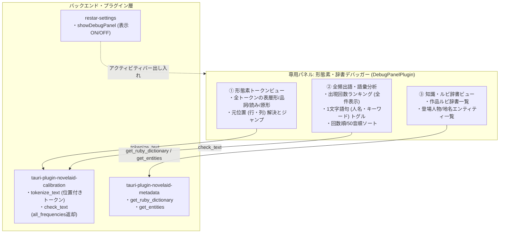

# 形態素解析デバッグおよびプロジェクト辞書確認仕様

## 1. 概要

本ドキュメントでは、小説執筆エディター **`novelaide`** における形態素解析（Lindera / IPADIC）の動作検証およびユーザー辞書（カスタム辞書・登場人物名辞書）適用準備のための「**形態素・辞書デバッガーパネル（DebugPanelPlugin）**」の仕様を定義します。

小説特有の人名や固有名詞、造語がどのように形態素（表層形・品詞・読み・原形）に分割されているかをリアルタイムに検査・可視化するとともに、頻出語の全件閲覧や、プロジェクト全体の作品ルビ辞書・エンティティ（登場人物・地名）の登録状況を確認できる基盤を提供します。

---

## 2. システム構成と責務分離

---

## 3. デバッグパネルの仕様詳細

### 3.1. パネル基本仕様
- **パネルID**: `novelaid.panel.debug`
- **タイトル**: `形態素・辞書デバッガー`
- **アイコン**: `Binary` (Lucide)
- **配置**: 右サイドペイン（`defaultPlacement: 'right'`）
- **スコープ**: `document`（開いている原稿テキストを対象に解析）
- **優先度**: `priority: 95`

### 3.2. サポート有無の切り替え（ON/OFF設計）
一般の執筆作業時に画面を圧迫しないよう、環境設定の「外観・テーマ」画面において、**「形態素・辞書デバッガーパネルを有効にする」**（キー: `showDebugPanel`、デフォルト: `true`）のチェックボックスを提供します。
`ActivityBar.tsx` は設定値を監視し、OFFの場合はアクティビティバーのアイコンを自動で非表示にします。

---

## 4. 各ビューの機能仕様

### 4.1. ① 形態素トークンビュー（Token Viewer）
開いている原稿テキストを `tokenizeText` で解析し、全形態素をテーブル表示します。
- **表示項目**:
  - 表層形 (`surface`)
  - 品詞詳細 (`pos`: 例 `名詞,固有名詞,人名,姓`)
  - 読み (`reading`: カタカナ)
  - 原形 (`baseForm`)
  - 元テキスト位置 (`range`: `L行:C列`)
- **エディタージャンプ連携**:
  - 行をクリックするとカスタムイベント `editor-jump-to` が発火し、エディター画面の該当文字にカーソルが移動・選択されます。
- **クイック品詞フィルタ**:
  - 「すべて」「名詞」「動詞」「形容詞」「助詞」のワンクリック絞り込みボタン。
- **インクリメンタル検索**:
  - 単語、読み、原形の部分一致検索。

### 4.2. ② 全頻出語・語彙分析（Vocabulary & Frequency）
原稿内の全名詞語彙の出現回数を集計し、ランキング形式で表示します。
- **全件表示対応**:
  - 従来の校正パネル（上位15件固定）と異なり、文書内の全名詞を制限なくスクロール閲覧可能。
- **1文字語句トグル**:
  - 「1文字語句を含める」チェックボックスを提供。
  - 人名やキーワードが1文字（例: 「霧」「天」など）に切断されて頻出語から脱落している現象を即座に調査可能。
- **ソート切り替え**:
  - 出現回数順（降順）と 50音順の切り替え。

### 4.3. ③ 知識・ルビ辞書ビュー（Knowledge & Dictionaries）
`tauri-plugin-novelaid-metadata` がインデックス化したプロジェクト知識を可視化します。
- **作品ルビ辞書**:
  - プロジェクト内で使用・定義されているルビの親文字、代表ルビ（`canonicalRuby`）、総出現回数を一覧表示。
- **登場人物・地名一覧**:
  - 抽出されたキャラクター名、地名、読み仮名、別名（alias）を一覧表示。

---

## 5. 校正パネル（CalibrationPanelPlugin）の拡張

文章校正パネルの「文体比率・頻出語」タブにおいても、デバッグパネルを開くことなく手軽に確認できるよう、以下の拡張を行いました。
- 頻出語ランキングヘッダーに **[全件表示 / 上位15件]** の切り替えボタンを追加。
- **「1文字を含む」** チェックボックスを追加し、1文字名詞の出現状況をその場で確認可能。
