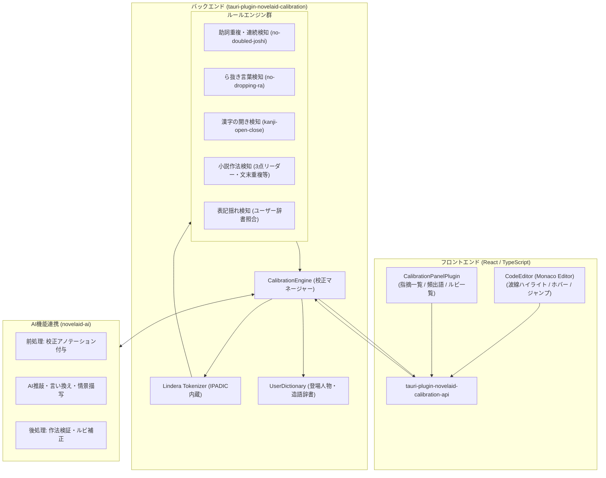
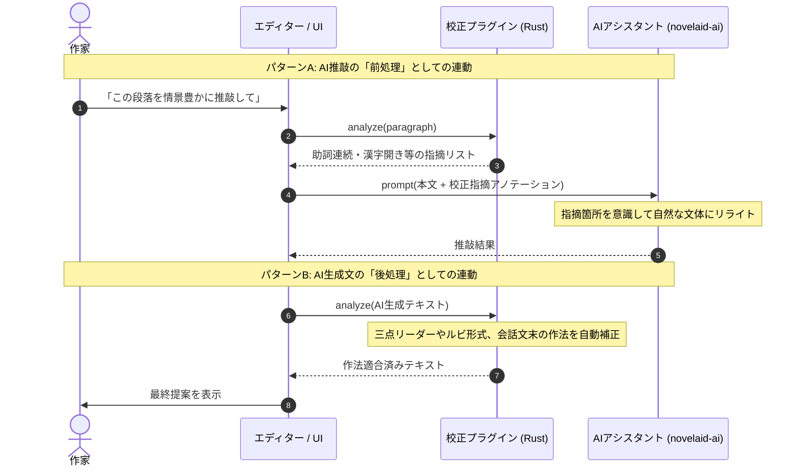

# 日本語文章校正および形態素解析基盤設計計画

## 1. 概要と基本方針

本ドキュメントは、`novelaide`（Tauri版・コードネーム `novelaid-e`）における**日本語文章校正（Proofreading / Calibration）**および**形態素解析基盤**のアーキテクチャ設計・移行計画を定義するものである。

### 1.1. 基本方針
1. **AIを使用しないルールベース・形態素解析のローカル完結**:
   - 本プラグインは、外部通信やLLMに依存せず、オフラインかつミリ秒単位の高速性・確実性を担保するルールベース校正および形態素解析を受け持つ。
2. **独立した Tauri プラグイン（`tauri-plugin-novelaid-calibration`）構成**:
   - `novelaid-fs`, `novelaid-ai` と同様に、Rustバックエンド（クレート）とフロントエンド（API/UI）が疎結合に分離された独立プラグインとして設計する。
3. **将来の AI 執筆パートナーとの相互連動（前処理・後処理）**:
   - AI推敲前の前処理（明らかなタイポや作法違反のアノテーション付与）およびAI生成文の後処理（小説作法適合チェック、ルビ補正）としてシームレスに相互呼び出しを行う。
4. **形態素解析を活用したルビ管理とユーザー辞書**:
   - 形態素解析エンジンの「読み」データを利用したルビ候補推測と、登場人物名・設定資料からのユーザー辞書動的生成を実現する。

---

## 2. ライブラリ調査結果と技術選定

`novelaid-editor-docs/docs/資料` の調査レポートに基づき、以下の技術スタックを選定する。

### 2.1. 形態素解析エンジン: `Lindera`（Rust製）
* **選定理由**:
  - 純Rust実装であり、辞書（IPADIC）をバイナリ内蔵可能（`features = ["embed-ipadic"]`）。外部辞書ファイルの配布・パス解決トラブルが原理的にゼロ。
  - 形態素ごとの**「表層形・品詞・原形・読み（カタカナ）・発音」**が高速に取得可能。
  - **簡易CSV（表層形・品詞・読みの3列）によるユーザー辞書実行時追加**を公式サポート。登場人物名や造語の動的登録に最適。

### 2.2. 校正エンジン: Rustネイティブによるルールベース実装
* **現行 `novelaid-editor`（textlint）の課題**:
  - textlint は Node.js/npm パッケージであり、Tauri/Rust 環境で動作させるには Node.js サイドカーを抱えるか、巨大な JS バンドルを WebView 上で動かす必要があり、起動速度・メモリ・依存関係破壊のリスクが高い。
* **新世代 `novelaide` での設計**:
  - textlint-ja の中核ルール（助詞連続、ら抜き言葉、二重否定、漢字の開き、表記揺れ）は、**「Lindera の形態素トークン列」に対するパターンマッチング**として Rust 側でネイティブ実装する。
  - **メリット**: 数万文字の長編小説であっても、わずか数ミリ秒で全ルールを瞬時に検証可能。

---

## 3. システムアーキテクチャ

---

## 4. 機能要件

### 4.1. 校正ルール（ルールベース）
| 分類 | ルール名 | 概要・検出基準 |
| :--- | :--- | :--- |
| **文法** | 助詞の連続検知 | 一文内で同一助詞（「の」「が」「を」等）が3回以上出現する場合に警告 |
| | ら抜き言葉検知 | 「来れる（来られる）」「見れる（見られる）」等のら抜き言葉を検出 |
| | 二重否定検知 | 「〜ないわけではない」など、意図しない二重否定の多用を抑制 |
| **作法（小説特化）** | 三点リーダー・ダッシュ | `……`（2マス）、`――`（2マス）の偶数配置ルール違反を検出 |
| | 会話文末の句点 | `「〜〜。」` となっている場合に `「〜〜」` への修正を提案 |
| | 感嘆符後の空白 | 文中感嘆符（`！` `？`）の直後に全角空白がないケースを検出 |
| | 文末の連続重複 | 同一の助動詞文末（「〜た。〜た。〜た。」等）の連続を検出 |
| **表記・用字** | 漢字の開き（公用文・小説） | 形式名詞（「事→こと」「時→とき」「所→ところ」等）の開き推奨 |
| | プロジェクト表記揺れ | 設定資料（キャラクター名・地名）の辞書と本文の不一致を検出 |

### 4.2. 形態素解析を活用したルビ支援
1. **ルビ候補の自動推測**:
   - 漢字を含む単語に対し、Lindera から得られる「読み（カタカナ）」をひらがなに変換し、ワンクリックで `｜漢字《かんじ》` 記法をエディタへ挿入。
2. **ルビの一括管理・抽出パネル**:
   - 原稿内で使用されているルビ付き単語を一覧化し、同一単語で異なるルビ（ルビ揺れ）を即座に検出。
3. **当て字・特殊ルビの辞書登録**:
   - 小説特有の当て字（例: `｜強敵《とも》`、`｜本気《マジ》`）をユーザー辞書に登録し、次回から自動補完・統一。

### 4.3. 頻出語・文体バランス分析
* **品詞別出現ランキング**: 名詞・動詞・形容詞の出現頻度トップ一覧を表示し、表現の偏りを可視化。
* **漢字・ひらがな比率メーター**: 一般に小説として読みやすいとされる「漢字率 20%〜30%」のバランスをリアルタイム測定。

---

## 5. AI機能との連携設計（前処理・後処理パイプライン）

* **ワンクリック AI 言い換え**:
  - 校正パネルで「助詞『の』が連続しています」と指摘された箇所に **[AIで言い換える]** ボタンを配置し、文脈に応じた自然な表現をAIに即座に提案させる。

---

## 6. 実装ステップ計画

1. **ステップ 1: `tauri-plugin-novelaid-calibration` の新設**:
   - クレート作成、`Lindera`（`embed-ipadic`）の導入、基本形態素解析 API の実装。
2. **ステップ 2: 小説特化ルールエンジンの実装**:
   - 助詞連続、ら抜き、漢字の開き、三点リーダー・会話文末作法ルールの Rust 実装。
3. **ステップ 3: フロントエンド連携（API & CalibrationPanelPlugin）**:
   - `tauri-plugin-novelaid-calibration-api` パッケージ作成。
   - Monaco Editor の Squiggly（波線マーカー）連動およびジャンプ機能。
4. **ステップ 4: ユーザー辞書・ルビ候補推測の実装**:
   - 設定資料からの CSV ユーザー辞書生成、ルビ自動推測と挿入機能。
5. **ステップ 5: AIプラグイン（`novelaid-ai`）連携インターフェースの構築**:
   - 前処理アノテーション生成 API とワンクリック言い換えアクションの接続。
