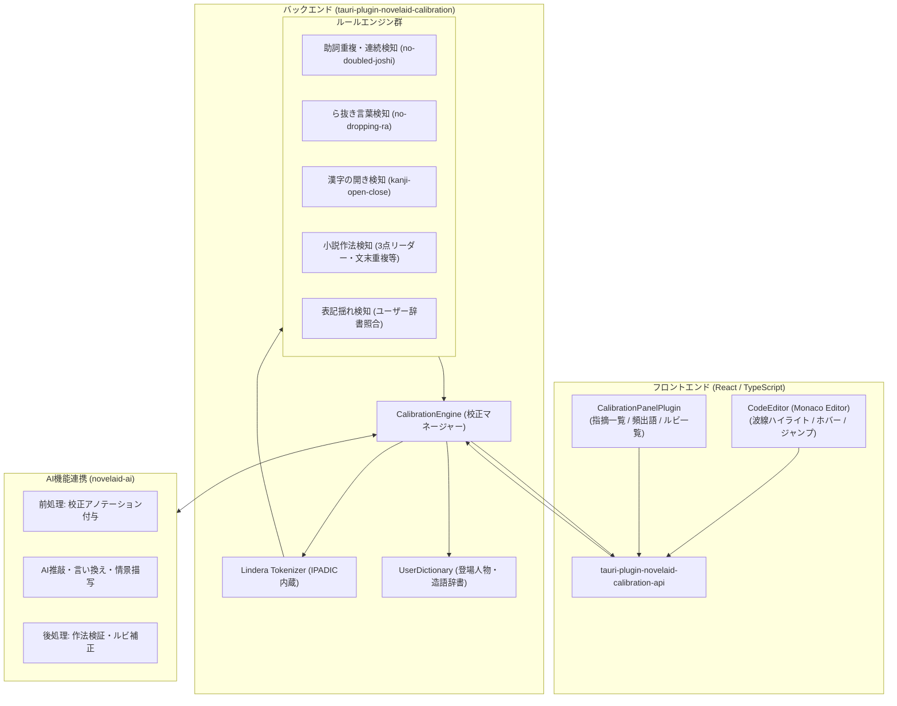
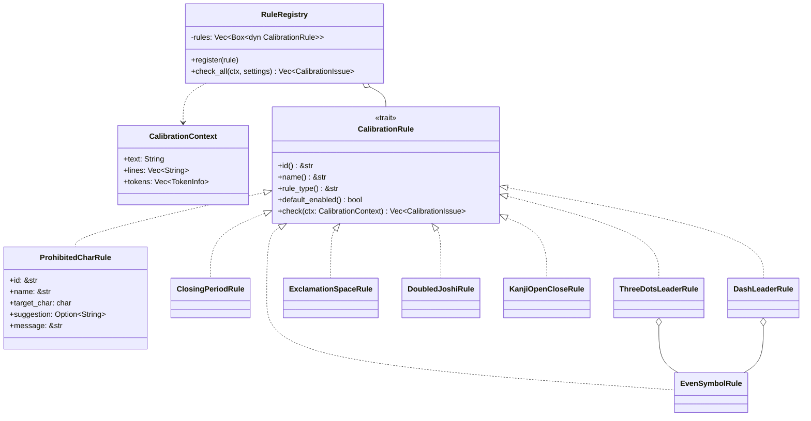
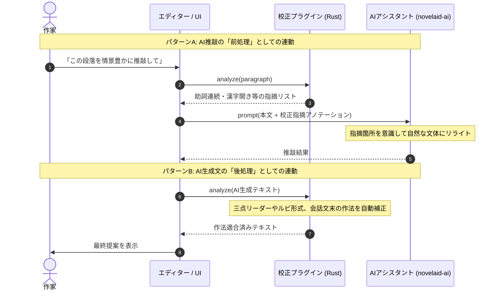

# 日本語文章校正および形態素解析基盤設計計画

## 1. 概要と基本方針

本ドキュメントは、`novelaide`（Tauri版・コードネーム `novelaid-e`）における**日本語文章校正（Proofreading / Calibration）**および**形態素解析基盤**のアーキテクチャ設計・移行計画を定義するものである。

### 1.1. 基本方針
1. **AIを使用しないルールベース・形態素解析のローカル完結**:
   - 本プラグインは、外部通信やLLMに依存せず、オフラインかつミリ秒単位の高速性・確実性を担保するルールベース校正および形態素解析を受け持つ。
2. **独立した Tauri プラグイン（`tauri-plugin-novelaid-calibration`）構成**:
   - `novelaid-fs`, `novelaid-ai` と同様に、Rustバックエンド（クレート）とフロントエンド（API/UI）が疎結合に分離された独立プラグインとして設計する。
3. **将来の AI 執筆パートナーとの相互連動（前処理・後処理）**:
   - AI推敲前の前処理（明らかなタイポや作法違反のアノテーション付与）およびAI生成文の後処理（小説作法適合チェック、ルビ補正）としてシームレスに相互呼び出しを行う。
4. **形態素解析を活用したルビ管理とユーザー辞書**:
   - 形態素解析エンジンの「読み」データを利用したルビ候補推測と、登場人物名・設定資料からのユーザー辞書動的生成を実現する。

---

## 2. ライブラリ調査結果と技術選定

`novelaid-editor-docs/docs/資料` の調査レポートに基づき、以下の技術スタックを選定する。

### 2.1. 形態素解析エンジン: `Lindera`（Rust製）
* **選定理由**:
  - 純Rust実装であり、辞書（IPADIC）をバイナリ内蔵可能（`features = ["embed-ipadic"]`）。外部辞書ファイルの配布・パス解決トラブルが原理的にゼロ。
  - 形態素ごとの**「表層形・品詞・原形・読み（カタカナ）・発音」**が高速に取得可能。
  - **簡易CSV（表層形・品詞・読みの3列）によるユーザー辞書実行時追加**を公式サポート。登場人物名や造語の動的登録に最適。

### 2.2. 校正エンジン: Rustネイティブによるルールベース実装
* **現行 `novelaid-editor`（textlint）の課題**:
  - textlint は Node.js/npm パッケージであり、Tauri/Rust 環境で動作させるには Node.js サイドカーを抱えるか、巨大な JS バンドルを WebView 上で動かす必要があり、起動速度・メモリ・依存関係破壊のリスクが高い。
* **新世代 `novelaide` での設計**:
  - textlint-ja の中核ルール（助詞連続、ら抜き言葉、二重否定、漢字の開き、表記揺れ）は、**「Lindera の形態素トークン列」に対するパターンマッチング**として Rust 側でネイティブ実装する。
  - **メリット**: 数万文字の長編小説であっても、わずか数ミリ秒で全ルールを瞬時に検証可能。

---

## 3. システムアーキテクチャ

### 3.2. ルールエンジン設計（Trait + Registry パターンによるファイル分離・設定対応）

単一ファイルでのべた書きを廃止し、**ルールごとのファイル分離**、**汎用構造体による共通化**、および**将来の設定によるON/OFF・パラメータ調整**に対応するアーキテクチャを採用する。

#### 設計の要点:
1. **統一 Trait `CalibrationRule`**:
   - すべてのルールが満たすべき契約（ID、名称、カテゴリ、チェックメソッド）を定義。
2. **汎用ルール構造体 `ProhibitedCharRule`**:
   - 「半角空白禁止」や「全角パイプ禁止」のように、特定の1文字を検知・置換するルールは共通構造体として実装し、コンストラクタ引数（対象文字・置換文字列・メッセージ）で多様な文字種チェックを量産可能にする。
3. **偶数単位記号の共通構造体 `EvenSymbolRule`**:
   - 三点リーダー（`novel-three-dots-leader`）とダッシュ（`novel-dash-leader`）のように、同一のチェックロジック（奇数マス・単独マスの検出、倍数への自動補正計算）を持つルールは共通構造体 `EvenSymbolRule` に集約し、修正時の抜け漏れを完全に排除。
4. **括弧ペアの一元定義と再利用性（`brackets.rs`）**:
   - 開き括弧と閉じ括弧のペア（`BRACKET_PAIRS: &[(char, char)]`）を一元定義し、片方のみの更新や不整合を完全に防止。
   - `get_matching_closing_bracket` などの対解決関数を提供し、校正ルールだけでなくエディタの括弧自動補完等でも安全に再利用可能にする。
   - 開きと閉じが同一記号となる対称引用符（`` ` ``、`"`、`'`）は `SYMMETRIC_QUOTES` として明確に分離。
   - `ClosingPeriodRule`（句点＋閉じ括弧）では `」` だけでなく `』` や `）` などすべての閉じ括弧との組み合わせを網羅的に検査。
5. **ルールごとのファイル分離**:
   - `src/rules/` ディレクトリ配下に、ルール種別ごとのファイルを分割配置し、1ルール1責務を徹底。
6. **`RuleRegistry` によるライフサイクル・設定管理**:
   - アプリ起動時または設定変更時に必要なルールをレジストリへ登録。
   - `settings: &HashMap<String, bool>` を渡すことで、ルールごとのON/OFFを動的に制御可能。
   - ルールごとのパラメータ調整（助詞の連続許容回数、空白チェックの厳格度など）も各構造体のフィールドで柔軟に変更可能。

---

## 4. 機能要件

### 4.1. 校正ルール（ルールベース）
| 分類 | ルールID | ルール名 | 概要・検出基準 | 自動修正案 (suggestion) | 実装状態 |
| :--- | :--- | :--- | :--- | :--- | :---: |
| **作法（記法・文字種）** | `novel-no-half-width-space` | 半角空白禁止 | 小説執筆では半角空白を使用せず全角空白に統一 | 全角空白 `　` | **実装済** |
| | `novel-no-full-width-pipe` | 全角パイプ禁止 | ルビ開始記号は半角 `|` を使用し全角 `｜` は使用しない | 半角パイプ `|` | **実装済** |
| | `novel-closing-period` | 会話文末の句点 | `「〜〜。」` となっている場合に `「〜〜」` への修正を提案 | `」` | **実装済** |
| | `novel-three-dots-leader` | 三点リーダー2マス | 単独の `…`（1マス）や奇数個連続を検知し偶数マス（`……`）を提案 | `……` | **実装済** |
| | `novel-dash-leader` | ダッシュ2マス | 単独の `―` や奇数個連続を検知し偶数マス（`――`）を提案 | `――` | **実装済** |
| | `novel-no-bracket-trailing-space` | 括弧直前の空白除去 | `「〜〜　」` などの末尾不要な空白を検出・除去 | `」` | **実装済** |
| | `novel-unclosed-bracket` | 対応する括弧の未閉じ・不整合検知 | 括弧の閉じ忘れ、開きのない閉じ括弧、括弧種類の不一致を検出 | 該当括弧 | **実装済** |
| | `novel-exclamation-space` | 感嘆符後の空白 | 文中感嘆符（`！` `？`）の直後に文字が続く場合に全角空白を要求 | `！　` / `？　` | **実装済** |
| | `novel-exclamation-normalization` | 感嘆符・疑問符の全角正規化 | 半角の `!` `?` `!?` `?!` の混入を検知し全角への正規化を提案 | `！` `？` `！？` | **実装済** |
| **構造・文体** | `novel-indent-first-line` | 段落冒頭の字下げ | 会話括弧や見出し以外の地の文の行頭で全角空白がないケースを検出 | `　` 挿入 | **実装済** |
| | `novel-sentence-end-repetition` | 文末助動詞の連続重複 | 同一の助動詞文末（「〜た。〜た。〜た。」等）の3連続以上を検出 | なし | **実装済** |
| **文法** | `no-doubled-joshi` | 助詞「の」連続検知 | 一文中・同一行内で助詞「の」が3回以上出現する場合に警告（パラメータ調整可能） | なし（要確認） | **実装済** |
| | `no-doubled-joshi-ga` | 助詞「が」連続・多用 | 一文中・同一行内で助詞「が」が3回以上出現する場合に警告 | なし（要確認） | **実装済** |
| | `no-dropping-ra` | ら抜き言葉検知 | 「来れる（来られる）」「見れる（見られる）」「食べれる（食べられる）」等のら抜き言葉を検出 | 「見られる」等 | **実装済** |
| | `no-double-negative` | 二重否定検知 | 「〜ないわけではない」「〜なくもない」など、意図しない二重否定の多用を抑制 | なし | **実装済** |
| **表記・用字** | `kanji-open-close` | 漢字の開き（形式名詞等） | 「事→こと」「時→とき」「所→ところ」「物→もの」等の開き推奨 | 「こと」「とき」等 | **実装済** |
| | `project-word-consistency` | プロジェクト表記揺れ | 設定資料（キャラクター名・地名）の辞書と本文の不一致を検出 | 辞書登録語 | 予定 |

### 4.2. 校正ルールの段階的実装ロードマップ
校正機能の進化は以下の4段階で順次進める。

1. **第1段階: 記法・文字種チェック（即時自動修正が容易で頻出する作法ルール）** [全項目完了]
   - 半角空白禁止（`novel-no-half-width-space`）[済]
   - 全角パイプ禁止（`novel-no-full-width-pipe`）[済]
   - 会話文末の句点（`novel-closing-period`）[済]
   - 三点リーダー2マス（`novel-three-dots-leader`）[済]
   - ダッシュ2マスチェック（`novel-dash-leader`）[済]
   - 括弧直前の不要な空白検知（`novel-no-bracket-trailing-space`）[済]
2. **第2段階: 小説の文構造・段落作法ルール** [全項目完了]
   - 感嘆符・疑問符後の全角空白（`novel-exclamation-space`）[済]
   - 感嘆符・疑問符の全角正規化（`novel-exclamation-normalization`）[済]
   - 段落冒頭の字下げ（`novel-indent-first-line`）[済]
   - 文末助動詞連続重複（`novel-sentence-end-repetition`）[済]
3. **第3段階: 形態素解析（Lindera）を活用した高度な文法・用字ルール** [中核実装完了]
   - 助詞重複検知の拡張（`no-doubled-joshi` の「の」連続、`no-doubled-joshi-ga` の「が」連続・多用）[済]
   - ら抜き言葉検知（`no-dropping-ra`、一段動詞・カ変動詞の最長一致判定）[済]
   - 二重否定検知（`no-double-negative`、「〜ないわけではない」等）[済]
   - 形式名詞・常用漢字の開き（`kanji-open-close`）[済]
4. **第4段階: 固有名詞・表記揺れチェック（ユーザー辞書・設定資料連携）**
   - 設定資料（登場人物・地名）辞書の動的読み込み
   - プロジェクト固有の表記揺れ検知（`project-word-consistency`）

### 4.3. 形態素解析を活用したルビ支援
1. **ルビ候補の自動推測**:
   - 漢字を含む単語に対し、Lindera から得られる「読み（カタカナ）」をひらがなに変換し、ワンクリックで `|漢字《かんじ》` 記法をエディタへ挿入。
2. **ルビの一括管理・抽出パネル**:
   - 原稿内で使用されているルビ付き単語を一覧化し、同一単語で異なるルビ（ルビ揺れ）を即座に検出。
3. **当て字・特殊ルビの辞書登録**:
   - 小説特有の当て字（例: `|強敵《とも》`、`|本気《マジ》`）をユーザー辞書に登録し、次回から自動補完・統一。

### 4.4. 頻出語・文体バランス分析
* **品詞別出現ランキング**: 名詞・動詞・形容詞の出現頻度トップ一覧を表示し、表現の偏りを可視化。
* **漢字・ひらがな比率メーター**: 一般に小説として読みやすいとされる「漢字率 20%〜30%」のバランスをリアルタイム測定。

---

## 5. AI機能との連携設計（前処理・後処理パイプライン）

* **ワンクリック AI 言い換え**:
  - 校正パネルで「助詞『の』が連続しています」と指摘された箇所に **[AIで言い換える]** ボタンを配置し、文脈に応じた自然な表現をAIに即座に提案させる。

---

## 6. 実装ステップ計画と進捗

| ステップ | 内容 | 状態 | 備考 |
| :--- | :--- | :---: | :--- |
| **ステップ 1-A** | `tauri-plugin-novelaid-calibration` の新設（モック実装） | **完了** | 外部依存解決トラブルを防止するため、まずはRustモックロジックと guest-js 通信パイプラインを確立。 |
| **ステップ 1-B** | フロントエンド UI（`CalibrationPanelPlugin`）の構築 | **完了** | 指摘一覧・文体比率ゲージ・頻出語・ルビ支援タブおよび修正適用ボタンを実装。 |
| **ステップ 2** | `Lindera`（`ipadic` 内蔵）クレートの正式導入と形態素解析 | **完了** | 純Rustの形態素解析器を組み込み、トークン分割、品詞判定、読み（カタカナ）抽出基盤を確立。 |
| **ステップ 3** | 小説特化ルールエンジンのアーキテクチャ刷新と本実装 | **完了** | `CalibrationRule` Trait + `RuleRegistry` パターンを導入。14種の小説作法・文法・用字ルールを完全実装。 |
| **ステップ 4** | 文末助動詞連続重複の検知および設定UI連携 | **完了** | 「〜た。」などの語尾連続重複の抑制ルール（`SentenceEndRepetitionRule`）を実装・登録。 |
| **ステップ 5** | ユーザー辞書・ルビ候補推測の実装 | 進行中 | 設定資料（登場人物等）からの CSV 辞書動的生成とルビ補完。 |
| **ステップ 6** | AIプラグイン（`novelaid-ai`）相互連携 | 予定 | 前処理アノテーション生成 API とワンクリック AI 言い換えアクション。 |
