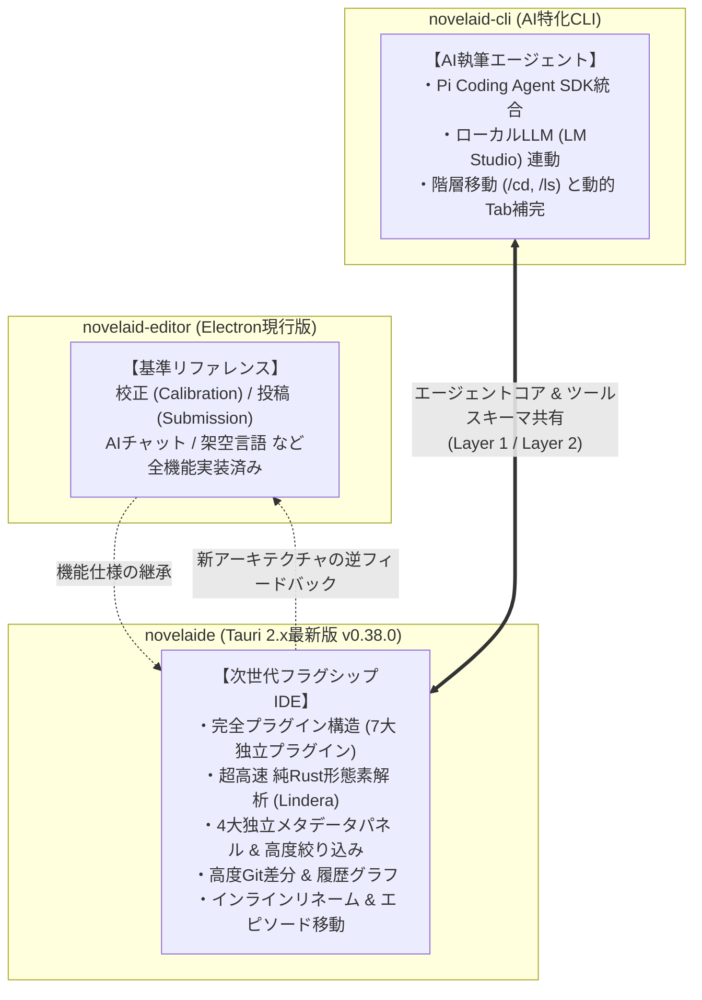
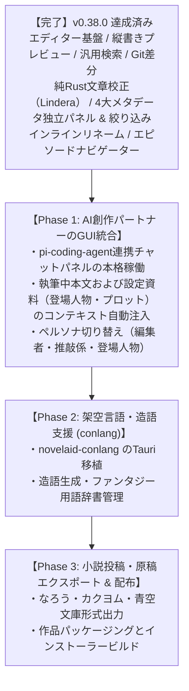

# 機能実装状況および開発ロードマップ（v0.38.0 最新版）

## 1. はじめに

本ドキュメントは、小説執筆支援システム群として並行開発・運用されている各プロジェクトについて、その機能と実装状況を横断的に比較・整理し、フラグシップIDEである **`novelaide`（Tauri完全新設計版・コードネーム `novelaid-e`・最新バージョン v0.38.0）** の到達点および今後の開発ロードマップを一本化してまとめたものです。

### 対象プロジェクトと基本方針

1. **`novelaid-editor`（Electron現行版）**:
   - 小説執筆に必要な基本機能を網羅した現行の本番稼働エディター。全機能要件の**「基準（リファレンス）」**。
2. **`novelaide`（Tauri完全新設計版・コードネーム `novelaid-e`）**:
   - `novelaid-editor` をベースに、Tauri 2.x + Rust で完全再設計した次世代IDE。
   - 超高速性・完全プラグイン疎結合・バックエンド主導型ファイル操作・純Rust形態素解析などを導入し、現行版の全機能を順次追い越し・高度化しています。
3. **`novelaid-cli`（AIエージェント特化CLI/TUI）**:
   - ターミナル上で作家とAIが対話しながらプロット・設定・本文を執筆・推敲するためのCLIツール。
   - `pi-coding-agent` SDK上に構築され、ローカルLLM（LM Studio）自動連携や境界保護付き階層移動（`/cd`, `/ls`）を備えています。エージェントコアおよびツール群を `novelaide` と共有します。
4. **`novelaid-editor-next`（Tauri初期再実装版・参考用）**:
   - novelaid-editor を Tauri で再実装する初期プロトタイプ（読み取り専用・参考用）。

### 3アプリの強みと役割分担

---

## 2. 機能実装状況の横断比較一覧（v0.38.0 現在）

`novelaid-editor` の機能を基準とし、現在の実装状況を整理しました。

| カテゴリ | 機能項目 | novelaid-editor (基準・現行Electron) | novelaide (次世代Tauri v0.38.0) | novelaid-cli (AI特化CLI/TUI) | novelaideの実装ステータスと特徴 |
| :--- | :--- | :---: | :---: | :---: | :--- |
| **基盤・設計** | アプリフレームワーク | Electron | Tauri 2.x + Rust | Node.js (TUI) | **最新化完了**（超軽量・省メモリ・高速起動） |
| | プラグイン拡張性 | ✕ (固定設計) | **◎ 完全プラグイン化** | ◯ (Command/Tool) | **大幅先行**（View / Panel / Settings / Search Registry） |
| | パッケージ/クレート分離 | ✕ (モノリス) | **◎ 独立クレート化** | △ (単一パッケージ) | **大幅先行**（`fs`, `settings`, `git`, `ai`, `calibration`, `ruby`, `metadata` の7プラグイン分離） |
| **プロジェクト・ファイル** | プロジェクト管理/選択 | ◯ (Launcher) | **◯ (restar-app 統合)** | ◯ (引数/カレントDir) | **同等達成**（最近開いた作品、新規作成、ダイアログ選択） |
| | エクスプローラー・ツリー | ◯ (標準ツリー) | **◎ 進化版ツリー** | ◯ (`/ls`, `/cd`, Tab補完) | **大幅先行**（自動連番推測、インライン作成/リネーム、D&D移動コピー、手動Reveal） |
| | ファイル安全操作 | △ (フロント先行) | **◎ バックエンド主導型** | ◯ (ルート上限保護) | **大幅先行**（Rust主導安全確認、`fs:changed` イベント駆動自律更新） |
| | 外部ファイル同期 & 保存保護 | ◯ (chokidar) | **◎ 高度オンデマンド同期** | ✕ | **大幅先行**（フォーカス復帰時mtime検証、競合検知、IME配慮自動保存、文字激減セーフティネット） |
| **エディターコア** | Monaco Editor 統合 | ◯ | **◎ 小説特化 Monaco** | ✕ (TUIのみ) | **完全達成**（文字サイズ16px、行間、右端折返し、完全日本語NLS配信） |
| | インラインタイトル & リネーム | ◯ (タイトル表示) | **◎ インラインリネーム** | ✕ | **大幅先行**（エディタ上部タイトル直接編集、アトミックファイル名変更） |
| | フッターエピソードナビゲーション | ◯ (NovelNavigator) | **◎ EpisodeNavigator** | ✕ | **同等達成**（自然順序ソート、タブを増やさないインプレイス遷移、novel限定） |
| | ルビ・小説記法補完 | ◯ (novelaid-ruby) | **◎ (tauri-plugin-novelaid-ruby)** | △ (ツール化予定) | **大幅先行**（Rust高速ルビ処理、表記揺れ根絶、傍点・ダッシュ・リーダー自動補完） |
| | 全角スペース・装飾可視化 | ◯ | **◎ デコレーション連動** | ✕ | **同等達成**（空行字下げ・全角スペース枠線可視化） |
| | マルチタブ・未保存管理 | ◯ | **◎ (DocumentContext)** | ✕ (単一コンテキスト) | **大幅先行**（参照カウント式ライフサイクル、左右ペイン完全共有、未保存マーク） |
| **表示・プレビュー** | 縦書き文庫プレビュー | ◯ | **◎ ビュープラグイン化** | ✕ | **同等達成**（フォント・行間・字詰め・ページ送り、ルビ表示） |
| | スプリットビュー (2画面) | ◯ (左右分割) | **◎ ドラッグリサイズ連動** | ✕ | **同等達成**（エディタ＋プレビュー、エディタ＋エディタ、独立タブ管理） |
| | 拡張 Markdown 描画 | ◯ (novelaid-markdown) | **◎ 高度リッチ描画** | ◯ (TUI Markdown) | **同等達成**（MapLibre地図、Mermaid作図、ルビ・傍点描画） |
| **検索・アウトライン** | 全文・横断検索 | ◯ (Search) | **◎ 汎用検索パネル** | △ (将来Tool化) | **大幅先行**（本文・メタデータ・セリフ切替検索プロバイダー） |
| | 見出しアウトライン | ◯ | **◎ アウトラインパネル** | ✕ | **同等達成**（H1〜H6階層ジャンプ） |
| **設定・メタデータ** | YAML Frontmatter 編集UI | ◯ (MetadataPanel) | **◎ (MetadataPanel)** | △ (`/metadata` 予定) | **同等達成**（右ペイン専用フォーム、タグ/シリーズ/巻/章対応） |
| | 設定資料独立パネル展開 | ◯ (個別パネル) | **◎ 4大独立パネル構成** | ✕ | **同等達成**（登場人物、地名・施設、プロット・構成、総合一覧の4パネル独立） |
| | メタデータ絞り込み・分類 | ◯ (簡易フィルタ) | **◎ BaseMetadataListPanel** | ✕ | **大幅先行**（シリーズ/巻ドロップダウン、タグAND絞り込み、役職/巻/タググループ表示、地名タグ完全互換） |
| | 設定管理・OS永続化 | ◯ (JSON永続化) | **◎ (restar-settings)** | ◯ (config) | **大幅先行**（独立プラグイン、型安全OS設定永続化） |
| **バージョン管理** | Git ソース管理 (コミット/差分) | ◯ (GitPanel) | **◎ 高度 Git プラグイン** | ✕ | **大幅先行**（SVGコミット履歴グラフ、Monaco Diff Editor文字差分比較） |
| **文章校正・解析** | 日本語文章校正 | ◯ (textlint等) | **◎ (novelaid-calibration)** | △ (`/proofread` 予定) | **大幅先行**（純Rust製Lindera形態素解析、三点リーダー/ダッシュ偶数、感嘆符後空白、助詞連続、禁止文字等の即時波線表示・ジャンプ・校正パネルワンクリック修正） |
| | ルビ自動推測 | △ (一部) | **◎ Lindera形態素連動** | ✕ | **大幅先行**（漢字選択時に平仮名読みをミリ秒推測、ダイアログ自動入力） |
| **AI・創作特化** | AIチャット (壁打ち・相談) | ◯ (Chat) | **△ 基盤実装済み・GUI統合中** | **◎ (Pi SDK フルTUI)** | *`pi-coding-agent` SDK統合済み、チャットUI画面接続中* |
| | ペルソナ切替 (編集者/キャラ) | ◯ (AI) | **△ 準備中** | △ (プロンプト切替) | *AIパネルGUI統合と合わせて実装* |
| | 架空言語支援 (conlang) | ◯ (ch/conlang) | **✕ 未着手** | ✕ | *次期フェーズで移植予定* |
| **投稿・出力** | 小説投稿サイト形式出力 | ◯ (Submission) | **✕ 未着手** | ✕ | *最終フェーズで実装*（なろう、カクヨム形式エクスポート） |

---

## 3. 現状の達成水準と主要マイルストーン（v0.38.0 の総括）

`novelaide` は初期の移植・基盤構築フェーズを完全に完了し、**エディター基盤・ファイル操作・Git差分管理・文章校正（Lindera形態素解析）・メタデータ管理（4パネル独立＆高度絞り込み）・エディター上下一体ナビゲーション** に至るまで、現行の `novelaid-editor` を機能・品質の両面で大きく凌駕する水準に達しました。

### 完了した主要マイルストーン
1. **純Rust文章校正エンジン (`tauri-plugin-novelaid-calibration`)**:
   - Lindera IPADIC形態素解析によるミリ秒単位の形態素・品詞分解。
   - 小説作法ルール（三点リーダー偶数、ダッシュ偶数、感嘆符スペース、助詞連続、禁止文字など）の網羅。
   - Monaco Editor波線マーカー、ジャンプ、校正パネル（`CalibrationPanel`）での指摘一覧・ワンクリック修正。
2. **統合メタデータ・ナレッジハブ (`tauri-plugin-novelaid-metadata`)**:
   - `BaseMetadataListPanel` による登場人物・地名・プロット・総合一覧の4パネル独立展開。
   - シリーズ（`serieses`）・巻（`books`）メタデータ連携。
   - リアルタイム検索、シリーズ/巻ドロップダウンフィルター、出現頻度タグチップスによるAND絞り込み。
   - 旧版 `novelaid-editor` との互換性を担保する網羅的タグ抽出（`LOCATION_TAGS` による地名判定完全対応）。
3. **エディター執筆体験の高度化**:
   - ファイルタイトルバー（`FileNameHeader`）による直接インラインリネーム。
   - フッターナビゲーション（`EpisodeNavigator`）による同一フォルダ内novelエピソードのタブを増やさない快適前後移動。
   - テーマシステムの視認性改善（コントラスト向上）。

---

## 4. 今後の残余開発ロードマップ

現在未着手または統合途中の機能領域は、明確に以下の3つのフェーズに整頓されます。

### 次期フェーズの詳細

#### Phase 1: AI創作パートナーのGUI統合 (`tauri-plugin-novelaid-ai`)
* すでに統合されている `pi-coding-agent` SDK コアとフロントエンドの AI チャットパネルを本格的に結線。
* `tauri-plugin-novelaid-metadata` から取得した登場人物・世界観・プロット設定や、現在エディターで開いている原稿本文を背景コンテキストとして動的に AI へ注入。
* 編集者（プロット相談・助言）、推敲係（文体改善・推敲）、登場人物（セリフ壁打ち）のペルソナ切り替えを実装。

#### Phase 2: 架空言語・造語支援 (`novelaid-conlang`) の移植
* 旧 Electron 版に搭載されていた造語・ネーミング支援ツールの再設計・移植。
* ファンタジー用語辞書の作成や発音・文法ルールの体系化を支援。

#### Phase 3: 小説投稿・原稿エクスポート & 配布
* なろう形式・カクヨム形式などのルビ変換ルールに合わせた一括エクスポート。
* Windows インストーラー（NSIS/MSI）自動生成およびリリースパイプラインの確立。
