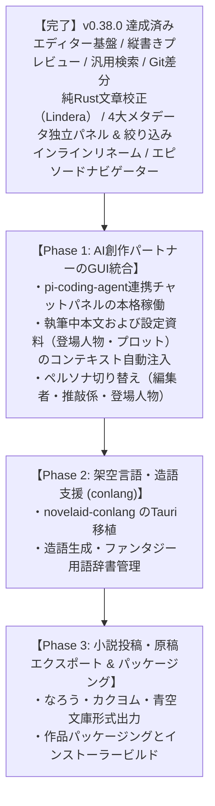

# novelaid 機能実装状況の総点検および開発ロードマップ改定（v0.38.0 最新版）

## 1. 概要

本ドキュメントは、小説執筆用デスクトップエディターの開発において、
先行プロジェクトである **`novelaid-editor`（Electron現行版）**、**`novelaid-editor-next`（Tauri初期再実装版・開発途中）**、および現在開発を進めている **`novelaide`（Tauri完全新設計版・コードネーム `novelaid-e`・最新バージョン v0.38.0）** の機能実装状況を横断的に比較・再確認し、最新の実装状況を反映して今後の開発ロードマップを整頓・改定したものです。

---

## 2. 3プロジェクトにおける機能実装状況の比較一覧（v0.38.0 現在）

各機能を「エディター基盤」「ファイル・プロジェクト」「UI・レイアウト」「執筆支援・分析」「バージョン管理」「設定」「AI・創作支援」の大きなくくりで分類し、3つのプロジェクトにおける実装状況を一覧化しました。

| 大分類 | 機能項目 | novelaid-editor (現行Electron版) | novelaid-editor-next (Tauri初期版・途中) | novelaide (現在最新版 v0.38.0) | 追いつき・進化状況 |
| :--- | :--- | :---: | :---: | :---: | :--- |
| **基盤・設計** | アプリフレームワーク | Electron | Tauri 2.x | Tauri 2.x + Rust | **最新化完了** |
| | プラグインアーキテクチャ | ✕ (固定設計) | ✕ (固定設計) | **◎ 完全プラグイン化** (View, Panel, Settings, Search) | **大幅に先行・進化** |
| | クレート/パッケージ分離 | ✕ | △ (novelaid-fsのみ) | **◎ 7プラグイン完全分離** (fs, settings, git, ai, calibration, ruby, metadata) | **大幅に先行・進化** |
| **プロジェクト・ファイル** | プロジェクト選択/作成 | ◯ (Launcher) | ◯ (restar-app) | **◯ (restar-app 統合)** | **同等達成** |
| | ファイルツリー・操作 | ◯ (新規/削除/変更) | ◯ (novelaid-fs) | **◎ 汎用エクスプローラー** 原稿/ファイル/目次の3連構成 | **大幅に先行・進化** |
| | ファイル安全操作 | △ (フロント先行) | ◯ | **◎ バックエンド主導型判定** Rust側での一元判定・削除確認 | **大幅に先行・進化** |
| | 外部ファイル同期 & 保存保護 | ◯ (chokidar) | △ | **◎ オンデマンド同期 & 激減セーフティ** フォーカス復帰時mtime同期・自動保存 | **大幅に先行・進化** |
| **エディターコア** | Monaco Editor統合 | ◯ | ◯ | **◎ 小説特化Monaco** 16px、行間、全角スペース枠線、完全日本語化 | **同等達成** |
| | ファイルタイトル & リネーム | ◯ (タイトル表示) | ✕ | **◎ インラインリネーム** エディター上部で直接ファイル名変更 | **大幅に先行・進化** |
| | エピソードナビゲーション | ◯ (NovelNavigator) | ✕ | **◎ EpisodeNavigator** タブを増やさないインプレイス前後移動 | **同等達成** |
| | ルビ記法・シンタックス | ◯ (novelaid-ruby) | ◯ (novelaid-ruby) | **◎ tauri-plugin-novelaid-ruby統合** ルビ・傍点・リーダー補完 | **大幅に先行・進化** |
| | マルチタブ・未保存検知 | ◯ | ◯ | **◎ 参照カウント式ライフサイクル** 左右ペイン完全共有・ダーティバッジ | **大幅に先行・進化** |
| **表示・プレビュー** | 縦書き文庫プレビュー | ◯ | △ (一部のみ) | **◎ ビュープラグイン化** フォント・行間・組版・ルビ完全対応 | **大幅に先行・進化** |
| | スプリットビュー (2画面) | ◯ (左右分割) | ◯ (左右分割) | **◎ ドラッグリサイズ連動** | **同等達成** |
| | 拡張Markdown描画 | ◯ (novelaid-markdown) | ◯ (novelaid-markdown) | **◎ MapLibre地図/Mermaid等** | **同等達成** |
| **検索・アウトライン** | 全文検索 | ◯ (Search) | △ (簡易) | **◎ 汎用検索パネル** 本文・メタ・セリフプロバイダー分離 | **大幅に先行・進化** |
| | 見出しアウトライン | ◯ | ◯ (簡易) | **◎ アウトラインパネル** | **同等達成** |
| **ステータス・集計** | リアルタイム文字数カウント | ◯ | ◯ | **◎ ステータスバー** 全角半角/原稿用紙換算/選択範囲解析 | **同等達成** |
| | テーマ切替 (外観) | ◯ (Dark/Light) | ◯ (Dark/Light/Sepia) | **◎ Dark/Light/Sepia** CSS変数+Monaco完全連動・高コントラスト改善 | **同等達成** |
| **環境設定** | 設定UI画面 | ◯ (モーダル) | △ (簡易モーダル) | **◎ 独立プラグイン化** (restar-app-settings) | **大幅に先行・進化** |
| | 設定のOS永続化 | ◯ | △ | **◎ Rust IPC JSON永続化** | **大幅に先行・進化** |
| **バージョン管理** | Git初期化/ブランチ/コミット | ◯ | △ (APIのみ) | **◎ tauri-plugin-restar-git** | **大幅に先行・進化** |
| | 差分比較 (Diff) | ◯ (Diff) | ✕ (未実装) | **◎ Monaco DiffEditor** 左右/インライン文字差分比較 | **大幅に先行・進化** |
| | コミット履歴グラフ | ◯ (Graph) | ✕ (未実装) | **◎ SVG履歴グラフ描画** | **大幅に先行・進化** |
| **設定・メタデータ** | Frontmatter詳細編集UI | ◯ (MetadataPanel) | ◯ (MetadataPanel) | **◎ 右ペイン専用フォーム** タグ/シリーズ/巻/章対応 | **完全達成** |
| | 設定資料独立パネル展開 | ◯ (個別パネル) | ✕ | **◎ 4大独立パネル構成** 登場人物/地名/プロット/総合一覧 | **完全達成** |
| | メタデータ絞り込み・分類 | ◯ (簡易) | ✕ | **◎ BaseMetadataListPanel** シリーズ/巻セレクタ、タグAND絞り込み、役職/巻グループ化、地名互換タグ判定 | **大幅に先行・進化** |
| **執筆支援・校正** | 日本語文章校正 | ◯ (textlint等) | △ (ProofreaderPanel) | **◎ tauri-plugin-novelaid-calibration** 純Rust製Lindera形態素解析・小説作法全ルール・エディタ波線・校正パネル | **大幅に先行・進化** |
| | ルビ自動推測 | △ (一部) | ✕ | **◎ 形態素解析連動ルビ推測** 漢字選択時の高速読み自動推測 | **大幅に先行・進化** |
| **AI・創作支援** | AIチャット (壁打ち) | ◯ (Chat) | ◯ (novelaid-chat) | **△ 基盤実装済み・GUI統合中** (`pi-coding-agent` SDK統合済み、遅延ロード) | *GUI統合フェーズ* |
| | ペルソナ切替 (編集者等) | ◯ (AI) | ◯ (novelaid-ai) | **△ 準備中** | *GUI統合フェーズ* |
| | 架空言語支援 (conlang) | ◯ (ch/conlang) | ◯ (novelaid-conlang) | **✕ 未着手** | *未着手（次フェーズ）* |
| **投稿・エクスポート** | 小説投稿サイト形式出力 | ◯ (Submission) | ✕ (未実装) | **✕ 未着手** | *未着手（将来）* |

---

## 3. 実装完了領域と先行状況のまとめ

`novelaide`（v0.38.0）は、旧版（`novelaid-editor`）および初期Tauri版（`novelaid-editor-next`）と比較して、以下の主要領域において「完全追いつき＆追い越し」を達成しています。

1. **純Rust文章校正エンジン (`novelaid-calibration`)**:
   - 純Rust形態素解析（Lindera IPADIC）を内蔵し、三点リーダー偶数・ダッシュ偶数・感嘆符スペース・助詞連続・ら抜き言葉・禁止文字など豊富な小説作法ルールをミリ秒単位で判定。
   - Monaco Editor への波線マーカー（`setModelMarkers`）、ジャンプ、校正パネル（`CalibrationPanel`）での指摘一覧とワンクリック自動置換まで完全に動作。
2. **統合メタデータ・ナレッジハブ (`novelaid-metadata`)**:
   - `BaseMetadataListPanel` を基盤に、登場人物・地名施設・プロット構成・総合設定資料の4パネルを独立配置。
   - シリーズ（`serieses`）・巻（`books`）メタデータの双方向対応。
   - リアルタイム検索、シリーズ・巻別ドロップダウンフィルター、出現頻度タグチップスによるAND絞り込み、役職/巻/タググループ表示切り替え。
   - 旧版との完全互換性を確保する地名タグ判定（`LOCATION_TAGS`）。
3. **エディター執筆体験の高度化**:
   - ファイルタイトルヘッダー（`FileNameHeader`）による直接インラインファイル名変更。
   - エディターフッター（`EpisodeNavigator`）による同一フォルダ内novelエピソードのタブを増やさない快適前後移動。
   - 外部ファイル変更オンデマンド検証と自動保存（文字激減セーフティネット）。

---

## 4. 今後の開発ロードマップ（残余フェーズ計画）

残る未実装・統合中の機能領域は、以下の3つのフェーズに整頓されます。

### 次期フェーズの詳細

#### Phase 1: AI創作パートナーのGUI統合 (`tauri-plugin-novelaid-ai`)
* すでに統合されている `pi-coding-agent` SDK コアとフロントエンドの AI チャットパネルを本格的に結線。
* `tauri-plugin-novelaid-metadata` から取得した登場人物・世界観・プロット設定や、現在エディターで開いている原稿本文を背景コンテキストとして動的に AI へ注入。
* 編集者（プロット相談・助言）、推敲係（文体改善・推敲）、登場人物（セリフ壁打ち）のペルソナ切り替えを実装。

#### Phase 2: 架空言語・造語支援 (`novelaid-conlang`) の移植
* 旧 Electron 版に搭載されていた造語・ネーミング支援ツールの再設計・移植。
* ファンタジー用語辞書の作成や発音・文法ルールの体系化を支援。

#### Phase 3: 小説投稿・原稿エクスポート & 配布
* なろう形式・カクヨム形式などのルビ変換ルールに合わせた一括エクスポート。
* Windows インストーラー（NSIS/MSI）自動生成およびリリースパイプラインの確立。
