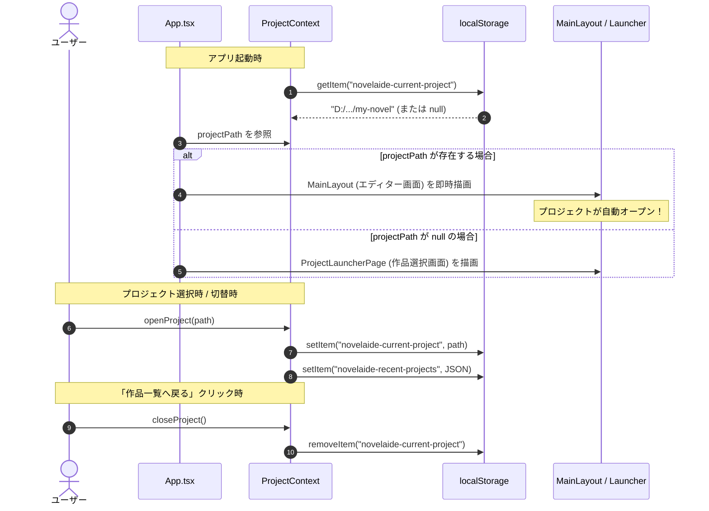
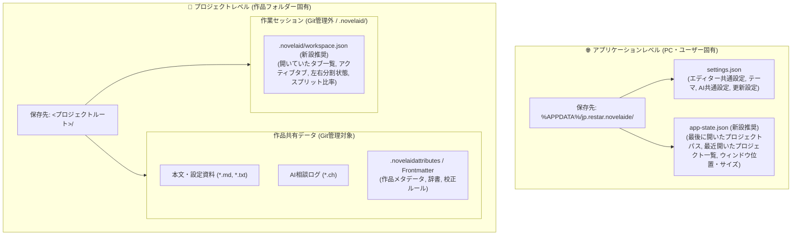
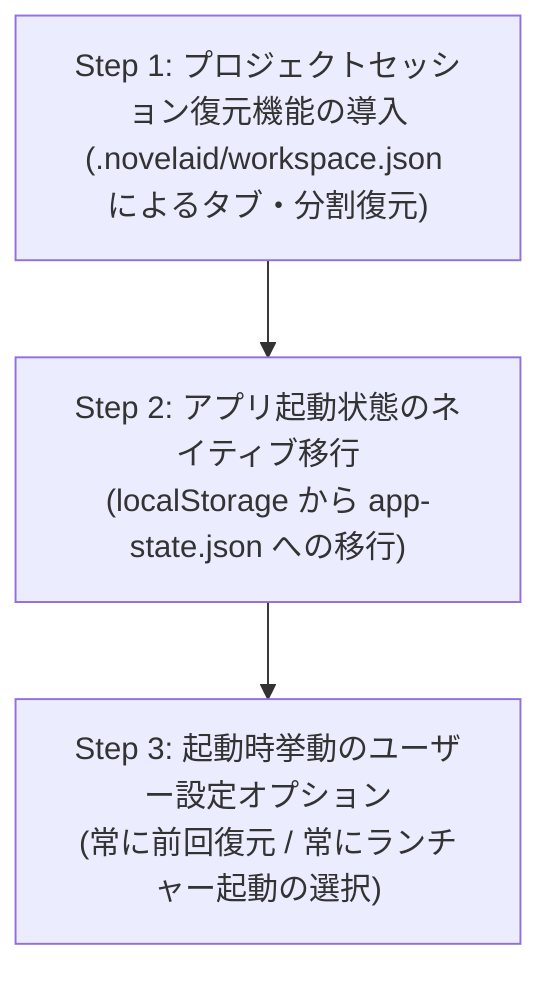

# 永続化情報およびセッション管理仕様

## 1. 概要

本仕様書は、小説執筆デスクトップIDE `novelaide`（コードネーム: `novelaid-e`）における永続化データ（起動情報、ユーザー設定、作品原稿、作業セッション等）の保存場所、データ形式、アクセス権限、および将来的なアーキテクチャ分離方針と実装計画を定義するものです。

---

## 2. 現行の永続化仕様と仕組み

現在、`novelaide` で永続化されている情報は、大きく分けて **3つの異なる記憶領域** に分散して保存されています。

### 2.1 起動情報・履歴（WebView `localStorage`）
WebView（ブラウザエンジン）内部の `localStorage` を用いて、起動およびプロジェクト履歴が管理されています。

| キー名 | 形式 | 格納内容 | 主な参照・更新コンポーネント |
| :--- | :--- | :--- | :--- |
| **`novelaide-current-project`** | 文字列 | 最後に開いていたプロジェクトフォルダーの絶対パス（例: `D:\...\novel-title`） | `ProjectContext.tsx`、`App.tsx` |
| **`novelaide-recent-projects`** | JSON文字列 (`ProjectItem[]`) | 最近開いたプロジェクトの履歴リスト（最大10件） | `ProjectContext.tsx`、`ProjectLauncherPage.tsx` |
| **`novelaide-theme`** | 文字列 | UIカラーテーマ名（`"dark"`, `"light"`, `"sepia"`, `"system"`） | `ThemeContext.tsx` |
| **`novelaide:last-novel:<projectPath>`** | JSON文字列 (`LastNovelInfo`) | プロジェクトごとに左ペインで最後に開いた/保存した単一novelエピソード情報 | `recentDocumentStorage.ts`, `DocumentContext.tsx` |

#### 起動・保存のライフサイクルフロー


### 2.2 アプリケーション共通設定（OS AppData / `settings.json`）
Tauri公式プラグイン `tauri-plugin-restar-settings` を通じ、OS標準の設定ディレクトリに保存されています。

- **保存場所**: `%APPDATA%\jp.restar.novelaide\settings.json`（Windows環境）
  - Linux: `~/.config/jp.restar.novelaide/settings.json`
  - macOS: `~/Library/Application Support/jp.restar.novelaide/settings.json`
- **データ形式**: 構造化 JSON
- **格納内容**:
  - `theme`: カラーテーマ
  - `editor`: エディター表示設定（フォントサイズ、行間等）
  - `showDebugPanel`: 形態素・辞書デバッグパネルの表示ON/OFF
  - `autoCheckUpdateOnStartup`: 起動時の自動更新確認フラグ
  - `ai`: AIプロバイダー設定（Gemini / LM Studioのモデル名、APIキー、カスタムURL等）

### 2.3 作品フォルダー内のデータ（プロジェクトレベル）
各小説プロジェクトのフォルダー内に実ファイルとして保存されます。

| 種別 | ファイル / パス | 形式 | 内容 |
| :--- | :--- | :--- | :--- |
| **小説本文** | `*.md`, `*.txt` | UTF-8 テキスト | 各エピソードの原稿本文 |
| **設定資料** | `characters/*.md` 等 | Markdown + Frontmatter | 登場人物、プロット、地名等の設定資料 |
| **AI相談ログ** | `*.ch` | JSON (`ChatMessage[]`) | AI執筆パートナーとの会話・思考履歴 |
| **バージョン履歴** | `.git/` | Gitリポジトリ | 原稿の変更履歴、コミットグラフ |

### 2.4 単一novelエピソードの自動復元仕様（v0.64.0実装）
過剰なタブ・分割状態の丸ごと復帰（旧 `novelaid-editor` での複雑化・肥大化の反省）を排し、作家が「直前の続きから単一エピソードの執筆を最速で再開できる」ことに特化した軽量セッション再開機能です。

#### 1. 記録ポリシーと左ペイン限定判定
- **対象ドキュメント**: 小説原稿（`documentType === 'novel'`）のみに厳密に限定。
  - 設定資料やプロット（Markdown）、コード等のファイルは除外（サイドバー等から1クリックで開けるため）。
- **左ペイン（`editor.left`）限定判定**:
  - `novelaide` では「左ペイン＝執筆用」「右ペイン＝参考資料・過去エピソード参照用」と責務が分かれているため、**左ペインでアクティブになった（開いた・タブを切り替えた）novelドキュメントのみ** を記録します。
  - 右ペインでどれだけ過去の novel を開いても、記録が上書きされることはありません。
- **保存時の連動**:
  - `saveDocument` 成功時、保存対象が `novel` かつ左ペインに関連している場合に最新パスとして記録。
- **リネーム追従**:
  - インラインファイル名変更時（`renameDocument`）、記録されているパスも新パスへ自動更新。

#### 2. 自動復元フロー
1. アプリ起動またはプロジェクト切り替え時（`currentProjectPath` 確定時）、開いているドキュメントが 0 件の場合に実行。
2. `recentDocumentStorage.get(currentProjectPath)` で記録を取得。
3. `fileService.getDocumentStat` により実ファイルが存在するか高速検証。
4. ファイルが存在すれば `openDocument(path, { paneId: 'editor.left' })` を実行し、左ペインに単一タブとして自動復元。
5. ファイルが削除・移動されていた場合は静かにキーをクリーンアップし、エラーを出さない。

---

## 3. 現行仕様における課題と今後の展望

1. **ブラウザストレージ依存による揮発リスク**:
   - `novelaide-current-project` や `novelaide-recent-projects`、`novelaide:last-novel:...` が WebView2 の `localStorage` に依存しているため、Windows Defender、ディスククリーンアップ、WebView2 のプロファイル初期化等によって履歴が消失するリスクがあります。将来的に `app-state.json` への移行を検討します。
2. **作業セッションの軽量・実用アプローチの確立**:
   - 全タブや分割状態を重厚に復元するのではなく、「左ペインの単一novelドキュメント自動復元」によって、不整合や肥大化を起こさずに実用的な執筆再開体験を実現しました。
3. **設定と外観の二重保持**:
   - テーマ設定が `localStorage`（`novelaide-theme`）と `settings.json`（`theme`）の双方に存在しており、責務が分散しています。

---

## 4. アプリケーションレベル vs プロジェクトレベルの分離アーキテクチャ

永続化情報を**「アプリケーションレベル（全作品共通）」**と**「プロジェクトレベル（作品個別）」**の2層に体系化し、責務を明確に分離します。



---

## 5. 詳細設計案とデータ構造仕様

### 5.1 アプリケーションレベル：`app-state.json` 仕様案
- **保存先**: `%APPDATA%\jp.restar.novelaide\app-state.json`
- **用途**: ユーザー設定（環境設定）とは区別される、直前のシステム状態や操作履歴。

```json
{
  "lastProjectPath": "D:\\home\\mituha\\repos\\novel-tools\\novelaide",
  "recentProjects": [
    {
      "name": "星を継ぐ少女",
      "path": "D:\\home\\mituha\\repos\\novels\\star-maiden",
      "lastOpened": "2026-11-07T08:00:00Z"
    }
  ],
  "windowState": {
    "width": 1280,
    "height": 800,
    "x": 100,
    "y": 50,
    "isMaximized": false
  }
}
```

### 5.2 プロジェクトレベル：`.novelaid/workspace.json` 仕様案
- **保存先**: `<projectPath>/.novelaid/workspace.json`
- **用途**: 作品フォルダーごとのエディター作業セッション（タブ、ペイン分割状態）。
- **Git管理方針**: `.gitignore` に `.novelaid/` を指定（作家ごとの作業環境であり、リポジトリには含めない）。

```json
{
  "version": 1,
  "isSplit": true,
  "splitRatio": 0.5,
  "activePane": "editor.left",
  "panes": {
    "editor.left": {
      "activePath": "01_プロローグ.md",
      "tabs": [
        {
          "path": "01_プロローグ.md",
          "viewMode": "editor"
        },
        {
          "path": "02_第一章.md",
          "viewMode": "editor"
        }
      ]
    },
    "editor.right": {
      "activePath": "characters/01_主人公.md",
      "tabs": [
        {
          "path": "characters/01_主人公.md",
          "viewMode": "preview"
        }
      ]
    }
  }
}
```

---

## 6. 段階的実装計画（ロードマップ）



1. **Step 1: プロジェクトセッション復元機能の実装（優先度: 高）**:
   - `DocumentContext.tsx` にセッション自動保存（デバウンス保存）とプロジェクトロード時のセッション復元ロジックを追加。
   - プロジェクトを開いた際、前回のタブ・分割状態が瞬時に復元される体験を実現。
2. **Step 2: アプリ状態のネイティブ永続化移行（優先度: 中）**:
   - `tauri-plugin-restar-settings` または専用コマンドを通じて `app-state.json` を新設。
   - `localStorage` から `lastProjectPath` および `recentProjects` を移行し、ブラウザストレージの破損耐性を強化。
3. **Step 3: 起動時挙動の設定オプション拡充（優先度: 低）**:
   - 設定画面（全般タブ）に「起動時に前回のプロジェクトを自動で開く」トグルを追加（OFFの場合は常にランチャー画面を表示）。
