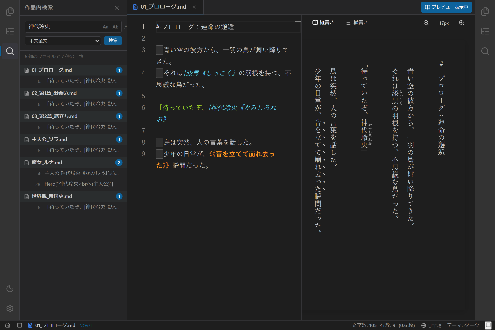

# 汎用検索パネル実装仕様書

## 1. 概要とアーキテクチャ方針

本ドキュメントは、**`novelaide`** における **共通UI（検索入力・置換・オプション・結果リスト）とプラグイン式検索プロバイダー（`SearchProviderPlugin`）を分離し、本文全文検索、メタデータ検索、セリフ特化検索等を柔軟に実行可能にする「汎用検索パネル（`SearchPanel`）」** の実装仕様を定義するものです。



### 設計方針
1. **標準UI機能の一貫性**:
   - 検索入力欄、置換欄、検索オプション（大文字小文字 `Aa`、単語単位 `Ab`、正規表現 `.*`）、検索結果ツリー（ファイル別マッチ、行番号、ジャンプ）はホストパネルが提供。
2. **プロバイダーのプラグイン化 (`SearchProviderPlugin`)**:
   - `SearchRegistry` を介して、検索対象や走査ロジックをプロバイダーとして動的に登録・切り替え可能にする。
3. **小説執筆に特化したプロバイダーの初期提供**:
   - 本文全文検索 (`FullTextSearchProvider`)
   - メタデータ・設定検索 (`MetadataSearchProvider`)
   - 会話劇・セリフ特化検索 (`DialogueSearchProvider`、`novelaid-ruby` 連携)

---

## 2. ディレクトリ構成

```text
src/
├── types/
│   └── searchPlugin.ts          # SearchQuery, SearchMatch, SearchProviderPlugin
├── core/
│   └── searchRegistry/          # 検索プロバイダーレジストリ
│       ├── SearchRegistry.ts
│       └── index.ts
├── plugins/
│   ├── search/
│   │   ├── FullTextSearchProvider.ts   # 本文全文検索
│   │   ├── MetadataSearchProvider.ts   # 設定・メタデータ検索
│   │   └── DialogueSearchProvider.ts   # セリフ特化検索
│   └── panels/
│       └── SearchPanelPlugin.tsx       # 検索パネルのPanelRegistry登録
└── components/
    └── Search/
        ├── SearchPanel.tsx      # 共通検索UIコンテナ
        └── SearchPanel.css
```

---

## 3. 型定義（`src/types/searchPlugin.ts`）

```typescript
export interface SearchQuery {
  text: string;
  replacement?: string;
  caseSensitive: boolean;
  wholeWord: boolean;
  useRegex: boolean;
}

export interface SearchMatch {
  filePath: string;
  fileTitle: string;
  lineNumber: number;
  column: number;
  matchLength: number;
  previewLine: string;
  extraInfo?: string;
}

export interface SearchProviderPlugin {
  readonly id: string;
  readonly name: string;
  readonly description?: string;
  readonly priority: number;
  search: (query: SearchQuery, projectPath: string) => Promise<SearchMatch[]>;
  replace?: (query: SearchQuery, projectPath: string, matches?: SearchMatch[]) => Promise<void>;
}
```

---

## 4. 組み込みプロバイダー仕様

| プロバイダーID | 表示名 | 優先度 | 検索対象と特徴 |
|---|---|:---:|---|
| `novelaid.search.fulltext` | 本文全文 | 100 | プロジェクト内の全 `.txt` / `.md` ファイルのテキスト行検索（デフォルト） |
| `novelaid.search.metadata` | 設定・メタデータ | 90 | YAMLフロントマターおよび設定資料内の属性（タグ、登場人物、ステータス） |
| `novelaid.search.dialogue` | セリフのみ | 80 | `novelaid-ruby` 連携により「」会話文のみを対象にした口調・発言チェック |

---

## 5. 実装ステップ計画

1. **Step 1: 検索プラグイン型定義とレジストリ基盤の作成**
   - `src/types/searchPlugin.ts`
   - `src/core/searchRegistry/SearchRegistry.ts` & `index.ts`
2. **Step 2: 組み込みプロバイダーの実装**
   - `FullTextSearchProvider.ts`
   - `MetadataSearchProvider.ts`
   - `DialogueSearchProvider.ts`
3. **Step 3: 共通検索UIコンポーネント（`SearchPanel.tsx`）の実装**
   - 入力バー、置換バー、オプションボタントグル、プロバイダー選択ドロップダウン、結果ツリー
4. **Step 4: `SearchPanelPlugin.tsx` の登録とペイン統合**
   - `PanelRegistry` に `novelaid.panel.search` として登録（左アクティビティバーの `Search` アイコンと連動）
5. **Step 5: 動作検証とスクリーンショット撮影**
