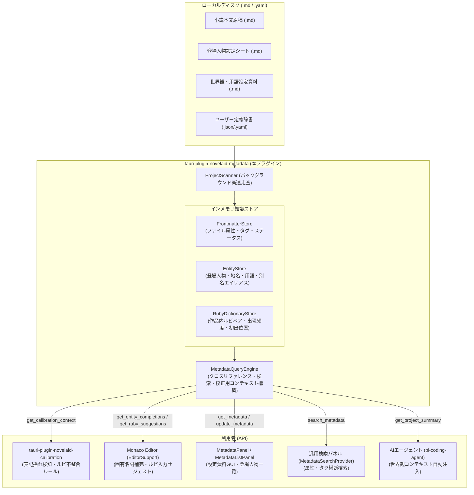
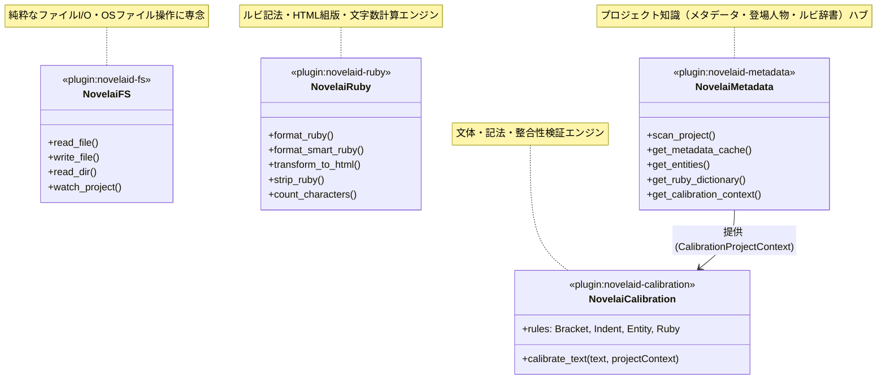

# 統合メタデータプラグイン（tauri-plugin-novelaid-metadata）仕様書

## 1. 概要と背景

本ドキュメントは、小説執筆用エディター **`novelaide`** における **プロジェクト全体の知識・コンテキスト（広義のメタデータ）を一元的にスキャン・収集・インデックス化・提供するバックエンドプラグイン `tauri-plugin-novelaid-metadata`** の設計および実装仕様を定義するものである。

### 1.1. 課題と目的

1. **校正機能の拡張に伴う動的コンテキスト要求**:
   - 高度な文章校正（表記揺れ検知、登場人物の誤記検知、世界観設定の整合性チェック、作品固有ルビの整合性チェック）を実施するためには、開いている単一ファイルの情報だけでなく、**「プロジェクト全体の登場人物・世界設定・使用ルビ」** の知識が不可欠である。
2. **「広義のメタデータ」の一元集約**:
   - 小説におけるメタデータとは、ファイル先頭の YAML Frontmatter（狭義のメタデータ）のみならず、**「登場人物シート」「地名・世界設定資料」「本文中に登場する固有ルビの出現履歴」** などの作品知識全般（広義のメタデータ）を包括する。
   - これらを各プラグイン（`fs` や `ruby`）に分散させず、**単一の知識基盤（ナレッジハブ）プラグイン**として独立・集約する。
3. **ファイルI/O責務の分離とキャッシュ最適化**:
   - `tauri-plugin-novelaid-fs` は純粋なファイルシステム操作（読み書き、ツリー構築、属性管理）に専念させ、メタデータの収集・解析・インメモリキャッシュは本プラグイン（`tauri-plugin-novelaid-metadata`）が担当することで、責務の純粋性と保守性を向上させる。

---

## 2. システムアーキテクチャ

`tauri-plugin-novelaid-metadata` は、ローカルディスク上のプロジェクトファイルをバックグラウンドで高速走査し、3つの特化ストアに構造化・インデックス化して各種コンシューマーへ提供する。



---

## 3. 各モジュールの設計仕様

### 3.1. Frontmatter 管理モジュール（`frontmatter`）

各 Markdown ファイル先頭の YAML Frontmatter（`---\n...---\n`）を高速パース・シリアライズし、インメモリに保持する。

* **主な機能**:
  - `extract_frontmatter(content: &str) -> (serde_json::Value, &str)`: 本文と Frontmatter の高速分離。
  - `format_frontmatter(metadata: &serde_json::Value, content: &str) -> String`: メタデータと本文の再結合。
  - `get_metadata_cache() -> HashMap<String, serde_json::Value>`: プロジェクト内全ファイルのメタデータ一覧返却。
  - `update_metadata(path: &str, metadata: serde_json::Value)`: 個別ファイルのメタデータ更新。

### 3.2. エンティティ動的収集モジュール（`entities`）

プロジェクト内の設定資料ファイルおよび本文から、登場人物や世界観用語を自動抽出・構造化する。

* **明示的エンティティの収集**:
  - `tags` に `character` / `登場人物` / `人物` / `chara` を含むファイルから、`name`（本名/表示名）、`reading`（読み仮名）、`aliases`（愛称/通称/略称）、`role`（役割）、`summary`（人物メモ）を登録。
  - `tags` に `location` / `地名` / `place` / `term` / `用語` を含むファイルから、世界観用語・地名エンティティを登録。
* **本文からの動的抽出・補完**:
  - セリフ行（`「...」`）の前後に登場する頻出固有名詞や、鉤括弧外の呼称パターンを分析し、未定義エンティティの候補としてインデックス。
* **エイリアステーブルの構築**:
  - 例: 本名「ソラ・アルスター」に対し、「ソラ」「アルスター」「ソラくん」を同一エンティティの別名としてリレーション付け。

### 3.3. 作品固有ルビ辞書モジュール（`ruby_dict`）

プロジェクト内の全原稿からルビ記法を動的に抽出し、作品内でのルビ辞書を自動生成する。

* **走査パターン**:
  - パイプありルビ: `|[|｜]([^|｜\n《》]+)《([^《》\n]+)》|`
  - パイプなし漢字ルビ: `|([々〇\u4e00-\u9fcf\u3400-\u4dbf]+)《([^《》\n]+)》|`
* **辞書エントリ構造**:
  - 親文字（`surface`）
  - 代表ルビ（`canonical_ruby`: 最も使用頻度が高いルビ）
  - ルビ候補リスト（`rubies`: 出現回数、初出ファイル、初出行番号）
* **不整合・表記揺れの検知支援**:
  - 同一の親文字に複数の異なるルビが振られている場合（例: `|魔剣《ソウルイーター》` と `|魔剣《ソウル・イーター》`、または `|運命《デスティニー》` と `|運命《さだめ》`）を即座に特定。

### 3.4. 校正・執筆コンテキスト供給モジュール（`context`）

校正プラグイン（`tauri-plugin-novelaid-calibration`）やエディタ補完が求める形式で、最適化されたコンテキストデータを一括提供する。

---

## 4. データ構造定義（TypeScript / Rust）

### 4.1. エンティティ定義 (`models.rs` / `models.ts`)

```typescript
/** プロジェクト内エンティティの種類 */
export type EntityCategory = 'character' | 'location' | 'term' | 'item' | 'other';

/** 登場人物・世界設定エンティティ */
export interface ProjectEntity {
  /** 固有識別子（ファイルパスまたは自動生成ID） */
  id: string;
  /** 正式名称・表示名（例: "ソラ・アルスター"） */
  name: string;
  /** 読み仮名（例: "そら あるすたー"） */
  reading?: string;
  /** 別名・略称・愛称（例: ["ソラ", "アルスター", "ソラくん"]） */
  aliases: string[];
  /** 分類カテゴリ */
  category: EntityCategory;
  /** 役割・属性（例: "主人公", "帝都", "古代魔法"） */
  role?: string;
  /** 概要メモ */
  summary?: string;
  /** 定義元ファイルパス（設定シートがある場合） */
  sourcePath?: string;
  /** 本文内での出現回数 */
  occurrenceCount?: number;
}
```

### 4.2. ルビ辞書エントリ定義

```typescript
/** ルビ出現詳細 */
export interface RubyOccurrence {
  /** 振られたルビ文字列 */
  ruby: string;
  /** 出現回数 */
  count: number;
  /** 初出ファイルパス */
  firstSeenPath: string;
}

/** 作品固有ルビ辞書エントリ */
export interface ProjectRubyEntry {
  /** 親文字（例: "魔剣"） */
  surface: string;
  /** 最頻ルビ（例: "ソウルイーター"） */
  canonicalRuby: string;
  /** 出現したすべてのルビバリエーション */
  variants: RubyOccurrence[];
  /** 表記揺れ（複数のルビが存在する）フラグ */
  hasConflict: boolean;
}
```

### 4.3. 校正用プロジェクトコンテキスト定義

```typescript
/** 校正エンジンに渡すプロジェクト知識 */
export interface CalibrationProjectContext {
  /** プロジェクト全エンティティ一覧 */
  entities: ProjectEntity[];
  /** 作品固有ルビ辞書一覧 */
  rubyDictionary: ProjectRubyEntry[];
}
```

---

## 5. IPC コマンドおよび Guest-js API 仕様

### 5.1. Tauri コマンド一覧（Rust）

| コマンド名 | 引数 | 戻り値 | 説明 |
| :--- | :--- | :--- | :--- |
| `scan_project` | `project_path: String` | `ProjectScanSummary` | プロジェクト全体を再スキャンしてインデックス構築 |
| `get_metadata_cache` | なし | `HashMap<String, Value>` | 全ファイルの Frontmatter キャッシュを取得 |
| `get_entities` | `category?: String` | `Vec<ProjectEntity>` | 登場人物や世界観用語の一覧を取得 |
| `get_ruby_dictionary` | なし | `Vec<ProjectRubyEntry>` | 作品固有ルビ辞書を取得 |
| `get_calibration_context`| なし | `CalibrationProjectContext`| 校正エンジン向けの統合コンテキストを一括取得 |
| `update_file_metadata` | `path: String, metadata: Value` | `()` | 指定ファイルの Frontmatter を更新 |
| `notify_file_changed` | `path: String, content: String` | `()` | ファイル編集時の増分インデックス更新 |

### 5.2. Guest-js API（`tauri-plugin-novelaid-metadata-api`）

```typescript
import {
  scanProject,
  getMetadataCache,
  getEntities,
  getRubyDictionary,
  getCalibrationContext,
  updateFileMetadata,
  notifyFileChanged,
} from 'tauri-plugin-novelaid-metadata-api';
```

---

## 6. 各プラグインの責務境界と移行計画

本プラグイン新設に伴い、既存プラグインとの責務境界を以下のように明確化する。



1. **`tauri-plugin-novelaid-fs` からの移管**:
   - `get_metadata_cache` は新プラグイン `tauri-plugin-novelaid-metadata` 側へ移管。
   - `tauri-plugin-novelaid-fs` の `get_metadata_cache` は下位互換性のため新プラグインを呼び出すか非推奨化。
2. **`tauri-plugin-novelaid-calibration` の拡張**:
   - `CalibrationContext` に `CalibrationProjectContext` を注入可能とし、人名表記揺れ検知ルール（`EntityConsistencyRule`）およびルビ整合性ルール（`RubyConsistencyRule`）を新設。
3. **フロントエンドの移行**:
   - `MetadataPanel` / `MetadataListPanel` / `MetadataSearchProvider` のデータソースを `tauri-plugin-novelaid-metadata-api` に切り替え。

---

## 7. 段階的実装ロードマップ

- **フェーズ 1**: `tauri-plugin-novelaid-metadata` の新規スキャフォールディング、Cargo構成、guest-js構成、Frontmatter管理モジュール。
- **フェーズ 2**: プロジェクト走査エンジン（`ProjectScanner`）、エンティティ動的収集（`EntityStore`）、作品ルビ辞書生成（`RubyDictionaryStore`）。
- **フェーズ 3**: 校正プラグイン（`tauri-plugin-novelaid-calibration`）とのIPC連携および表記揺れ・ルビ不整合ルールの実装。
- **フェーズ 4**: フロントエンドUI（`MetadataPanel`, `MetadataListPanel`, `EditorSupport`）の統合と単体・結合テスト検証。
