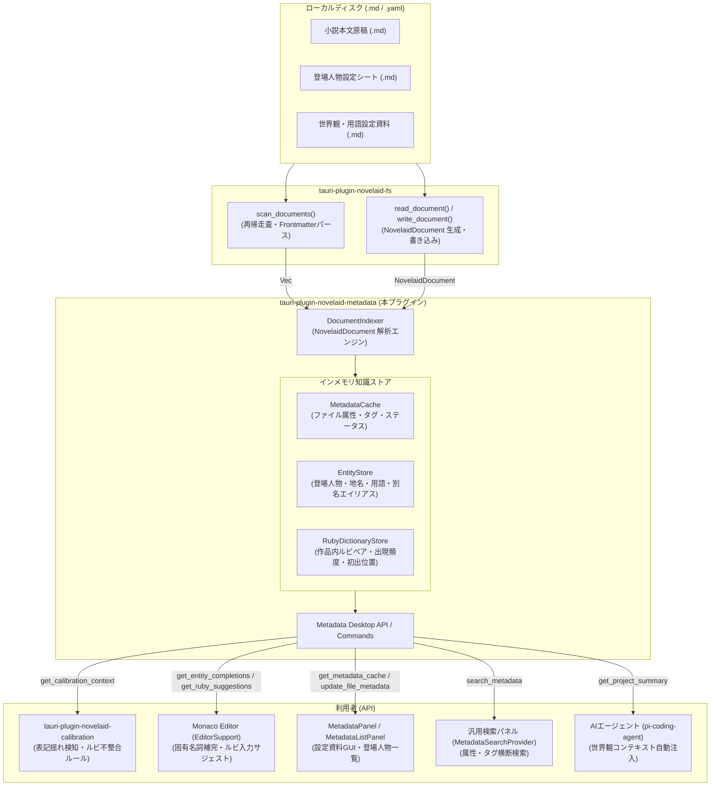
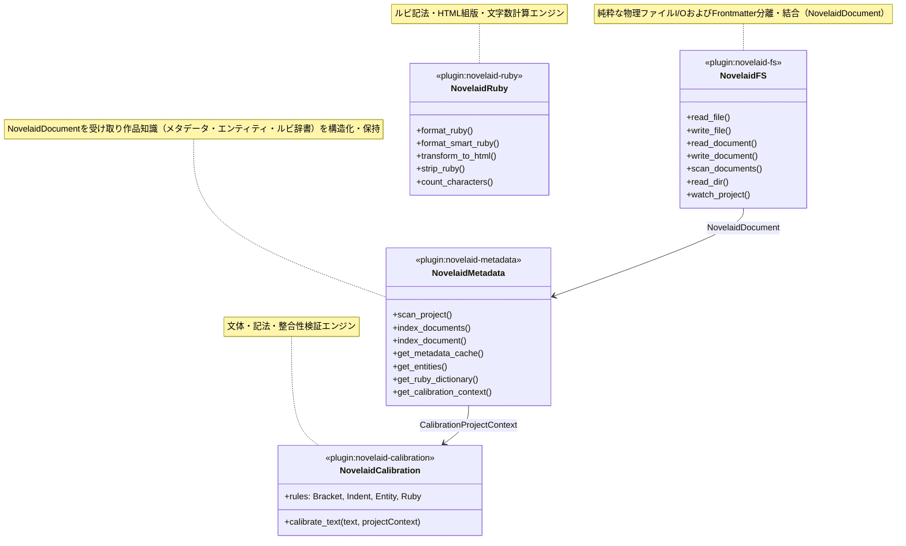

# 統合メタデータプラグイン（tauri-plugin-novelaid-metadata）仕様書

## 1. 概要と背景

本ドキュメントは、小説執筆用エディター **`novelaide`** における **プロジェクト全体の知識・コンテキスト（広義のメタデータ）を一元的にインデックス化・提供するバックエンドプラグイン `tauri-plugin-novelaid-metadata`** の設計および実装仕様を定義するものである。

> [!IMPORTANT]
> **共通概念・知識ハブ仕様の参照元**:
> - プロジェクトナレッジ基盤概念: [プロジェクトナレッジ基盤仕様](../../novelaid-editor-docs/docs/dev/プロジェクトナレッジ基盤仕様.md)
> - 純粋なファイルフォーマット規約: [Frontmatterメタデータ共通仕様](../../novelaid-editor-docs/docs/dev/Frontmatterメタデータ仕様.md)

### 1.1. 課題と目的

1. **校正機能の拡張に伴う動的コンテキスト要求**:
   - 高度な文章校正（表記揺れ検知、登場人物の誤記検知、世界観設定の整合性チェック、作品固有ルビの整合性チェック）を実施するためには、開いている単一ファイルの情報だけでなく、**「プロジェクト全体の登場人物・世界設定・使用ルビ」** の知識が不可欠である。
2. **「広義のメタデータ」の一元集約**:
   - 小説におけるメタデータとは、ファイル先頭の YAML Frontmatter（狭義のメタデータ）のみならず、**「登場人物シート」「地名・世界設定資料」「本文中に登場する固有ルビの出現履歴」** などの作品知識全般（広義のメタデータ）を包括する。
   - これらを各プラグイン（`fs` や `ruby`）に分散させず、**単一の知識基盤（ナレッジハブ）プラグイン**として独立・集約する。
3. **ファイルI/O責務の分離とデータモデルの統一**:
   - **物理ディスクアクセスおよび YAML Frontmatter のパース・結合はすべて `tauri-plugin-novelaid-fs` が担当**する（`NovelaidDocument` の入出力）。
   - `tauri-plugin-novelaid-metadata` は物理ファイルシステムを直接走査せず、`tauri-plugin-novelaid-fs` から渡された `NovelaidDocument`（構造化済みメタデータと本文）を解析してインメモリ知識ストア（インデックス）を構築・提供する純粋な知識プロセッサとして動作する。

---

## 2. システムアーキテクチャ

`novelaid-fs` と `novelaid-metadata` は厳格に責務を分離し、物理ファイルI/Oと Frontmatter パースは `novelaid-fs`、知識インデックス化とクエリは `novelaid-metadata` が担う。



---

## 3. 各モジュールの設計仕様

### 3.1. ドキュメントインデクサーモジュール（`indexer`）

`tauri-plugin-novelaid-fs` から渡された `NovelaidDocument`（構造化済みメタデータ `serde_json::Value` と本文 `content`）を受け取り、各知識ストアへ振り分ける。

* **主な機能**:
  - `index_document(doc: &NovelaidDocument, ...)`: 単一ドキュメントからメタデータ、エンティティ、本文内ルビを抽出・登録。
  - `index_documents(project_path: &str, docs: &[NovelaidDocument], ...)`: 全ドキュメントを一括インデックス化し `ProjectScanSummary` を返却。
* **物理I/Oの非依存**:
  - `serde_yaml` や `walkdir` 等のファイル走査・YAMLパース依存を持たず、純粋なデータ変換とキャッシュ管理に特化。

### 3.2. エンティティ動的収集モジュール（`entities`）

`NovelaidDocument` の `metadata` から登場人物や世界観用語を自動抽出・構造化する。

* **明示的エンティティの収集**:
  - `tags` に `character` / `登場人物` / `人物` / `chara` を含むファイルから、`name`（本名/表示名）、`reading`（読み仮名）、`aliases`（愛称/通称/略称）、`role`（役割）、`summary`（人物メモ）を登録。
  - `tags` に `location` / `地名` / `place` / `term` / `用語` を含むファイルから、世界観用語・地名エンティティを登録。
* **エイリアステーブルの構築**:
  - 本名「ソラ・アルスター」に対し、「ソラ」「アルスター」「ソラくん」を同一エンティティの別名としてリレーション付け。

### 3.3. 作品固有ルビ辞書モジュール（`ruby_dict`）

`NovelaidDocument` の `content` からルビ記法を抽出し、作品内でのルビ辞書を自動生成する。

* **走査パターン**:
  - パイプありルビ: `|[|｜]([^|｜\n《》]+)《([^《》\n]+)》|`
  - パイプなし漢字ルビ: `|([々〇\u4e00-\u9fcf\u3400-\u4dbf]+)《([^《》\n]+)》|`
* **辞書エントリ構造**:
  - 親文字（`surface`）
  - 代表ルビ（`canonical_ruby`: 最も使用頻度が高いルビ）
  - ルビ候補リスト（`variants`: 出現回数、初出ファイル）
  - 不整合フラグ（`has_conflict`: 1つの親文字に異なるルビが振られている場合）

---

## 4. データ構造定義（TypeScript / Rust）

### 4.1. エンティティ定義 (`models.rs` / `models.ts`)

```typescript
/** プロジェクト内エンティティの種類 */
export type EntityCategory = 'character' | 'location' | 'term' | 'item' | 'other';

/** 登場人物・世界設定エンティティ */
export interface ProjectEntity {
  id: string;
  name: string;
  reading?: string;
  aliases: string[];
  category: EntityCategory;
  role?: string;
  summary?: string;
  sourcePath?: string;
  occurrenceCount?: number;
}
```

### 4.2. ルビ辞書エントリ定義

```typescript
export interface RubyOccurrence {
  ruby: string;
  count: number;
  firstSeenPath: string;
}

export interface ProjectRubyEntry {
  surface: string;
  canonicalRuby: string;
  variants: RubyOccurrence[];
  hasConflict: boolean;
}
```

### 4.3. 校正用プロジェクトコンテキスト定義

```typescript
export interface CalibrationProjectContext {
  entities: ProjectEntity[];
  rubyDictionary: ProjectRubyEntry[];
}
```

---

## 5. IPC コマンドおよび Guest-js API 仕様

### 5.1. Tauri コマンド一覧（Rust）

| コマンド名 | 引数 | 戻り値 | 説明 |
| :--- | :--- | :--- | :--- |
| `scan_project` | `project_path: String` | `ProjectScanSummary` | `novelaid_fs().scan_documents` を呼び出して全件インデックス構築 |
| `index_documents` | `project_path: String, docs: Vec<NovelaidDocument>` | `ProjectScanSummary` | 外部から渡された `NovelaidDocument` 群を一括インデックス化 |
| `index_document` | `doc: NovelaidDocument` | `()` | 単一 `NovelaidDocument` をインデックス化 |
| `get_metadata_cache` | なし | `HashMap<String, Value>` | 全ファイルの Frontmatter キャッシュを取得 |
| `get_entities` | `category?: String` | `Vec<ProjectEntity>` | 登場人物や世界観用語の一覧を取得 |
| `get_ruby_dictionary` | なし | `Vec<ProjectRubyEntry>` | 作品固有ルビ辞書を取得 |
| `get_calibration_context`| なし | `CalibrationProjectContext`| 校正エンジン向けの統合コンテキストを一括取得 |
| `update_file_metadata` | `path: String, metadata: Value` | `()` | 指定ファイルの Frontmatter キャッシュを更新 |

### 5.2. Guest-js API（`tauri-plugin-novelaid-metadata-api`）

```typescript
import {
  scanProject,
  indexDocuments,
  indexDocument,
  getMetadataCache,
  getEntities,
  getRubyDictionary,
  getCalibrationContext,
  updateFileMetadata,
} from 'tauri-plugin-novelaid-metadata-api';
```

---

## 6. 各プラグインの責務境界


