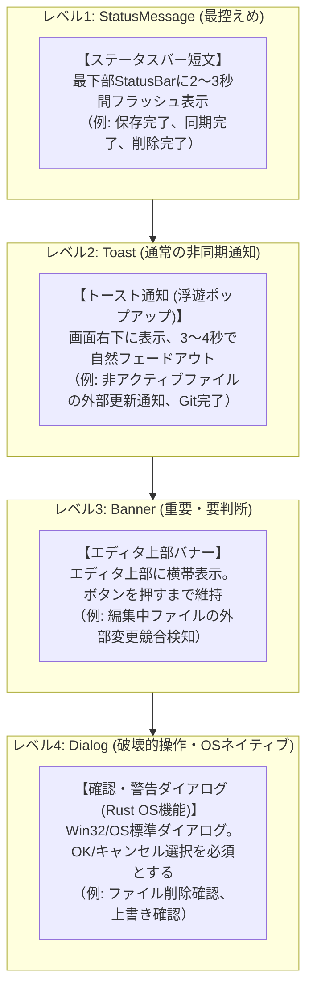
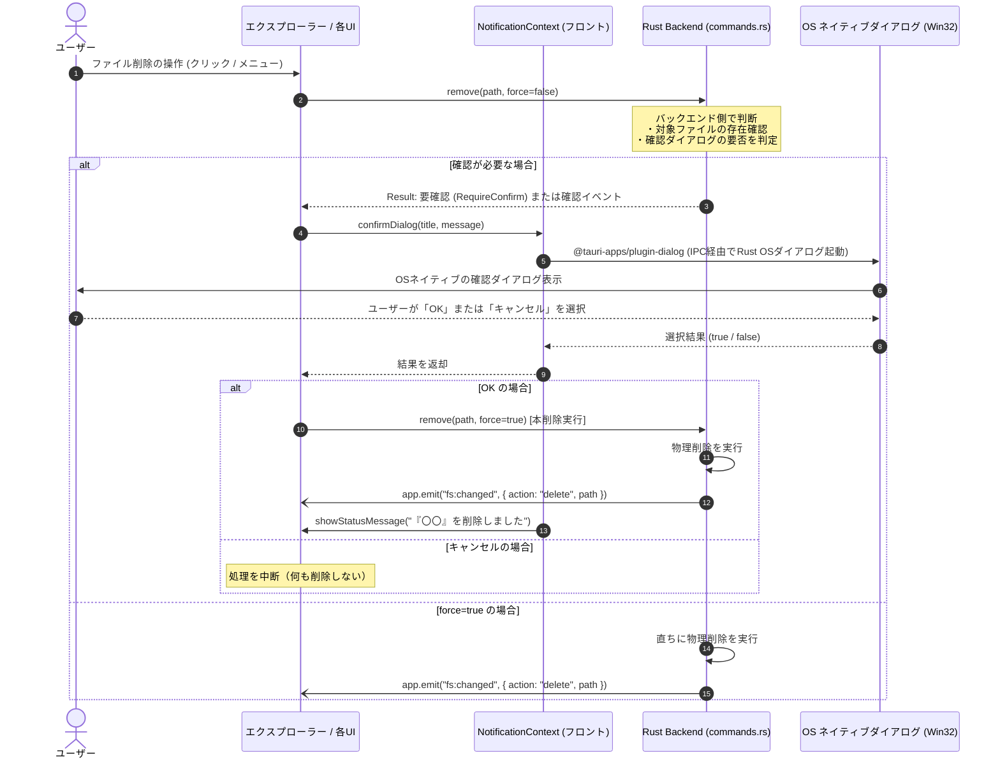
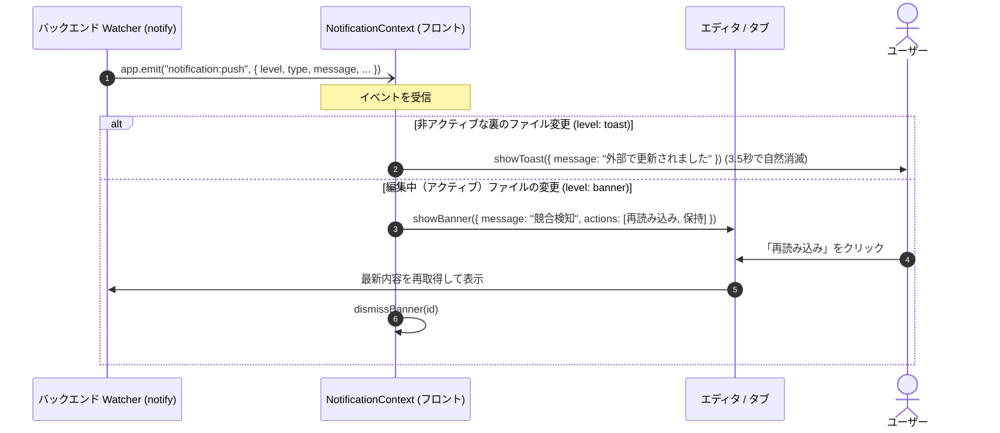

# 統合通知システム設計および呼び出し経路仕様

## 1. 概要と基本方針

本ドキュメントは、`novelaide` におけるユーザーへの各種通知（ダイアログ、トースト、バナー、ステータスメッセージ）の体系を整頓し、すべての通知表示と確認フローを**フロントエンド経由に一元化**するための設計仕様です。

### 1.1 基本原則：バックエンド判断・Rust OSダイアログ利用・フロントエンド経由のオーケストレーション
ファイル削除や外部変更競合などの処理において、以下の3つの原則を明確に分離・統合します：

1. **判断ロジックはバックエンドが一元管理**:
   - 削除対象の存在確認、削除に確認が必要かどうかの判断（通常削除か、強制削除フラグ `force` があるか等）は、バックエンド（Rustコマンド側）で一元的に判断します。
   - これにより、フロントエンドの複数箇所（エクスプローラー、コンテキストメニュー、ショートカットキー、将来のCLI内蔵機能等）で判断基準が重複・分散するのを防ぎます。
2. **ダイアログ表示の実装は Rust による OS ネイティブ機能（`tauri-plugin-dialog`）を使用**:
   - ダイアログはブラウザ標準やHTML/CSSの独自モーダルではなく、極力 **Rust側によるOSネイティブ機能（WindowsではWin32ダイアログ）** を利用します。
3. **呼び出し経路としてフロントエンドを経由（オーケストレーション）**:
   - バックエンドがRustスレッド内部で直接 `blocking_show()` を同期実行すると、スレッドが一時停止し、WebViewやUI側で「ダイアログ表示中なのか、処理フリーズなのか」が把握できず、ステータス表示や通知管理との連携が破綻します。
   - そのため、**バックエンドの判断結果を一度 IPC でフロントエンドに通知し、フロントエンドの統合通知マネージャー（`NotificationContext`）経由でダイアログ（裏でRustのOS機能）を起動・制御**します。

---

## 2. 4つの通知レイヤー（表示形式）の定義

重要度と緊急度に応じて、以下の4段階の通知UIを提供します。



### レイヤー別 特徴一覧

| レベル | 表示形式 | 実装技術 | 振る舞い | 執筆への影響 | 主なユースケース |
| :---: | :--- | :--- | :--- | :---: | :--- |
| **L1** | **ステータスメッセージ**<br>(StatusMessage) | フロントエンド<br>(StatusBarスロット) | 2〜3秒間テキストを表示後、元の表示に自動復帰。 | なし | ・「保存しました」<br>・「『〇〇』を削除しました」 |
| **L2** | **トースト通知**<br>(Toast) | フロントエンド<br>(フローティングUI) | 3〜4秒で自動消去。ホバーで一時停止。アクションボタン付加可。 | 極小 | ・裏で開いていないファイルの外部更新<br>・Git コミット/プッシュ完了 |
| **L3** | **エディタバナー**<br>(Editor Banner) | フロントエンド<br>(エディタ上部UI) | ユーザーが選択ボタンを押すまで持続表示（自動消滅しない）。 | 中 | **【外部変更競合】**<br>「このファイルは外部で変更されました。[再読み込み] [手元の内容を保持]」 |
| **L4** | **確認ダイアログ**<br>(Confirm Dialog) | **Rust OSネイティブ**<br>(`tauri-plugin-dialog`) | ユーザーが「OK」または「キャンセル」を押すまで待機。 | 大 | ・ファイル・フォルダの物理削除確認<br>・未保存変更破棄の確認 |

---

## 3. 呼び出し経路のアーキテクチャ

すべての通知・ダイアログ要求は、フロントエンドの **`NotificationContext`** を経由して整頓されます。

### 3.1 ファイル削除等の確認ダイアログ経路（Rust OS機能 × フロントエンド経由）



### 3.2 外部ファイル監視（Watcher）からの通知経路（トースト・バナー）



---

## 4. インターフェース定義

### 4.1 フロントエンド API (`NotificationContext.tsx`)

フロントエンドは通知全般の一元化窓口として機能し、L4ダイアログの表示は `@tauri-apps/plugin-dialog`（裏側でRustがOSネイティブ呼び出し）をラップします。

```typescript
export interface ConfirmDialogOptions {
  title?: string;
  message: string;
  okLabel?: string;
  cancelLabel?: string;
  kind?: 'warning' | 'info';
}

export interface NotificationContextType {
  // L1: ステータスバー短文（2〜3秒自動消滅）
  statusMessage: string | null;
  showStatusMessage: (message: string, duration?: number) => void;

  // L2: トースト通知（浮遊型ポップアップ・3.5秒自動消滅）
  toasts: ToastItem[];
  showToast: (options: ToastOptions) => string;
  dismissToast: (id: string) => void;

  // L3: エディタバナー（持続型通知・アクションボタン付き）
  banners: BannerItem[];
  showBanner: (options: BannerOptions) => void;
  dismissBanner: (id: string) => void;

  // L4: 確認ダイアログ（Rust OSネイティブダイアログを起動）
  confirmDialog: (options: ConfirmDialogOptions) => Promise<boolean>;
  alertDialog: (message: string, title?: string) => Promise<void>;
}
```

### 4.2 バックエンド・フロントエンド IPC インターフェース

#### 1. ファイル削除コマンド (`remove`)
```rust
// バックエンド: commands.rs
#[tauri::command]
pub async fn remove<R: Runtime>(
    app: AppHandle<R>,
    path: String,
    force: Option<bool>,
) -> Result<RemoveResult> {
    // force が false の場合は、削除前に確認が必要である旨を返すか、
    // またはフロントエンド経由での確認を前提とする
}

#[derive(Serialize, Deserialize)]
pub enum RemoveResult {
    Success,
    NeedConfirm { file_name: string },
    NotFound,
}
```
または、フロントエンドからの呼び出しを `remove(path, force: bool)` とし、`force=false` の場合はバックエンドが事前検証を行って `NeedConfirm` を返し、フロントエンドがOSダイアログで確認を取った後に `force=true` で本実行を行う構成とします。

#### 2. 非同期プッシュ通知 (`notification:push`)
```rust
#[derive(Serialize, Clone)]
pub struct NotificationPushPayload {
    pub level: Option<String>,       // "toast" | "banner" | "status"
    pub notification_type: Option<String>, // "info" | "success" | "warning" | "error"
    pub title: Option<String>,
    pub message: String,
    pub duration: Option<u64>,
}
```

---

## 5. 設計のメリットまとめ

1. **OSネイティブダイアログの確実な利用**:
   Web独自モーダルではなく、Rust経由でOSネイティブの標準ダイアログを利用するため、信頼性とネイティブ感が維持される。
2. **スレッドブロック・UIフリーズの解消**:
   Rustのワーカースレッドが同期的にブロッキング停止することがなくなり、非同期かつ安全にダイアログ処理が行われる。
3. **通知のライフサイクル一元管理**:
   ダイアログ、トースト、バナー、ステータスバーの全通知が `NotificationContext` を経由するため、多重表示や表示重複を制御できる。
