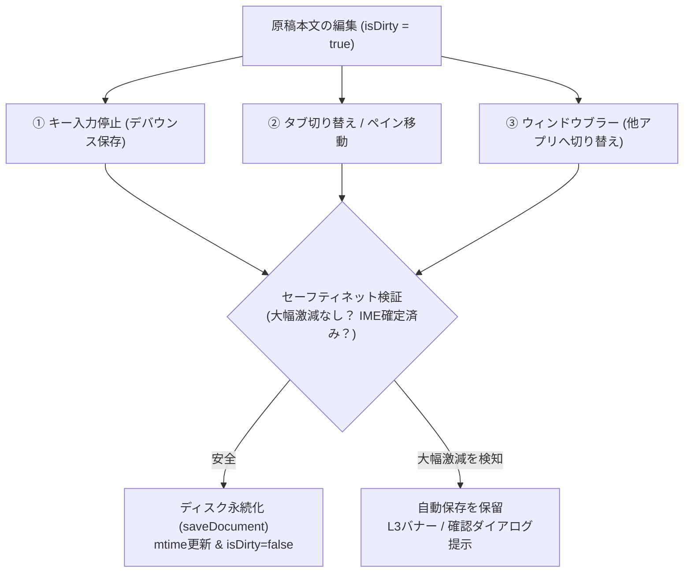
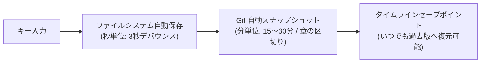

# 自動保存および原稿保護セーフティネット設計仕様

## 1. 概要と最重要理念

小説執筆用エディターにおいて、**「作家が執筆した原稿データが事故や不具合によって失われることを絶対に防ぐ」** ことは、システムの最優先事項である。

本仕様は、日々の執筆を中断させずに確実に原稿を永続化する**自動保存（オートセーブ）メカニズム**と、誤操作（全選択削除や置換ミス等）による原稿消失を防ぐ**保護セーフティネット**、および**将来のGit自動保存計画**を体系化した設計仕様である。

---

## 2. 自動保存の3大トリガー設計

原稿の損失リスクを最小化するため、以下の3つのタイミングで自動保存を実行する。



### 2.1. ① キー入力停止によるデバウンス自動保存
* **動作**:
  - 作家がタイピングを停止してから一定時間（デフォルト: 3000ms / 設定で変更可能）が経過した時点で、自動的にバックグラウンド保存を実行する。
* **IME（日本語入力）状態の保護要件**:
  - 日本語変換中（未確定の変換候補選択中など）に保存処理が割り込むと、Monaco Editor のフォーカスや変換状態、カーソル位置が乱れる危険性がある。
  - **要件**: Monaco Editor の `onDidCompositionStart` / `onDidCompositionEnd`（またはブラウザの `compositionstart` / `compositionend` イベント）を監視し、**IME入力中（`isComposing === true`）はタイマーカウントを停止**する。変換確定（`compositionend`）が発火した後にデバウンスタイマーを開始・リセットする。

### 2.2. ② タブ切り替え・ペイン移動時の即時保存
* **動作**:
  - タブの切り替え（`switchTab`）、アクティブペインの変更（`setActivePane`）、タブを閉じる操作（`closeTab`, `closeDocument`）の直前に、切り替え元のドキュメントが未保存（`isDirty: true`）であれば即時保存を実行する。
* **設計意図**:
  - **「現在編集中のアクティブタブ以外は、常にディスク上に保存済みである」** という不変条件（Invariant）を確立する。
  - これにより、バックグラウンドのタブが未保存のまま放置されるリスクを完全に排除し、フォーカス復帰時の外部変更検証との整合性を極大化する。

### 2.3. ③ ウィンドウフォーカス喪失（`window.onblur`）時の即時保存
* **動作**:
  - 作家がリファレンス確認やWeb検索、他アプリの操作のために `novelaide` のウィンドウからフォーカスを外した瞬間に、編集中ドキュメントを即時保存する。
  - OSの再起動やPCスリープ、突発的なアプリ終了時にも直前の原稿が確実に保護される。

---

## 3. 大幅激減検知セーフティネット（破壊的変更保護）

### 3.1. 課題: 誤操作の自動保存による「上書き事故」
作家が誤って `Ctrl + A` から `Backspace` を押してしまった場合や、全テキスト置換の失敗などで本文の大半が消去された場合、それが数秒後に自動保存されてしまうと、ディスク上の正本データまで消失してしまう。

### 3.2. 激減検知判定ロジック
自動保存を実行する直前に、前回保存時の文字数（`lastSavedLength`）と現在の文字数（`currentLength`）を比較検証する。

```typescript
const lengthDiff = lastSavedLength - currentLength;
const decreaseRatio = lengthDiff / Math.max(lastSavedLength, 1);

// 判定基準:
// 前回保存時より一定割合（例: 30%以上）減少し、かつ絶対文字数として200文字以上減少している場合
const isDrasticDecrease = decreaseRatio >= 0.30 && lengthDiff >= 200;
```

### 3.3. 検知時の保護フロー
1. **自動保存の即時保留**:
   - ディスクへの書き込みを中断し、メモリ上の原稿バッファのみを維持する。
2. **L3 エディタバナー（または保護ダイアログ）の提示**:
   - エディタ上部に警告バナーを表示する。
   - **メッセージ**: 「原稿の大幅な削除が検知されました（前回: {lastSavedLength}字 → 現在: {currentLength}字、-{Math.round(decreaseRatio * 100)}%）。この内容で保存しますか？」
   - **アクション**:
     - `[そのまま保存]`: 作家の明示的な意思による大幅削除（推敲・推敲破棄）であると確認し、保存を実行。
     - `[元に戻す (Undo)]`: Monaco Editor の Undo を呼び出して削除前の状態に復元。
3. **手動保存（`Ctrl + S`）の扱い**:
   - 作家が明示的に `Ctrl + S` を押した場合は、作家の直接の意志とみなし、警告なし（または軽微な確認）で保存を許可する。

---

## 4. 将来の Git 自動保存・スナップショット計画

ファイルシステムへの自動保存（上書き）に加えて、作家が「何時間も前の状態」や「昨日の夜の状態」へ安全に戻れるようにするため、Git を活用した多層的スナップショット機能を計画する。



### 4.1. 自動コミット（シャドウセーブポイント）
* **間隔**: 15分〜30分おき、または設定された原稿用紙枚数（例: 5枚執筆ごと）に自動実行。
* **コミットメッセージ形式**:
  - `auto-save: 2026-10-31 10:30 (総文字数: 5,420字, +340字)`
* **作家体験**:
  - 作家に Git の専門知識を要求せず、「執筆タイムライン（セーブポイント一覧）」として視覚的に過去のバージョンを表示し、ワンクリックで差分確認・復元を可能にする。

---

## 5. 実装ロードマップ

1. **フェーズ 1: タブ切り替え・フォーカス喪失時の即時保存**
   - `switchTab`, `closeTab`, `setActivePane`, `window.onblur` における `isDirty` ドキュメントの即時永続化。
2. **フェーズ 2: IME状態を考慮したデバウンス自動保存**
   - Monaco Editor の IME Composition イベントと連動した安全なタイマー制御。
3. **フェーズ 3: 大幅激減検知セーフティネットの組み込み**
   - `lastSavedLength` の追跡と L3 警告バナーによる誤削除保護。
4. **フェーズ 4: Git 自動セーブポイント機構（将来フェーズ）**
   - バックグラウンドでの Git 自動コミットおよび履歴タイムライン UI との統合。
