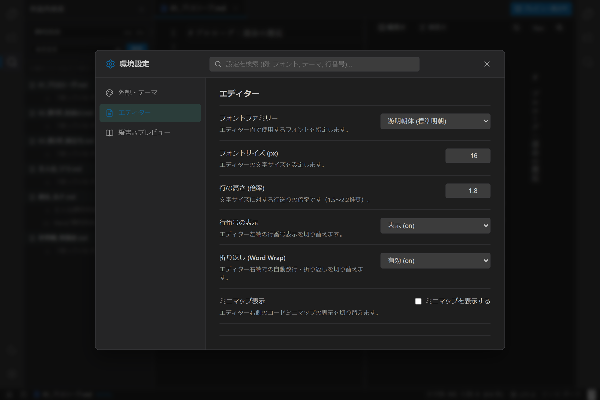

# 設定プラグインアーキテクチャ実装仕様書

## 1. 概要とアーキテクチャ方針

本ドキュメントは、**`novelaide`** における **設定システム（Settings / Preferences）のプラグインアーキテクチャ** の実装仕様を定義するものです。

エディター本体、テーマ、縦書きプレビュー、将来の拡張機能など、多様な設定項目をハードコードせず、**各機能が自身の設定タブ・項目・デフォルト値を「設定タブプラグイン（`SettingTabPlugin`）」として独立提供・登録できる仕組み** を構築します。



---

## 2. ディレクトリ構成

```text
src/
├── types/
│   └── settingsPlugin.ts           # SettingTabProps, SettingTabPlugin, AppSettings
├── core/
│   └── settingsRegistry/           # 設定タブ管理レジストリ
│       ├── SettingsRegistry.ts
│       └── index.ts
├── contexts/
│   └── SettingsContext.tsx         # 設定状態管理・永続化・リアクティブ提供
├── plugins/
│   └── settings/                   # 設定タブプラグイン群
│       ├── AppearanceSettingsPlugin.tsx   # 外観・テーマ
│       ├── EditorSettingsPlugin.tsx       # エディター設定
│       └── NovelPreviewSettingsPlugin.tsx # 縦書きプレビュー設定
└── components/
    └── Settings/                   # 設定モーダルUI
        ├── SettingsModal.tsx
        └── SettingsModal.css
```

---

## 3. 型定義（`src/types/settingsPlugin.ts`）

```typescript
export interface SettingTabProps {
  settings: Record<string, any>;
  updateSetting: <T>(key: string, value: T) => void;
  resetSetting: (key: string) => void;
  searchQuery: string;
}

export interface SettingTabPlugin {
  id: string;
  title: string;
  icon?: string;
  order: number;
  keywords?: string[];
  defaultValues: Record<string, any>;
  render: (props: SettingTabProps) => React.ReactNode;
}

export interface AppSettings {
  // 外観
  theme: 'dark' | 'light' | 'sepia';
  // エディター
  editorFontFamily: string;
  editorFontSize: number;
  editorLineHeight: number;
  editorLineNumbers: 'on' | 'off' | 'relative';
  editorMinimap: boolean;
  editorWordWrap: 'on' | 'off';
  manuscriptCharsPerLine: number;
  manuscriptLinesPerPage: number;
  autoSaveInterval: number;
  // プレビュー
  previewWritingMode: 'vertical-rl' | 'horizontal-tb';
  previewFontSize: number;
  previewFontFamily: string;
  [key: string]: any;
}
```

---

## 4. 設定レジストリ（`SettingsRegistry`）

- プラグインの登録（`register`）、解除（`unregister`）
- `order` 順でのタブ取得（`getAll`）
- 全登録プラグインの `defaultValues` をマージしたデフォルト設定辞書の生成（`getAllDefaultValues`）
