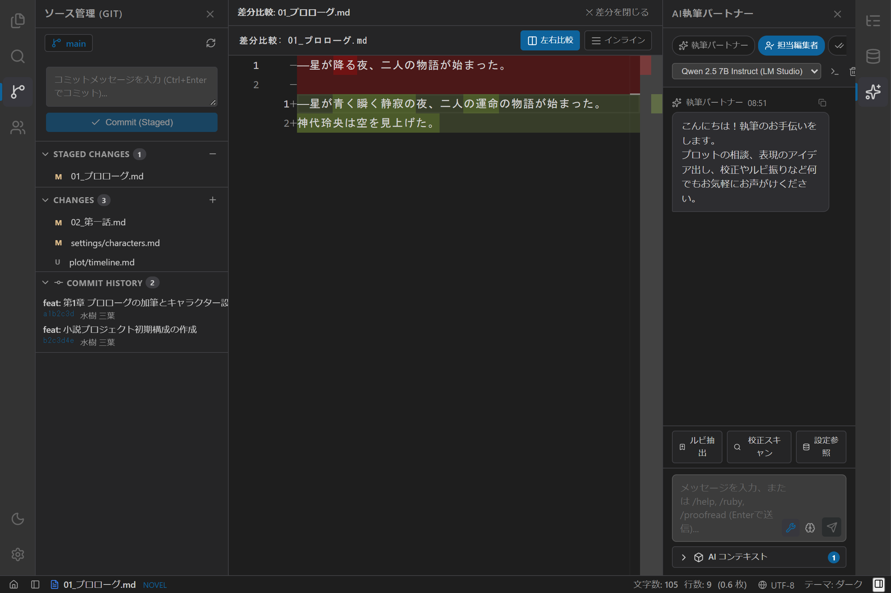

# AI執筆パートナーの使い方

`novelaide` では、作家の執筆を強力に支援するAIパートナー機能を提供しています。
AIへのモデルアクセスやセッション管理の基盤として、独立プラグイン **`tauri-plugin-novelaid-ai`** を内蔵しており、`novelaid-editor`（Electron版）や `novelaid-cli`（CLI版）と100%コード互換・相互フィードバック可能な洗練されたUIと通信機構を備えています。

---

## 1. パネルの開き方

1. 画面右側（または左側）のアクティビティバーにある **「AI執筆パートナー」アイコン（星マーク）** をクリックします。
2. サイドペインにAIチャットパネルが展開されます。
3. もう一度アイコンをクリックするとパネルを折りたたむことができます。

---

## 2. 4つの執筆ペルソナ

チャット上部のチップをクリックすることで、対話相手となるAIの役割（ペルソナ）を瞬時に切り替えることができます。

| ペルソナ | 主な役割・特徴 | 活用シーン |
| :--- | :--- | :--- |
| **執筆パートナー** | 共創・アイデア出し | プロット展開の相談、情景描写の言い換え、ネタ出しなど |
| **担当編集者** | 講評・構成アドバイス | 読者視点でのテンポ確認、伏線配置、読後感へのフィードバック |
| **校正係** | 文体・ルビ・誤字脱字 | 助詞の重なり、文末の連続、ルビ記法、表記ゆれのチェック |
| **作中人物** | キャラクター対話 | 登場人物になりきって会話。台詞の口調や感情反応の整合性検証 |

---

## 3. 基本機能と操作方法

### AI コンテキスト選択アコーディオン (`AIContextSelector`)
入力欄の下部にある **「AI コンテキスト」** をクリックすると、AIに渡す背景資料を細かく制御できるアコーディオンが展開されます。

- **左ペイン・右ペイン個別選択**:
  - 「左: ○○.md」: エディターで編集中（未保存の最新状態）の原稿本文を含めます。
  - 「右: ○○.md」: 右ペインに開いている設定資料やプレビュー対象を含めます。
- **その他の開いているタブ**:
  - チェックを入れると、エディタータブとして開かれている他の章や設定メモも一括でAI文脈に注入します。
- **任意ファイルの Drag & Drop 追加**:
  - ファイルツリーから任意の設定資料（キャラクター設定、年表など）をドロップゾーンにドラッグ＆ドロップして、個別に追加・除外できます。
- **コンテキストバッジ**:
  - 現在AIに渡されているファイル数がバッジ（例: `[2]`）で一目で確認できます。

### 自動伸縮入力エリアとキー操作 (`AIChatInput`)
- テキストの入力行数に応じて入力欄の高さが自動的に拡張されます。
- **Enter**: メッセージを即座に送信。
- **Shift + Enter**: メッセージ欄で改行。
- **ツールトグル（レンチアイコン）**: 執筆ツールの利用をON/OFF。
- **推論トグル（脳アイコン）**: 思考プロセス表示をON/OFF。

### スラッシュコマンド（CLI/TUI 共通コマンド）
チャット入力欄に `/` から始まるコマンドを入力して送信することで、AIモデルとの通信を行わずにローカル支援機能を直接呼び出すことができます。`novelaid-cli`（CLI版）と全く同一のコマンド体系がGUIでも利用可能です。

| コマンド | 説明 | 実行例 |
| :--- | :--- | :--- |
| **`/ruby`** | 難読漢字・作中固有名詞のルビ候補を一覧抽出 | `/ruby`（原稿全体）または `/ruby 魔法陣` |
| **`/proofread`** | 文末重複（〜た。の3連続）や誤字脱字を即時スキャン | `/proofread` |
| **`/check`** | `/proofread` のエイリアスコマンド | `/check` |
| **`/info`** | 接続中のLLMエンドポイント、ペルソナ、Extensionステータスを表示 | `/info` |
| **`/help`** | 利用可能なスラッシュコマンド一覧のヘルプを表示 | `/help` |

### メッセージのコピーと選択
- **ワンクリックコピー**: 各メッセージヘッダー（AI・ユーザー）の **「コピー」ボタン（クリップボードアイコン）** をクリックすると、メッセージ全文がクリップボードにコピーされます（コピー完了時は2秒間チェックアイコンに変化）。
- **ドラッグ選択対応**: メッセージ本文はマウスドラッグによる自由な範囲選択および `Ctrl+C`（macOSは `Cmd+C`）でのコピーが可能です。

### 執筆ツールのワンクリック実行
入力欄上部には、Rustによる超高速テキスト解析・メタデータキャッシュと連携したクイックアクションボタンが用意されています。

- **ルビ抽出**: 現在開いている原稿から、未ルビの固有名詞や難読漢字を自動検出し、`|漢字《ルビ》` 形式の候補を一覧表示します。
- **校正スキャン**: 文末の「〜た。」連続（3文以上）、ら抜き言葉、冗長な表現の自動スキャンを実行します。
- **設定参照**: `tauri-plugin-novelaid-fs` が保持する作品内の Frontmatter 設定資料キャッシュ（登場人物、地名、プロット等）を瞬時に検索・要約してAIの対話文脈に引き出します。

### デバッグ情報とトラブルシューティング
- パネル上部のヘッダー右側にある **「ターミナル」アイコン（デバッグ情報出力）** をクリックすると、現在のペルソナ、選択モデル、利用可能ツール、通信セッション状態、直近のエラー詳細がアプリの開発者コンソール（`Ctrl+Shift+I` または `F12`）に出力されるとともに、クリップボードにも即座にJSON形式でコピーされます。
- チャット送信時にエラーが発生した場合は、このデバッグ情報をコピーして調査・問い合わせに活用できます。

---

## 4. 連携モデルの設定

パネル上部のモデル選択ドロップダウンから、接続先のAIモデルを選択できます。
- **LM Studio (ローカルLLM)**: `http://localhost:1234/v1` のエンドポイントを自動検出し、オフライン環境でも原稿データを外部に送信することなく安全に利用可能です。
- **Gemini / OpenAI 等**: 高度な長文推敲や複雑なプロット構築を依頼する際に活用できます。
