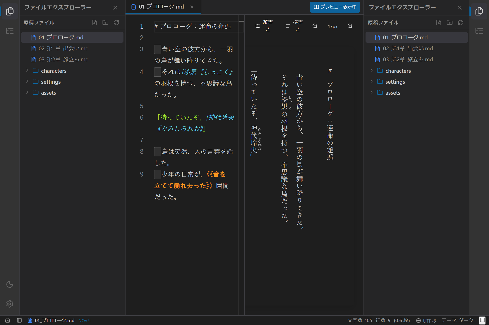

# UIプラグインと左右ペインの使い方

## 1. 概要

`novelaide` は、執筆者が自身のスタイルに合わせて作業空間を柔軟にカスタマイズできるよう、**左右対称のサイドペイン** と **UIプラグイン構造** を採用しています。

---

## 2. 左右ペインの役割分担

左右のペインは構造的にまったく同じ対称コンテナとなっており、それぞれ以下の役割に特化したパネルをプラグイン的に配置しています。

| ペイン位置 | 主な役割・スコープ | 主な機能パネル | 特徴・活用シーン |
|---|---|---|---|
| **左ペイン** | **プロジェクト全体**に関わるもの | **ファイルエクスプローラー** (`Files`) 作品内検索 (`Search`) 執筆履歴 (`Git`) | 作品フォルダー内の全原稿・設定・画像を行き来し、作品全体を俯瞰・管理します。 |
| **右ペイン** | **個々のドキュメント**に関わるもの | **見出しアウトライン** (`ListTree`) 登場人物・用語抽出 文体校正 (Textlint) | 現在エディターで開いている原稿の見出し・章節構造を抽出し、目的の場面へ瞬時にジャンプできます。 |

---

## 3. ペインとパネルの開閉操作

### アクティビティバーからの操作
- **左アクティビティバー**: ウィンドウ左端のアイコンをクリックすることで、ファイル一覧などのプロジェクトパネルを開閉できます。
- **右アクティビティバー**: ウィンドウ右端のアイコン（見出しアウトライン等）をクリックすることで、ドキュメント個別パネルを開閉できます。

### ステータスバーからのワンクリック開閉
ウィンドウ最下部のステータスバーにも、左右それぞれのペイン開閉トグルボタンが配置されています。
- 左下: 左サイドペイン開閉ボタン (`PanelLeft`)
- 右下: 右サイドペイン開閉ボタン (`PanelRight`)

### パネル幅（リサイズ）の調整
左右どちらのペインも、境界線のリサイズハンドルをマウスでドラッグすることで、幅を自由に変更できます。
- 左ペイン: 右ドラッグで拡大
- 右ペイン: 左ドラッグで拡大
