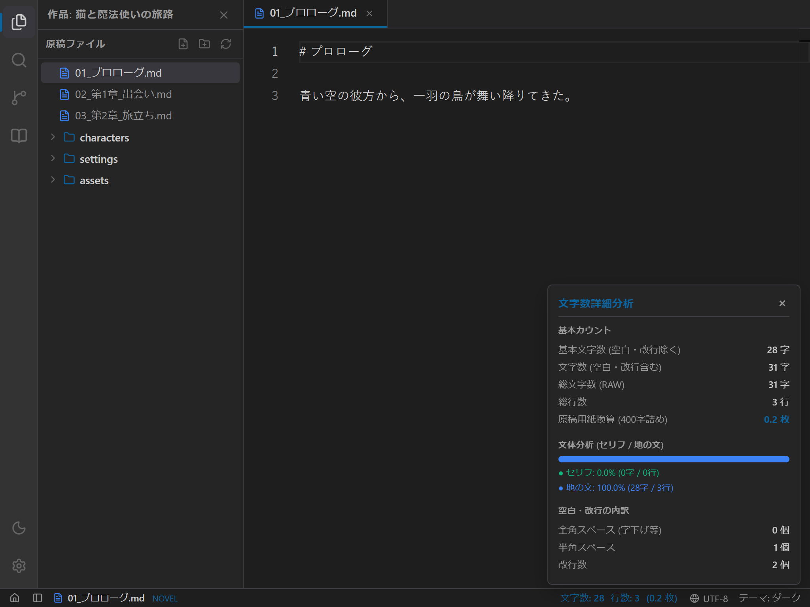

# ステータスバーと文字数カウント機能の使い方マニュアル

本マニュアルでは、**`novelaide`** の画面最下部に常駐する **ステータスバー（`StatusBar`）** の見方、**リアルタイム文字数・行数・原稿用紙換算枚数** の確認方法、および **文字数詳細分析ポップアップ** の活用方法について説明します。

---

## 1. 画面構成

エディター最下部のバーには、執筆の進捗とドキュメントの基本情報がコンパクトに集約されています。

### ① 左側：操作・ドキュメント情報
- **ホームボタン (🏠)**: クリックすると、作品選択（プロジェクトランチャー）画面に戻ります。
- **サイドバー開閉ボタン**: 左側のファイルエクスプローラーの表示／非表示をワンクリックで切り替えます。
- **ドキュメント情報**: 現在開いている原稿ファイル名と、種別バッジ（`NOVEL`, `MARKDOWN` など）が表示されます。

### ② 右側：文字数・各種メトリクス
- **通常時**: `文字数: 3,450 行数: 120 (12.3 枚)` のように、基本文字数・総行数・400字詰原稿用紙換算枚数がリアルタイムに更新されます。
- **範囲選択時**: テキストをマウスやキーボードで選択すると、**`選択中: 150 / 3,450 字`** のようにハイライト表示に切り替わり、選択部分のボリュームが瞬時にわかります。
- **エンコーディング**: 現在のテキストエンコーディング（`UTF-8`）が表示されます。
- **テーマ切り替え**: クリックするたびに「ダーク ➔ ライト ➔ セピア ➔ システム」とテーマが切り替わります。

---

## 2. 文字数詳細分析ポップアップの開き方

ステータスバーの **文字数表示エリアをクリック** すると、上向きに詳細分析ポップアップが展開されます。
閉じるには、右上の `×` ボタンをクリックするか、ポップアップの外側をクリックします。

---

## 3. 分析できる項目

### ① 基本カウント
| 項目名 | 説明 |
|---|---|
| **基本文字数 (空白・改行除く)** | ルビ文字や記号、全角・半角スペース、改行をすべて除外した純粋な文字数（**カクヨム、小説家になろう等の標準カウントに完全適合**）。 |
| **文字数 (空白・改行含む)** | ルビ記号のみを除外し、スペースや改行を含めた文字数（**小説家になろうの1話あたりシステム上限カウント**用）。 |
| **総文字数 (RAW)** | 原稿テキスト全体の総文字数。 |
| **総行数** | 原稿の全行数。 |
| **原稿用紙換算 (400字詰め)** | 日本の出版基準（20字×20行）に合わせ、改行や字下げによる行消費を計算した換算枚数。 |

### ② 文体分析（セリフと地の文の比率）
小説のテンポを客観的にチェックするためのビジュアルバーが表示されます。
- **セリフ（グリーン）**: `「……」` や `『……』` などの会話文の割合（%）、文字数、行数。
- **地の文（ブルー）**: 描写や心理描写などの割合（%）、文字数、行数。

> **執筆のヒント**:
> 会話文の比率が高すぎる（例: 70%以上）と会話劇のようにテンポが速くなり、逆に低すぎる（例: 20%未満）と情景描写が多く落ち着いた重厚な文体になります。作品のジャンルやシーンに合わせて理想のバランスを確認しましょう。

### ③ 空白・改行の内訳
- **全角スペース (字下げ等)**: 段落冒頭の全角スペースの総数。
- **半角スペース**: 原稿内に混入している半角スペースの総数。
- **改行数**: シーンの改行・段落数。
