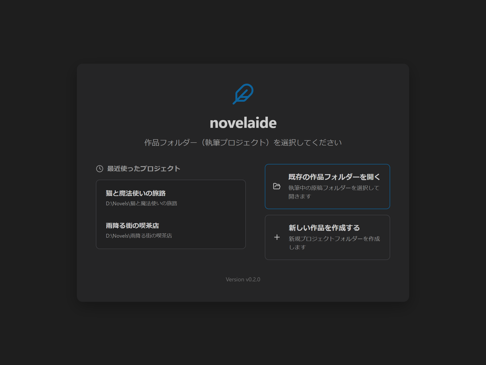

# ダウンロードとインストールの手順

[← マニュアル目次に戻る](./index.md) ｜ [トップポータル](../index.md)

本ドキュメントでは、小説執筆用デスクトップIDE **`novelaide`** の入手方法、Windows PC へのインストール手順、初回起動時の設定、および自動アップデート機能について説明します。

---

## 1. アプリのダウンロード

最新版のインストーラーは、GitHub の公式リリースページからダウンロードいただけます。

* 🚀 **[最新リリースのダウンロード (GitHub Releases)](https://github.com/mituha/novelaide/releases/latest)**

### ダウンロードするファイル
リリースページの **`Assets`** セクションを展開し、以下のインストーラーファイル（`.exe`）をダウンロードしてください：

* **Windows 64bit**: `novelaide_<version>_x64-setup.exe`

---

## 2. インストール手順

1. ダウンロードしたセットアップファイル（`novelaide_..._x64-setup.exe`）をダブルクリックして実行します。
2. インストールウィザードの指示に従って進めると、デスクトップおよびスタートメニューにショートカットが作成され、インストールが完了します。

### ⚠️ Windows Defender (SmartScreen) の警告が表示された場合
個人開発の新しいソフトウェアを初回実行する際、Windows によって「**Windows によって PC が保護されました**」という警告画面が表示される場合があります。

1. 画面内の **「詳細情報」** リンクをクリックします。
2. 右下に **「実行」** ボタンが表示されますので、クリックしてインストールを続行してください。

---

## 3. 初回起動と作品フォルダーの準備

インストール後、デスクトップのショートカットまたはスタートメニューから **novelaide** を起動します。

1. **初期ランチャー画面**:
   - アプリを起動すると、プロジェクト（作品フォルダー）選択画面が表示されます。
2. **作品フォルダーを開く / 新規作成**:
   - **既存のフォルダーを開く**: 以前執筆していた小説原稿（`.md` や `.txt`）が保存されているフォルダーを選択します。
   - **新規プロジェクト作成**: 作品名を入力して新しいフォルダーを作成し、執筆を開始します。
3. **エディターの展開**:
   - 作品フォルダーが開くと、左右分割対応のエディター画面が展開され、直ちに執筆を開始できます。

---

## 4. 自動アップデート機能

`novelaide` は自動アップデート機能を備えています。

* **起動時の自動確認**:
  - アプリ起動時にバックグラウンドで最新バージョンをチェックし、新しいバージョンが公開されている場合は自動的にお知らせします。
* **手動での確認**:
  - 左アクティビティバー最下部の **歯車アイコン（環境設定）** を開き、「全般・更新」タブの **「更新を確認」** ボタンをクリックすることで、いつでも最新版の有無を確認・適用できます。

---

[← マニュアル目次に戻る](./index.md) ｜ [トップポータル](../index.md)
