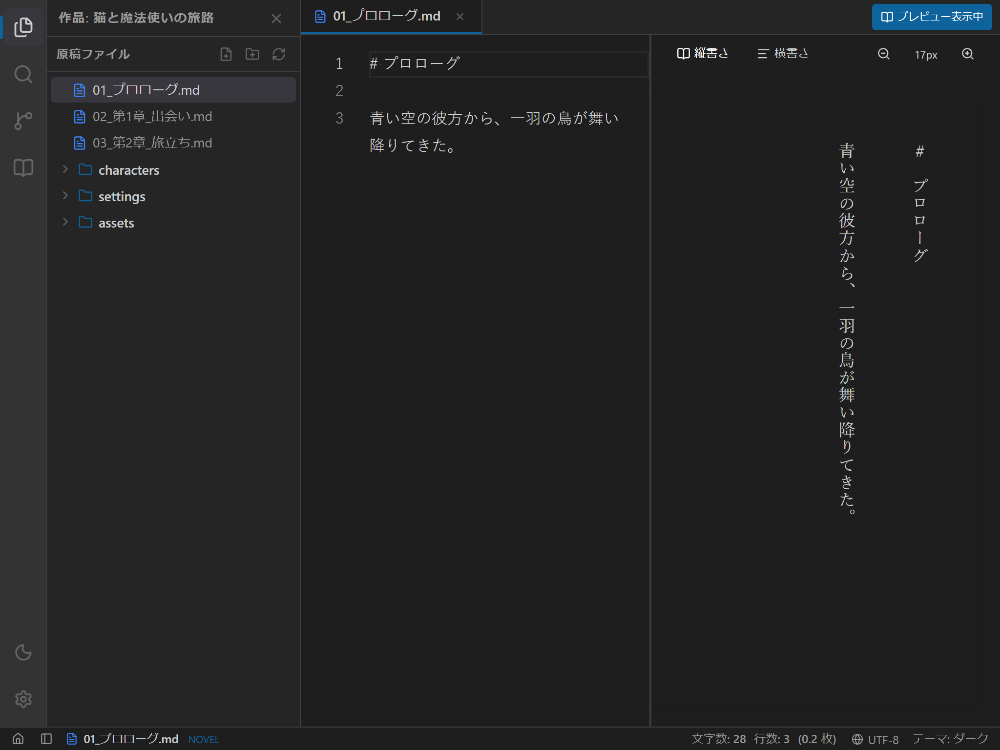

# プレビューとスプリットビューの使い方

## 1. 概要

`novelaide` では、小説本文エディターの横にリアルタイム組版プレビューを表示する「スプリットビュー（2画面分割）」機能を備えています。

ルビ（`|漢字《かんじ》`）や傍点（`《《強調》》`）がどのように組版されるかを、**「縦書き文庫本スタイル」** や **「横書きスタイル」** で確認しながら執筆を進めることができます。

---

## 2. プレビューと左右分割の操作方法

`novelaide` では、ドキュメント表示領域自体が独立した2つのタブ付きペイン（左ペイン・右ペイン）として構成されています。

### (1) 同一ペイン内でのプレビュー切り替え
- タブバー右端の **「表示」ボタン** をクリックすると、現在開いているエディタータブがそのまま組版プレビュー（小説形式なら縦書きリーダー）に切り替わります。
- プレビュー表示中に **「編集へ」ボタン** をクリックすると、即座に通常のエディター画面に戻ります。

### (2) 左右分割（別窓プレビュー）の展開
- 左ペインのタブバー右端にある **「別窓プレビュー」ボタン** をクリックすると、右ペインが自動的に展開され、同じドキュメントが右ペインにプレビューとして開かれます。
- **リアルタイム完全同期**: メモリ上のドキュメント実体は1つのみ保持されるため、左ペインで文章を入力・編集すると、右ペインのプレビューも遅延なく瞬時に連動更新されます。

### (3) 右ペインのクローズと昇格
- 右ペインのタブバー右端にある **「ペインを閉じる」ボタン** をクリックすると、右ペインが開いていたタブが一括でアンロードされ、元の単一ペイン表示に戻ります。
- **安心の自動保存**: 未保存の変更がある状態でタブやペインを閉じた場合でも、確認ダイアログ不要で自動的にディスクへ安全に保存されます。
- **ペインの自動昇格**: 左ペインのタブをすべて閉じて右ペインのみが残った場合、右ペインの内容が自動的に左ペインへ引き継がれ、常に1画面のときは左ペインとして扱われます。

---

## 3. プレビュー操作ツールバー

プレビュー領域の上部ツールバーから、以下の操作が可能です。

| 操作ボタン | 機能 | 備考 |
|---|---|---|
| **縦書き** | 文庫本と同じ縦書き右開きレイアウトで表示 | 読書感覚で通読・誤字脱字チェックを行いたい時に最適です。 |
| **横書き** | 一般的な横書きレイアウトで表示 | Web小説投稿サイトでの表示イメージ確認に適しています。 |
| **文字サイズ縮小 / 拡大** | プレビュー本文のフォントサイズを 12px 〜 28px の範囲で調整 | 好みの文字の大きさで組版を確認できます。 |

---

## 4. 画面分割比率（スプリッター）の調整

- 左ペイン（エディター）と右ペイン（プレビュー）の境目にあるスプリッターバーをマウスでドラッグすることで、画面分割比率（20% 〜 80%）を自由に変更できます。
- 執筆に集中したいときはエディターを広げ、通読・推敲に集中したいときはプレビューを広げて活用できます。

---

## 5. テーマ（配色）への対応

プレビュー画面は、アプリのテーマ設定（ダーク・ライト・セピア）と自動的に連動します。
特に「セピアモード」では、目に優しい文庫本古紙のような色合いで長時間の推敲・読書を快適に行えます。
